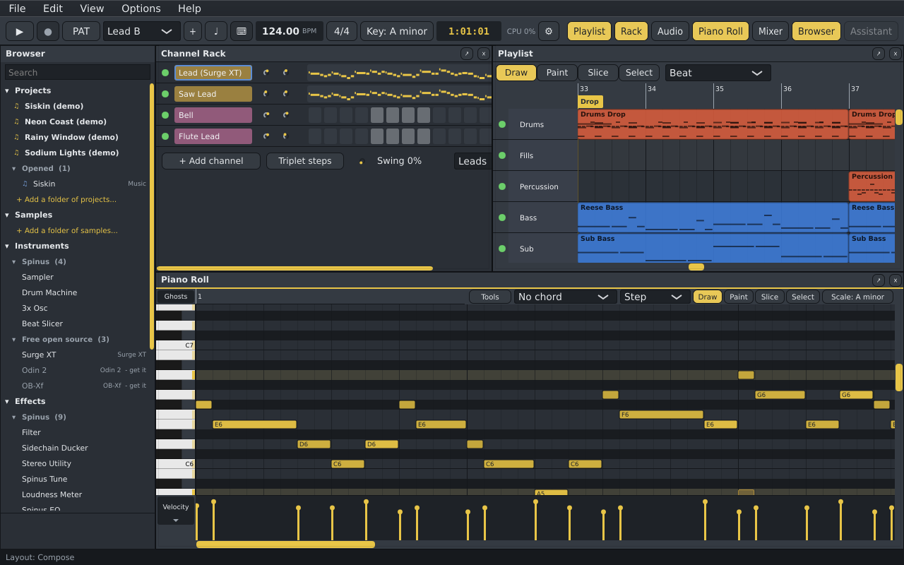

<p align="center"></p>

# Spinus DAW

A free, open-source digital audio workstation with an FL Studio-style workflow and built-in AI assistance.

*Spinus* is a genus of small songbirds in the finch family (Fringillidae): the siskins and goldfinches.
The bird in the logo is a siskin.

> **Status: 0.1.0-alpha.1, an early release for testers.** Spinus is in an early, fast-moving stage of
> development: expect bugs, and save your work often. It runs on Linux and Windows (the Windows build
> has had the least testing). See [Known issues](docs/user/known-issues.md) and
> [what's new](CHANGELOG.md), and please [report what you find](https://github.com/tuturu742/spinus-daw/issues).

<p align="center"></p>

## What it does

- **FL-style workflow:** Channel Rack with a step sequencer, a Piano Roll with chord stamps, scales,
  ghost notes and note tools, a Playlist for patterns, audio and automation, and a mixer where every
  channel gets its own insert, with sends, buses and sidechains.
- **Instruments and effects:** Spinus's own Sampler, Drum Machine, 3x Osc and Beat Slicer; EQ,
  Compressor, Limiter, Gate, Filter, Sidechain Ducker, Stereo Utility, Loudness Meter and Spinus Tune
  (pitch correction); Surge XT, Odin 2 (Linux), OB-Xf, LSP Plugins (Linux), Dragonfly Reverb and PeakEater as free
  one-click downloads.
- **Plugins:** VST3, CLAP, LV2 and VST2; on Linux, Windows plugins through Wine and yabridge with no
  manual setup. A plugin that crashes can run in its own process from then on.
- **Recording:** MIDI from a keyboard or the computer keyboard, audio from a microphone, takes and
  comping, and many inputs at once from a multi-input sound card.
- **Clip launcher** for jamming in scenes, recordable into the Playlist.
- **Optional AI, off until you turn it on:** an assistant that knows the manual and your project and only
  changes things when you approve; a pattern generator; hum, sing or beatbox to notes; an automixer with before and after;
  and, as an experiment, a song analyzer (tempo, key, stems, and turning stems into patterns and sounds).
  Use your own Anthropic, OpenRouter or local (Ollama) connection.
- **Export** to WAV, FLAC, MP3, Opus and AAC, the whole song, a pattern or stems.

Everything is in the [user manual](docs/user/README.md).

## Installing

On Arch Linux, build the package (it takes about half an hour the first time):

```sh
git clone https://github.com/tuturu742/spinus-daw.git
cd spinus-daw/packaging/arch/release   # or packaging/arch for the newest code
makepkg -si
```

On other Linux systems, use the AppImage from the
[releases page](https://github.com/tuturu742/spinus-daw/releases). See [Installing Spinus](docs/user/install.md)
for details and the Flatpak.

On Windows 10 or 11 (64-bit), run `Spinus-0.1.0-alpha.1-Setup.exe` from the releases page. See
[Installing Spinus › On Windows](docs/user/install.md#on-windows).

## Building from source (Arch Linux)

```sh
sudo pacman -S --needed base-devel git cmake ninja alsa-lib jack2 freetype2 fontconfig \
    libx11 libxrandr libxinerama libxcursor libxext libxi libxrender mesa lv2 lilv curl \
    libsndfile cairo

git clone https://github.com/tuturu742/spinus-daw.git
cd spinus-daw
git submodule update --init                              # JUCE, Tracktion, Catch2, CLAP, FST
git submodule update --init --recursive external/surge  # Surge XT and its libraries
cmake --preset release
cmake --build --preset release
ctest --preset release          # unit tests and pluginval checks
./build/release/spinus          # run the app
```

Other presets: `debug`, and `asan` (Debug with AddressSanitizer). Useful app options:

- `--no-audio`: start without opening an audio device
- `--snapshot file.png`: render the main window to an image and exit (for screenshots)
- `--version`

The first build takes 10–15 minutes because it compiles JUCE, Tracktion Engine, the bundled Surge XT synth and
the bundled effects (LSP Plugins, Dragonfly Reverb; their source is downloaded during the build).
Add `-DSPINUS_BUILD_SURGE=OFF` or `-DSPINUS_BUILD_BUNDLED_PLUGINS=OFF` to the first `cmake` command to skip them.

The presets put `/usr/bin` first on `PATH`, so tools and libraries from Homebrew (Linuxbrew) or similar can't
replace Arch's own. If you configure without a preset, check that `pkg-config` is `/usr/bin/pkg-config`.

Don't use `git clone --recurse-submodules`: it would also fetch an unused copy of JUCE inside Tracktion Engine.

## Documents

- [AGENTS.md](AGENTS.md): rules for contributors and coding agents

## License

AGPL-3.0-or-later. See `LICENSE` and `THIRD_PARTY.md`.
