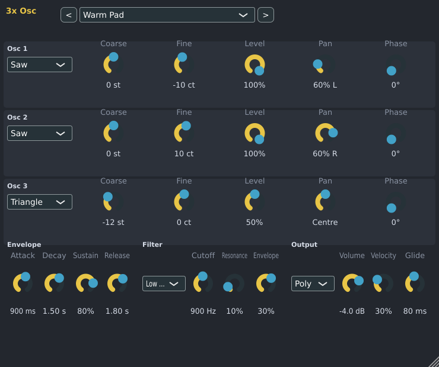

# 3x Osc

3x Osc is a quick, simple synth, like FL Studio's 3xOsc. It mixes three oscillators, shapes the sound
with an envelope and a filter, and plays up to 16 notes at once, or one note at a time that slides from note to note. It is made by Spinus. For big, complex
sounds use Surge XT.

Add it from the [Browser](browser.md) (**Instruments › Spinus › 3x Osc**) or the Channel Rack's
**+ Add channel** menu, then double-click the channel's name to open it.

## Presets

The menu at the top of the window holds 3x Osc's presets: ready-made sounds to start from. Click it and
choose one, or use **<** and **>** beside it to go to the previous or next preset. A preset sets every
control in the window; turn any of them afterwards to make the sound your own. Once you have changed a
control the menu shows the preset's name with "(changed)".

- **Default** puts every control back to how a new 3x Osc starts.
- Choosing a preset is one step in **Edit › Undo** (Ctrl+Z): undo goes back to the sound you had before.
- The presets come with Spinus; there are no files to install or download.

| Preset | Sound |
|---|---|
| **Bass** | |
| Sub Bass | A deep, round sine bass with a hint of an octave up so it is heard on small speakers. Mono, short slides. |
| Reese Bass | Two saws detuned against each other over a sine sub: the wide, moving bass of drum and bass. |
| Pluck Bass | A punchy bass whose filter snaps open on each note and closes again: funk, house and pop basslines. |
| Acid Bass | A squelchy 303-style bass. Make notes overlap in the Piano Roll to slide (see [Slides](#slides-mono)). |
| Square Bass | A hollow, woody square bass with a sine an octave down for weight. |
| **Lead** | |
| Saw Lead | Three saws, two detuned and spread left and right: a big, classic synth lead. Mono with slides. |
| Square Lead | A hollow square lead with a quiet octave above: retro and game-like. |
| Bright Lead | A cutting lead that sounds a little like oscillator sync: saws an octave and a fifth apart, thin at the bottom. |
| Flute Lead | A soft, breathy lead: a triangle with a quiet sine above and a little noise for breath. |
| **Pad** | |
| Warm Pad | Slow, soft and wide: detuned saws spread left and right over a triangle an octave down, filtered dark. |
| String Pad | Like a string section: detuned saws and a quiet octave above, swelling in and fading out slowly. |
| Choir Pad | An airy pad a little like voices singing "aah": soft oscillators through a band-pass filter. |
| Sweep Pad | A dark pad whose filter slowly opens while you hold the note. |
| **Keys** | |
| Pluck | A short, bright pluck that dies away: arpeggios, chords and melodies in house and pop. |
| Bell | A clear bell that rings for a few seconds. |
| Organ | A drawbar-style organ, the same loudness however hard you play. |
| Soft Keys | A mellow key a little like an electric piano: brighter when you play harder, fading while held. |
| Synth Brass | 80s synth brass: detuned saws whose filter swells open at the start of each note. |
| Chip Square | An 8-bit video-game square for chiptune chords and arpeggios. |
| **FX** | |
| Thump | A short, deep hit with a click, a little like a kick drum. 3x Osc can't bend a note's pitch down the way a real kick does, so play it low (C2 to C3). |
| Hat | A closed hi-hat-like tick: a very short burst of high noise. |
| Zap | A laser-like zap: a ringing filter that falls fast from high to low. |
| Noise Riser | A noise sweep that rises over four seconds while you hold the note: for build-ups before a drop. |

Most basses and leads are set to **Mono (slides)**, so they play one note at a time. To play chords
with them, set **Voices** to **Poly**.

The [Assistant](assistant.md) can choose these presets too, by name (with the `device.loadPreset`
command). In other programs, the "Spinus 3x Osc" plugin lists them as its programs or presets.

## Oscillators

Each of the three rows is one oscillator. They play together.

| Control | What it does |
|---|---|
| Shape | **Sine** (pure, soft), **Triangle** (soft, a little brighter), **Saw** (bright, buzzy), **Square** (hollow) or **Noise** (hiss, for percussion and effects). |
| **Coarse** | Tuning in semitones: -12 is an octave down, +12 an octave up. |
| **Fine** | Fine tuning in cents. A few cents between oscillators makes the sound wider and richer. |
| **Level** | How loud this oscillator is. At 0% it is off. |
| **Pan** | Where this oscillator sits, left to right. |
| **Phase** | Where in its cycle the oscillator starts each note. |

A new 3x Osc plays oscillator 1 (Saw) alone. Oscillator 2 is set to a Square an octave down and
oscillator 3 to a Sine 7 cents up: turn up their **Level** to add them.

## Envelope, filter, output

| Control | What it does |
|---|---|
| **Attack, Decay, Sustain, Release** | How each note's volume starts, falls to its held level, and fades after the note ends. |
| Filter type | Off, low pass (darker), high pass (thinner) or band pass. |
| **Cutoff**, **Resonance** | Where the filter cuts, and how much it rings there. |
| **Envelope** | How much the envelope opens (positive) or closes (negative) the filter during each note: the classic "pluck" or "wah". |
| **Volume** | Overall level. |
| **Velocity** | How much softer notes are quieter. |
| Voices | **Poly**: every note plays on its own. **Mono (slides)**: one note at a time; see below. |
| **Glide** | In Mono, how long a slide takes (up to 2 seconds). |

## Slides (Mono)

Set **Voices** to **Mono (slides)** for basslines and leads that glide, like FL Studio's slide notes or a
303. In the Piano Roll, make a note **overlap** the next one (its end past the next note's start): the
sound slides to the new note's pitch over the **Glide** time, without starting the note again. Notes that
don't overlap start fresh, with no slide. Let go of a higher note while a lower one is still held and the
sound slides back down to it.

Every control can be automated. With an [MPE controller](piano-roll.md#mpe-controllers), each note
bends on its own, swells as you press harder, and gets brighter or darker as you slide.

## In other programs

3x Osc is also built as a **VST3** and **LV2** plugin called "Spinus 3x Osc".
