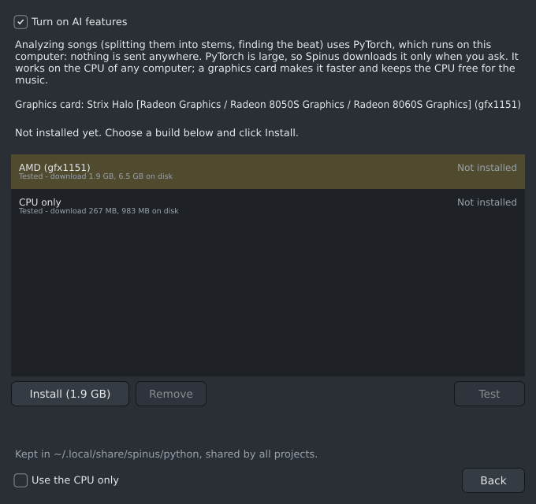

# The analysis engine

Analyzing songs (splitting them into stems, finding the beat, turning parts into notes) uses PyTorch, a
program for AI models that runs on your computer. Nothing is sent anywhere. PyTorch is large, so Spinus
downloads it only when you ask, and keeps it in one place for all your projects.

The analysis engine is used by the [Analyzer](analyzer.md), which is **experimental**: it shows only
while **Show experimental features** is ticked in **Options › AI...**.

## Installing it

1. Open **Options › AI...** and make sure **Turn on AI features** is ticked.
2. Click **Analysis engine...**.
3. The window shows the graphics card Spinus found, and the PyTorch build that suits it: for example
   **AMD (gfx1151)** for a Radeon 8060S. **CPU only** is always offered too.
4. Select a build and click **Install**. Spinus first tells you how much it downloads and how much disk
   space it takes, and where it comes from. Click **Install** again to agree.
5. A bar shows the progress. **Cancel** stops it and removes what was downloaded. You can close the
   window meanwhile: opening it again shows the progress.

Installing needs the `uv` tool. If the window says so, install it with `sudo pacman -S uv`.

## Which build?

| Graphics card | Build | Download, on disk |
|---|---|---|
| AMD Radeon (RX 5000 and newer, Ryzen graphics) | AMD (your card's model, e.g. gfx1151) | about 1.5 to 2 GB, 5.9 to 6.7 GB |
| Nvidia GeForce, RTX (driver 580 or newer) | Nvidia (CUDA 13) | about 3.1 GB, 5.7 GB |
| Older Nvidia cards or drivers (driver 525 or newer) | Nvidia (CUDA 12) | about 3.7 GB, 6.8 GB |
| Intel Arc, Core Ultra graphics | Intel (XPU) | about 2.5 GB, 7.4 GB |
| None of these | CPU only | about 0.3 GB, 1 GB |

The window shows the exact sizes for your card.

**Tested** builds have been tried on that kind of graphics card. **Untested** ones should work but
nobody has tried them yet. If one does not work, Spinus uses the CPU instead and says why.

Nvidia's and Intel's builds include their makers' own libraries, which are not open source. Spinus does
not ship them: your computer downloads them from the makers' and PyTorch's servers, like a graphics
driver.

## Graphics card or CPU

With a graphics card, analysis is faster and leaves the CPU free for the music. Every computer can use
the CPU: it is slower, but it works.

- **In use** says which build Spinus uses, and whether on the graphics card or the CPU.
- **Test** starts PyTorch and checks that the graphics card computes correctly. If it fails, or crashes,
  Spinus uses the CPU until you test again or restart Spinus.
- **Use the CPU only** leaves the graphics card alone, for example while you play a game or run a local AI
  chat model on it.

If your account may not use the graphics card, the window says so: add yourself to the `render` and
`video` groups (`sudo usermod -aG render,video $USER`), then log out and back in.

## Removing it

Select an installed build and click **Remove**. Everything is in `~/.local/share/spinus/python/`;
deleting that folder removes it too. Compiled graphics card code is kept in `~/.cache/spinus/gpu/`,
which can also be deleted at any time.

When Spinus is updated to a newer PyTorch, an installed build says **an update is available**: the old
one keeps working until you click **Update**.
