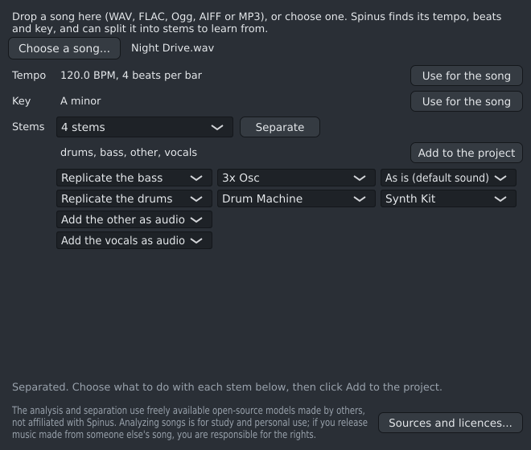

# The Analyzer

Drop a song into the Analyzer to learn from it: Spinus finds its **tempo**, **beats** and **key**, and can
split it into **stems** (vocals, drums, bass and the rest) that you can play along with, mute, solo and
study in the Playlist.

The Analyzer is **experimental**: it is still being worked on, and may change, be slow or not work well
for some songs. It is hidden until you turn it on: open **Options › AI...** and tick **Show experimental
features**. **View › Analyzer (experimental)** then opens it (no restart needed). Untick it again and the
Analyzer closes and disappears from the menus; a saved [window layout](main-window.md#layouts) doesn't
bring it back while it's off.

## What it needs

The Analyzer uses AI models that run on your computer; nothing is sent anywhere.

1. **AI turned on** in **Options › AI...**.
2. **The analysis engine** (PyTorch), installed once: the Analyzer offers a **Set up the analysis engine...**
   button that opens [the analysis engine page](analysis-engine.md).
3. **Model files**, downloaded once the first time: Beat This! (8 MB on the CPU, 81 MB with a graphics
   card), Basic Pitch (230 KB) and the separation model for the **Stems** choice: Demucs for 4 stems
   (84 MB) or 6 stems (55 MB), or MVSep for many instruments (1.4 GB). Basic Pitch also needs the
   `python-onnxruntime-cpu` package. The Analyzer says what it needs and how big it is; click
   **Download** to agree. What it lists always follows your choices: change the **Stems** choice and the
   list changes at once, before you download anything. Once the download is done, the Analyzer carries on
   with what you asked for (finding the beat, separating, or adding the stems).
   **Sources and licences...** (at the bottom of the Analyzer, always there) lists every model file it
   may use, with its licence, its size and whether it is downloaded; choose one to open its page and check
   for yourself where it comes from. These are freely available open-source models made by others, not
   affiliated with Spinus.
   Closest presets and drum samples, and Surge XT tuned to a stem (it starts from its closest preset), also
   need CLAP (776 MB): it is listed as soon as you choose one of those for a stem. Tuning any other synth
   needs nothing more.

## Analyzing a song

1. Drag a song file onto the Analyzer, or click **Choose a song...**. It reads WAV, FLAC, Ogg, AIFF, MP3
   and Opus, and with ffmpeg installed (`sudo pacman -S ffmpeg`) also M4A/AAC, WebM, WMA and more.
2. Spinus prepares the song, then finds the beat and the key. Each step shows its progress; **Cancel**
   stops it.
3. **Tempo**: for example "98.0 BPM, 4 beats per bar". **Use for the song** sets your song's tempo (and
   time signature, if the bars are not four beats) in one undo step.
4. **Key**: for example "A minor". When it is not sure, it says what else it might be. **Use for the song**
   sets your song's key.
5. **Stems**: choose **4 stems** (vocals, drums, bass, other) or **6 stems** (also piano and guitar, less
   clean), and click **Separate**. A four-minute song takes about 15 seconds on a graphics card, longer on
   the CPU. While Spinus plays, it leaves some of the CPU free for the music.

   **Many instruments** tells apart up to 53 kinds of sound: lead and backing vocals, synth, organ,
   strings, flute, saxophone, accordion, electric and acoustic guitar and more. It keeps only the ones it
   hears in the song, and doesn't give the same sound twice (the drums stay one stem, for the Drum
   Machine). The first time it downloads a 1.4 GB model ([MVSep Mega 53 stems](https://github.com/ZFTurbo/Music-Source-Separation-Training/releases/tag/v1.0.21),
   MIT). It is slower than 4 or 6 stems and works best on a graphics card with 16 GB of memory. Its
   stems don't add up exactly to the song, and each is a little less clean than with 4 stems. With many
   stems, scroll the list of stems to see them all.
6. **Each stem**: beside each stem, choose what happens to it:
   - **Replicate**: Spinus turns it into notes on a new channel, played by the sound you choose beside it
     (see below).
   - **Add as audio**: the stem itself goes on a Playlist track of its own, named
     "Vocals stem (<song>)", lined up so that the song's first bar starts on bar 1 (set the song's
     tempo first for the bars to match).
   - **Leave out**: nothing is added for it.

   The drums and the bass start as **Replicate**, the other stems as **Add as audio**. Click **Add to the
   project**: everything chosen is added at once, and one **Ctrl+Z** takes it all away. If something
   cannot be added, nothing is, and the line under the buttons says why ("Nothing was added: ...").

7. **Replicated stems**: each becomes a new channel named after the stem and the song, such as "Bass (<song>)", with its notes in a new
   pattern "Analysis: <song>", placed on the Playlist at bar 1. Melodic stems play on **3x Osc**; the
   drums become steps on a **Drum Machine** (kick, snare, clap, hats, toms, rim, crash and ride on their
   own pads). The notes follow the song's own beats (even when it speeds up or slows down) and snap to
   sixteenths. Swap the instrument for the sound you want.

   The first time you turn drums into steps, Spinus spends a few seconds learning its own drum sounds
   (nothing is downloaded for this).

   When the song has two clearly different sounds of one kind (a tight snare and a big one, say), each
   gets a pad of its own ("snare" and "snare 2"), so you can give them different samples. Each pad's
   loudest hit plays at full strength and the others keep their accents.

   Beside a replicated stem, two lists choose what plays its notes, then how; each stem can have a
   different choice. The second list shows only the ways the chosen sound can play it, and is hidden when
   there is just one.

   For a melodic stem (bass, vocals, guitar, accordion...), the first list, **what plays it**:
   - **Its own phrases (Sampler)**: the stem is cut into **phrases** where it goes quiet (at most 4 bars
     each, on sixteenths) and put into a **Sampler**, one key per phrase (C5, C#5, D5...), with a note
     for each phrase where it was in the song. Play the pattern and you hear the stem again; move, copy or
     delete the notes to rearrange it, or play the phrases from the keyboard. The sounds are saved inside
     the project, like any sample you drop onto the Channel Rack. These are the song's own recordings, so
     there is nothing to tune: there is no second list.
   - Then every instrument Spinus can use, in one list in alphabetical order: **3x Osc** (the default),
     **Surge XT**, **Odin 2** and **OB-Xf** once they are downloaded (Options › Plugins), and every
     instrument plugin the plugin scan found on your computer, Windows plugins included, the same ones as
     in the Browser (effects are not listed). Each instrument is listed once: Surge XT installed by your
     system as well as by Spinus shows only once.

   The second list, **how**:
   - **As is (default sound)**: the notes on a new channel with that instrument as it sounds when added;
     choose a preset in its own window.
   - **Closest preset** (Surge XT, OB-Xf, Odin 2, and your installed instrument plugins): the instrument
     with the preset that sounds most like the stem. Under the stems, a list offers the next closest
     presets: pick one to hear it in place. The preset is set on the new channel's instrument, so it is
     saved with your project; open the instrument's window to change it further. It is a starting point
     to shape by ear, not a copy of the song's sound.

     Which presets:
     - **Surge XT**: every Surge XT preset (about 3,000), including your own patches in
       Documents/Surge XT/Patches.
     - **OB-Xf**: its 488 factory patches, which Spinus downloads with it, and your own in
       Documents/OB-Xf/Patches.
     - **Odin 2**: its 260 factory presets, which are built into the plugin.
     - **Your installed plugins** (experimental): the presets the plugin shows to programs like Spinus
       (its "programs", or for a CLAP plugin the presets it lists), up to the first 1,000. Placeholder
       names such as "Init", "Default" or "Program 12" don't count. Many plugins keep their presets in a
       browser of their own that Spinus can't see; Spinus finds that out only when it loads the plugin,
       so the choice is offered for every instrument plugin. If a plugin has none Spinus can choose from,
       it plays its own sound and the status line says so after adding ("... has no presets Spinus can
       choose from; it plays its own sound."); Spinus remembers this, and from then on that plugin doesn't
       offer Closest preset (until the plugin is updated). Windows plugins work the same way when they
       show their programs through the bridge; one set to run separately (after a crash) has none Spinus
       can see. **Save your project first:** the plugin plays its presets inside Spinus, so a plugin that
       crashes then closes Spinus with it.

     The first time, Spinus listens to each preset playing a short phrase and keeps what it measured, per
     preset; the status line shows how far it is. For Surge XT that takes a few minutes with a graphics
     card and around a quarter of an hour on the CPU only; OB-Xf's and Odin 2's presets take a few
     minutes on the CPU. **Cancel** stops it and it carries on from there next time. Afterwards only new
     or changed presets are measured (for a plugin, all of its presets again when the plugin is updated).
   - **Tuned to it (slow)** (3x Osc, Surge XT, Odin 2 and OB-Xf): the synth's main settings
     (oscillator shapes and levels, filter, envelopes) are tuned, try after try, until it sounds as close
     as it can to the stem's busiest few seconds playing the same notes. Surge XT starts from the closest
     preset (so it needs CLAP and the presets measured, as above); the others start from their default
     sound. It takes about half a minute per stem; **Cancel** stops tuning and keeps the best so far.
     Expect a good starting point to shape by ear, not a copy: effects, reverb and the mix around the stem
     are not part of the synth. The tuned settings are on the new channel's synth: open its window to see
     them and change them further. Which settings are tuned is set by a
     [synth profile](synth-profiles.md).
   - **Tuned to it (experimental)** (your installed instrument plugins, and other free synths): the same,
     for a synth Spinus has not tried. Spinus picks the settings to tune by their names (cutoff,
     resonance, attack, release, wave, pulse width, detune...) and leaves out volume, tuning, effects and
     switches; you can choose them yourself with a [synth profile](synth-profiles.md). How well it works
     depends on the plugin: a synth whose main sound is chosen from a list Spinus cannot see (some keep
     their oscillator type out of reach) only gets closer, not close. A plugin with too few such settings
     plays as it is, and the status line says so after adding ("... has no settings Spinus can tune; it
     plays its own sound."). **Save your project first:** the plugin is tuned inside Spinus, so a plugin
     that crashes while it is being tuned closes Spinus with it.

   For the drums, the first list:
   - **Drum Machine** (the default), with the second list:
     - **Synth Kit**: the steps play Spinus's own kit.
     - **Closest drum samples**: for each of the song's drum sounds, Spinus suggests samples that sound
       like it, from its own Synth Kit and from a folder of yours (click **Drum samples...** under the
       drums' row to choose it; subfolders are searched, sounds up to 3 seconds long, and Spinus remembers
       the folder). The closest one goes on the pad, and a list per drum sound offers the next four. The
       first time, Spinus listens to the samples once and keeps what it measured (it needs CLAP).
   - **Its own hits (Drum Machine)**: each pad gets the song's clearest hit of that drum (its kick, its
     snare...).

Everything is kept in the project's `cache` folder: analyzing the same song again is instant.

Notes are found best on a clean single part (a bass line, a lead vocal). Chords and busy mixes give more
wrong notes: treat the result as a sketch to correct in the Piano Roll. Drums work best on a clear drum
stem; heavily processed drums or sounds unlike a drum kit may land on the wrong pad.

If something goes wrong, the line under the buttons says what. Hover over it to read a long message in
full, and right-click it and choose **Copy message** to paste it into a bug report. The same works in the
Automixer, the analysis engine window and the AI settings.

To learn what several songs (an album, say) have in common rather than taking one apart, use the
[Track creator](track-creator.md).

## About other people's songs

The analysis and the separation use freely available open-source models made by others; they are not
affiliated with Spinus. Analyzing songs is for study and personal use. If you release music made from
someone else's song, you are responsible for the rights.
