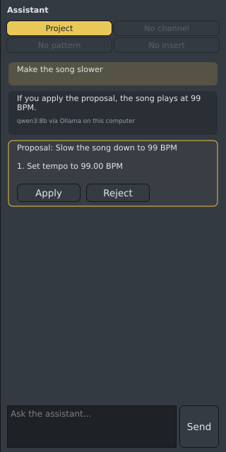
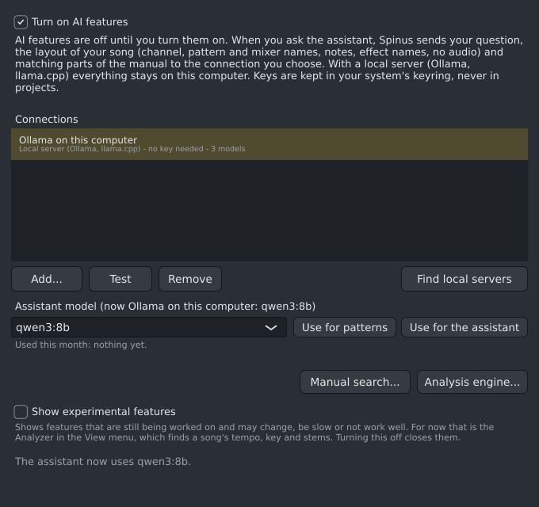
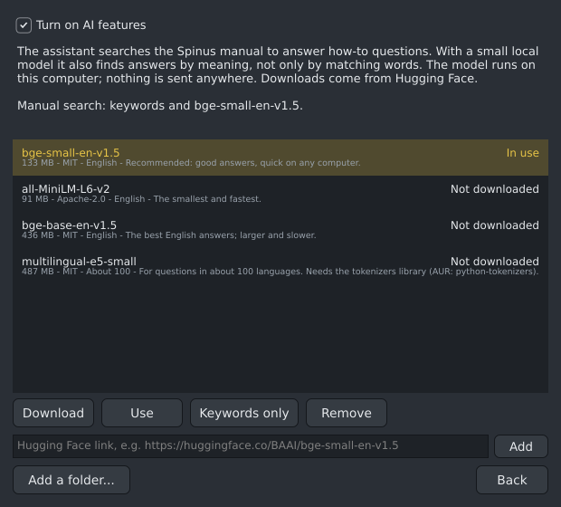

# The assistant and AI settings

The assistant answers questions about your song and about Spinus, and can propose changes. It never
changes anything by itself: every change comes as a **proposal** with **Apply** and **Reject**.

## AI is off until you turn it on

A new Spinus uses no AI at all: nothing runs, nothing is downloaded and nothing is sent anywhere. To
use the assistant, open **Options › AI...**, tick **Turn on AI features**, and add a connection.

When you ask the assistant something, Spinus sends your question, the layout of your song (channel,
pattern and mixer names, notes, effect names; never audio) and matching parts of this manual to the
connection you chose. Untick **Turn on AI features** at any time: the AI part stops, and your projects
work exactly as before.

**Show experimental features** (below the connections) shows features that are still being worked on and
may change, be slow or not work well. For now that is the [Analyzer](analyzer.md). It is off at first;
tick it and **View › Analyzer (experimental)** appears at once, untick it and the Analyzer closes.
Spinus remembers the choice.

## Connections

Click **Add...**, choose a provider, and **Save and test**. You can add several and switch between them.

| Provider | What you need |
|---|---|
| **Anthropic (Claude)** | An API key from console.anthropic.com. |
| **OpenRouter** | One key from openrouter.ai for many models (Claude, GPT, open models). OpenRouter reports what each answer cost. |
| **OpenAI-compatible service** | Its address and key. |
| **Local server** | Nothing leaves your computer and nothing costs money. Needs a model server running on this computer (below). No key. |

- Keys are stored in your system's keyring (the same safe store your desktop uses for Wi-Fi passwords),
  never in projects or settings files. A saved key is not shown again; to change it, add the connection
  again with the new key and remove the old one.
- **Test** checks the address and the key and lists the provider's models.
- **Assistant model**: choose the connection in the list, pick a model and click **Use for the
  assistant**. If that connection is down, busy or refuses the key, the assistant tries your other
  connections in the order you added them, and each answer says which model gave it.
- **Pattern generator model**: the Piano Roll's [Generate](piano-roll.md#generate) uses the assistant's
  model, or the one you pick with **Use for patterns**.
- **Used this month**, near the bottom of the window above the Manual search and Analysis engine
  buttons, shows how many tokens (pieces of text) each connection used, and the cost where the provider
  reports it.

### A local model with Ollama

1. In a terminal: `sudo pacman -S ollama` and then `ollama serve` (or enable its service:
   `sudo systemctl enable --now ollama`).
2. Get a model, for example `ollama pull qwen3` (a few GB). Larger models answer better; smaller ones
   answer faster.
3. In **Options › AI...**, click **Find local servers**. Spinus adds Ollama (and a llama.cpp server on
   port 8080, if one runs) and lists its models.

Local models are good for questions about Spinus and simple changes. For complex requests a large
model (Claude through Anthropic or OpenRouter) does better.

### Manual search with a local model (optional)

To answer "how do I..." questions, the assistant searches this manual. By default it matches words. A
small **embedding model** on your computer lets it also find answers by meaning: "my bass should get
quieter when the kick plays" finds the Sidechain Ducker page even though it never says "duck".

1. Install what the model needs to run (once): `sudo pacman -S python-onnxruntime-cpu python-numpy`.
   If something is missing, the window says what.
2. In **Options › AI...**, click **Manual search...**.
3. Select **bge-small-en-v1.5** (recommended, 133 MB) and click **Download**. A bar shows the progress;
   **Cancel** stops it. Spinus checks every file it downloads. Each model shows its licence; hover over
   it to see where it comes from, or right-click it and choose **Open its page** to read about it.
4. Click **Use**. The first time, it reads the whole manual (a few seconds). The line above the list says
   "Manual search: keywords and bge-small-en-v1.5" when it is ready.

Other choices:

- **all-MiniLM-L6-v2** is smaller and faster; **bge-base-en-v1.5** answers a little better but is larger.
- **multilingual-e5-small** understands questions in about 100 languages. It also needs the `tokenizers`
  library (AUR: `python-tokenizers`).
- **Your own model**: paste a Hugging Face model link and click **Add**, or click **Add a folder...** and
  pick a folder with `model.onnx` and `vocab.txt` (or `tokenizer.json`). Spinus cannot check these files
  or their license; that is up to you.
- **Keywords only** goes back to matching words. **Remove** deletes a downloaded model (a folder of your
  own is only taken off the list, never deleted).

Downloaded models are kept in `~/.local/share/spinus/models`, shared by all your projects.

The model runs on your computer; nothing is sent anywhere. Downloads come from Hugging Face and only
happen when you click Download or Add.

### The analysis engine

**Analysis engine...** installs PyTorch, which song analysis needs, for your graphics card or the CPU.
See [The analysis engine](analysis-engine.md).

## Asking

Show the assistant with the **Assistant** button (top right) or **Ctrl+Shift+A**. Drag the thin bar on
its left edge to make it wider or narrower. Select text in an answer with the mouse and copy it with
**Ctrl+C** (or right-click › Copy). Type a question and press **Enter** (**Send**). Examples:

- "Why is my kick quiet?"
- "How do I sidechain the bass to the kick?"
- "Add a reverb bus for the snare."
- "Make the hi-hats in the first pattern quieter."

The answer appears as it is written; the line under the conversation says what the assistant is doing
("Looking at the project", "Searching the manual"). **Stop** ends an answer early.

The buttons above the conversation say what the assistant sees: the **project**, the selected
**channel**, the current **pattern** and the **insert** selected in the Mixer. Click one to leave it out
of your next questions.

## Proposals

A proposal lists its steps ("Add channel 'Reverb bus'", "Set send level"). Spinus checks every step on a
copy of your project before showing it; a step that cannot be done is shown with the reason, and the
proposal cannot be applied.

- **Apply** makes all the steps at once. **Ctrl+Z** undoes the whole proposal in one go.
- **Reject** leaves your project as it is. You can tell the assistant what to change and ask again.
- If you edit the project before clicking **Apply**, Spinus checks the proposal again first.

## Notes from the assistant

Ask for music ("write a bass line for the drums", "make the hi-hats busier") and the assistant has the
[pattern generator](piano-roll.md#generate) write it. The notes appear in the Piano Roll as a
[suggestion](piano-roll.md#suggestions), for the channel and pattern they are for: **Accept** or
**Discard** them there. The pattern generator uses its own model if you chose one with **Use for
patterns**.
