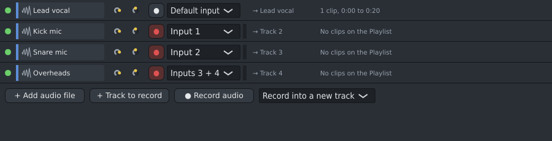

# Audio tracks (Shift+F6)

Vocals, stems, a recorded guitar, a whole song to remix: long audio is not something you build patterns
from, so it does not belong in the [Channel Rack](channel-rack.md) next to your drums and synths. Each
piece of audio on the [Playlist](playlist.md#audio-clips) plays through an **audio track**, and the
**Audio tracks** panel lists them. Open it with the **Audio** button in the top bar, **View › Audio
tracks**, or **Shift+F6**.

## Adding audio

- Click **+ Add audio file** and choose one or more files, or drop files from your file manager onto the
  panel. Each becomes a new track, with the file on the Playlist from the start of the song, below the
  clips already there.
- Dropping files on the Playlist works too: the clip lands where you drop it, on its own track.
- Dropping a file **longer than 20 seconds on the Channel Rack** adds it as an audio track as well (the
  hint bar says so). Shorter files dropped on the Channel Rack become [Sampler](sampler.md) channels, for
  playing in patterns. M4A and other files that need ffmpeg count as long. To put a long file in the
  Channel Rack as a Sampler anyway, hold **Shift** while dropping it there.

## Recording audio

Record a microphone, a guitar or anything else plugged into your sound card:

1. Choose the input in **Options › Audio settings...** (**F10**): **Record from** your sound card or
   microphone, and **Microphone on** the input it is plugged into.
2. Put the song position where you want to start (click the Playlist's ruler).
3. In **Audio tracks**, click **● Record audio**. The song plays from there and Spinus records; the line
   beside the button shows the time and how loud the input is ("too loud!" when it is close to clipping).
4. Press **Space** (or **■ Stop recording**) to stop.

The take goes on a new audio track on the Playlist, exactly where it was played: Spinus allows for the
time the sound takes to get in and out of the computer. It is saved as "Recording 1.wav" (then 2, 3...)
in the project's `audio` folder. **Ctrl+Z** removes it from the song. A mono input makes a mono file, a
stereo pair a stereo one. Use headphones, so the song doesn't get into the microphone.

## Recording several tracks at once

With a sound card that has several inputs (an audio interface with 4, 8 or more microphone inputs), you
can record drums, vocals and guitar together, each on its own track:

1. Choose the sound card in **Options › Audio settings...** (**F10**), under **Record from**.
2. In **Audio tracks**, click **+ Track to record** once for each microphone or instrument, and rename the
   tracks (right-click a name): "Kick mic", "Snare mic", "Overheads"...
3. Beside each track, choose its **input**: **Input 1**, **Input 2**... (as numbered on the sound card), or a
   pair such as **Inputs 3 + 4** for a stereo source (overheads, a keyboard). **Default input** is the one
   chosen in Options › Audio settings...
4. Click the **●** button of each track to record: it turns red (armed). The thin bar beside the input
   shows how loud it is, so you can set each microphone's gain on the sound card before recording.
5. Click **● Record audio**. The song plays and every armed track records its own input, all perfectly in
   step. Press **Space** to stop.

Each track's take goes on that track on the Playlist, where it was played ("Kick mic 1.wav",
"Snare mic 1.wav"... in the project's `audio` folder); over audio already on a track it becomes another
take (see below). One **Ctrl+Z** removes all of them. Disarm the tracks (click **●** again) to go back to
recording one input into a new track. A track's input and arm are saved with the project.

Recording several USB microphones at once (each its own device) is not supported: they would drift apart
in time. Use one sound card with several inputs.

## Takes and comping

To record a part several times and keep the best of each try, record **into** its track:

1. In the list next to **● Record audio**, choose **Record into** and the track (instead of **a new
   track**).
2. Record again over the same part of the song. Each try is a **take** on its own Playlist track ("Take
   2", "Take 3"...), grouped under the first take's track (see [Track groups](playlist.md#track-groups)),
   and all play through the same audio track (its volume, pan and mixer insert).
3. The newest take plays where it was recorded; the older takes there are cut and muted (they show
   dimmed).
4. **Comp** (choose the best parts): **Alt+click** a take on the Playlist, or **Shift**+right-click it › **Use this
   take here**: it plays, and the other takes are muted where it plays. To pick a phrase, first cut all
   the takes at the same places with the Playlist's **Slice** tool (drag a line down across them), then
   Alt+click the piece you want in each place.

Recording into a track where it has no audio yet just puts the recording on that track. Fold the takes'
group to see only the result. Every take and every choice is one undo step.

## Each track

| Part | What it does |
|---|---|
| Green light | Click to mute or unmute the track. |
| Name | Double-click to open the track's first clip in [Spinus Tune](spinus-tune.md#editing-a-vocal-note-by-note). Right-click for **Rename**, **Edit in Spinus Tune**, **Move to Channel Rack** (see below), **Create automation clip** (volume or pan, see [Automation clips](playlist.md#automation-clips)) and **Delete track**, which also removes its clips from the Playlist. |
| Two knobs | Volume and pan. Drag to change; double-click to reset. They move with their automation while it plays. |
| → Insert | The [Mixer](mixer.md) insert the track plays into. Each new track gets its own insert, named after the file, for its effects. |
| Clips | How many clips the track has on the Playlist and from when to when they play (minutes:seconds). |

- Every change is one undo step (**Ctrl+Z**).
- **Move to Channel Rack** turns the track's audio into a [Sampler](sampler.md) channel, to play and
  chop it in patterns. The track and its clips leave the Playlist; press **Ctrl+Z** twice to bring them
  back. It works when all the track's clips play the same file.
- Projects made before audio tracks existed show their audio clips' channels here automatically.
