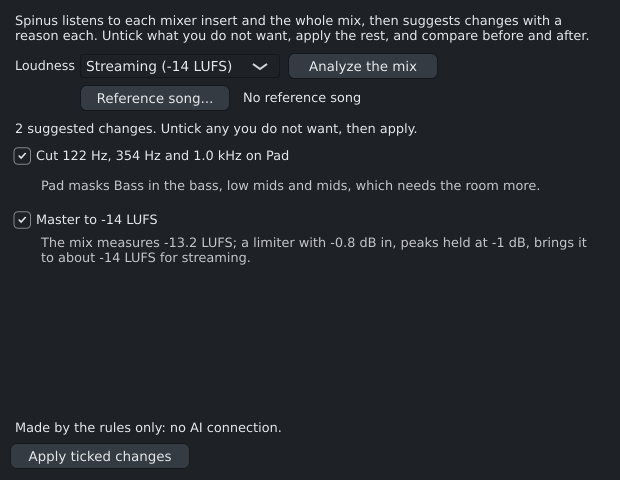

# The Automixer

**View › Automixer** listens to your mix and suggests changes, each with a reason you can read, such as
"Cut 122 Hz, 354 Hz and 1.0 kHz on Pad: Pad masks Bass in the bass, low mids and mids". You choose which
changes to keep, apply them in one go, and compare the mix before and after.

## What it needs

- **AI turned on** in **Options › AI...**: the measuring runs in Spinus's AI service on your computer.
- An AI connection is **not** needed. With one, the AI reviews the suggestions (it may drop or adjust
  them and words the reasons); without one you get the rules' suggestions, and the window says so. The
  review uses the assistant's model.

## Using it

1. Choose the **Loudness**: leave it as it is, **Streaming (-14 LUFS)** or **Club (-9 LUFS)**. With a
   target, a limiter on the master brings the whole mix there, its peaks held at -1 dB.
2. Optionally click **Reference song...** and pick a finished song whose sound you like (WAV, FLAC, MP3,
   ...): a gentle EQ on the master moves your mix's tonal balance towards it.
3. Click **Analyze the mix**. Spinus records each mixer insert and the whole mix (like an export), then
   measures them: how loud each part is, its peaks, its tone, its width, and which parts cover each
   other up in which frequencies.
4. Read the suggestions. Untick any you do not want.
5. Click **Apply ticked changes**. Everything happens as **one undo step** ("Automixer: 3 changes"), so
   one **Ctrl+Z** takes it all back.
6. Compare with **Before** and **After**. While you compare, Spinus plays both equally loud (the "after"
   is turned up or down to match), because louder always sounds better at first. Click **Keep** when you
   are done.

## The kinds of change

- **Lower a part** that peaks so close to 0 dB that the mix has no room left.
- **Cut** a few frequencies on one part where it covers up another (the part that needs that range less
  gives way), or **high-pass** a part that has nothing useful in the low end.
- **Compress gently** a part whose peaks are far above its average, so it sits in the mix.
- **Match the reference's tone** and **bring the master to a loudness** (see above).

The EQ, compressor and limiter are the ordinary [Spinus EQ](eq.md), [Spinus Compressor](compressor.md) and
[Spinus Limiter](limiter.md) on the inserts: open them in the Mixer to see or change what was set. Treat the suggestions as a second pair of ears, not as rules: trust what you hear.
