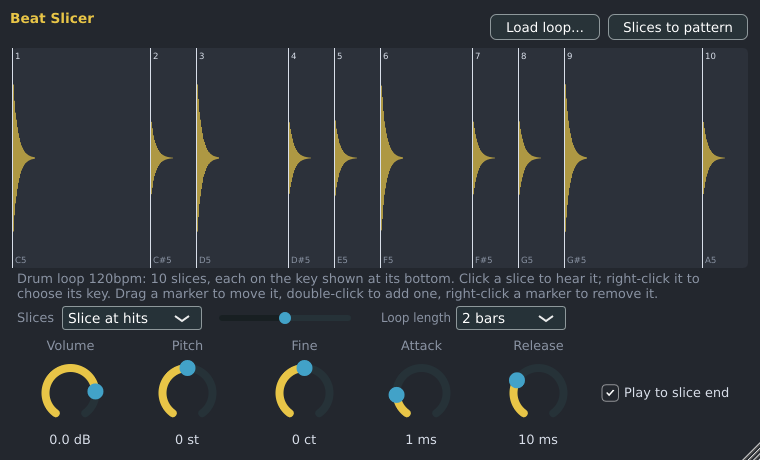

# Beat Slicer

The Beat Slicer chops a drum loop (or any recording with several hits) into slices and plays each slice
from its own key: slice 1 from C5, slice 2 from C#5, and so on, or from any key you choose. Play the
slices from the Piano Roll, write them into a pattern with one click, then move, repeat or delete notes
to make new grooves from the same loop. It is made by Spinus (like FL Studio's Slicex).

There are several ways to open a sound in it:

- **From the Browser:** right-click a sample under **Samples** and choose **Open in Beat Slicer**.
- **From a Sampler channel:** right-click the channel's name in the Channel Rack and choose **Open in
  Beat Slicer**. A new Beat Slicer channel gets the Sampler's sound; the Sampler stays.
- **From an audio track:** right-click its name in [Audio tracks](audio-tracks.md) and choose **Open in
  Beat Slicer**. The track stays.
- Or add an empty one from the [Browser](browser.md) (**Instruments › Spinus › Beat Slicer**) or the
  Channel Rack's **+ Add channel** menu, double-click the channel's name to open it, and load a loop.

The window opens with the sound already sliced.

## Loading and slicing a loop

1. Drop an audio file (WAV, AIFF, FLAC, Ogg, MP3) on the window, or click **Load loop...**. Loops up
   to two minutes long work.
2. The Beat Slicer cuts it at each hit (**Slice at hits**). Move the slider next to it to the right to
   also find quieter hits, to the left for only the loud ones. Or choose **Slice by grid** and a note
   length to cut it into equal parts.
3. Check **Loop length**. Spinus guesses it from a tempo in the file name ("Funk 96bpm.wav") or else
   from the song's tempo. Fix it if the guess is wrong: it decides where the notes go in the pattern
   and how long grid slices are.

In the waveform:

| Action | How |
|---|---|
| Hear a slice | Click it. |
| Move a slice's start | Drag its marker. |
| Add a slice | Double-click where it should start. |
| Remove a slice | Right-click its marker. |
| Choose a slice's key | Right-click inside the slice: **Play from key** lists every key by octave, **Next free key up** moves it to the next key no slice uses. The key is shown at the bottom of each slice. |

Slicing again (changing the method, the slider, the grid or the loop length with grid slicing) replaces
slices you moved by hand, and puts the slices back on C5 upwards.

### Keys

Each key plays one slice. Choosing a key that another slice uses swaps the two, so you can put, say,
the kick on C5, the snare on D5 and the hats from F#5 up. A slice you add gets the lowest free key from
C5; removing a slice frees its key. **Reset all keys** (in the same menu) puts slice 1 back on C5 and the
others above it. **Slices to pattern** writes each note on its slice's key.

## Slices to pattern

Click **Slices to pattern** in the window, or right-click the channel's name in the Channel Rack and
choose **Slices to pattern**. Spinus writes one note per slice, where the slice is in the loop, so the
pattern plays the loop back at the song's tempo.

- If the current pattern is at least as long as the loop, the notes replace this channel's notes in it.
  Otherwise Spinus makes a new pattern as long as the loop (in whole bars), named after the loop, and
  switches to it.
- **Ctrl+Z** undoes it in one step.
- At a faster or slower song tempo than the loop's, each slice still plays at its own speed and pitch;
  only the gaps between them change.

## Knobs

| Control | What it does |
|---|---|
| **Volume** | The level of all slices. |
| **Pitch** / **Fine** | Tunes all slices up or down, in semitones and cents. |
| **Attack** | Fades each slice in. Leave it short to keep the hits sharp. |
| **Release** | How long a slice fades out after its note ends. |
| **Play to slice end** | On (the default): each note plays its whole slice, however short the note. Off: a slice stops when its note ends. |

A slice always stops at its end (with a 2 ms fade), so it never runs into the next slice. The loop is
saved inside the project, so it plays on any computer. The Beat Slicer is also installed as a VST3 and
LV2 plugin ("Spinus Beat Slicer") for use in other programs.
