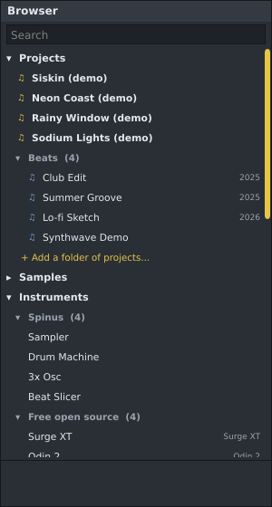

# Browser

The Browser is on the left of the main window. Show or hide it with **F8** or the **Browser**
button. It lists your projects, your samples and everything you can play or put on a mixer insert:

| Section | What is in it |
|---|---|
| **Projects** | The demo songs that come with Spinus and folders of projects you add yourself (see [Projects](#projects) below). |
| **Samples** | Folders of samples on your computer that you add yourself (see [Samples](#samples) below). Spinus does not come with samples. |
| **Instruments** › **Installed plugins** | Instrument plugins found on your computer. |
| **Instruments** › **Free open source** | Free, open-source instruments made by others, which Spinus downloads for you: Surge XT and OB-Xf, by the Surge Synth Team, Odin 2 (Linux), by TheWaveWarden, and the Six Sines FM synthesizer. |
| **Effects** › **Installed plugins** | Effect plugins found on your computer. |
| **Effects** › **Free open source** | Free, open-source effects made by others, which Spinus downloads for you: another EQ, compressor, limiter and gate, a multiband compressor and a spectrum analyzer from LSP Plugins, reverbs from Dragonfly Reverb, Surge XT Effects, the PeakEater clipper, and the TIME-12 and GATE-12 shapers. The project each one comes from is shown next to its name; hover over it for its license. |
| **Problem plugins** | Plugin files that crashed or hung while Spinus checked them. |

Free open-source plugins that are not downloaded yet are greyed out with "get it" after the name.
Double-click one to open [Get free plugins](free-plugins.md).

**Instruments** › **Spinus** lists the instruments made by Spinus: the [Sampler](sampler.md), the
[Drum Machine](drum-machine.md), [3x Osc](3x-osc.md) and the [Beat Slicer](beat-slicer.md). **Effects** › **Spinus** lists the effects made
by Spinus: the [Spinus EQ](eq.md), [Spinus Compressor](compressor.md), [Spinus Limiter](limiter.md) and
[Spinus Gate](gate.md) (the basic mixing effects, with nothing to download), the [Filter](filter.md), the
[Sidechain Ducker](ducker.md), the [Stereo Utility](stereo-utility.md), [Spinus Tune](spinus-tune.md) and the
[Loudness Meter](loudness-meter.md).

Each installed plugin shows its format: **VST3**, **CLAP**, **LV2**, **VST2**, or **WIN** for a Windows
plugin (see [Windows plugins](windows-plugins.md)). Hover over a plugin to see its maker and file in the hint bar.
A plugin installed in several formats is listed once, in the best one (CLAP, then VST3, LV2, VST2); the hint
bar says which other formats you have. If that version doesn't work well for you (some Windows plugins run
smoother as VST2, for example), right-click it and choose another under **Use the version**: Spinus lists and
adds that one from now on, also after a restart. Channels and effects you already added keep the version they
have; add the plugin again to use the other one.

## Adding instruments and effects

- **Double-click an instrument** to add a channel that plays it. The Channel Rack opens.
- **Double-click an effect** to add it to the insert selected in the Mixer (the Master if none is).
- **Drag** an instrument onto the Channel Rack, or an effect onto a mixer strip or one of the effect slots
  on the right of the Mixer.
- Right-click a plugin for the same choices.

The **+ Add channel** button in the Channel Rack and the empty effect slots in the Mixer list the same
devices, with installed plugins grouped by maker under **Installed plugins**.

## Finding plugins

Click **Scan plugins** at the bottom. Spinus checks each new or changed plugin file in a separate helper
program, so a broken plugin cannot crash Spinus. The progress shows below the button; click
**Cancel scan** to stop. The next scan only checks new or changed files. See [Plugins](plugins.md) for
the folders Spinus looks in.

## Finding things quickly

Type in the **Search** box to filter by name, maker, project or format (for example `reverb`, `lsp`, `xfer` or `vst3`).
Click a section or group title to fold it away.

Presets don't show in the Browser yet.

## Projects

The **Projects** section at the top is the quick way back to your songs.

- **Demo songs:** the songs that come with Spinus, each shown as "*name* (demo)", for example
  **Siskin (demo)**. Double-click one to open it: Spinus puts your own copy in your **Music**
  folder and opens that, so you can change and save it freely (see
  [Your first beat](getting-started.md#listen-to-the-demo-songs-first)).
- **Your folders of projects:** click **+ Add a folder of projects...** (or right-click **Projects**) and
  choose a folder, for example the one you keep all your songs in. Spinus looks through it and its
  subfolders (up to six folders deep) and lists every project it finds, with the subfolder it is in after
  the name. It skips hidden folders (and, on Windows too, folders whose name starts with a dot, such as
  `.git`) and doesn't look inside projects. Looking happens in the background,
  so Spinus stays quick even with a big folder; the list from last time shows at once on the next start.
  A project you save into one of your folders shows up there at once.

Double-click a project to open it. If the open project has unsaved changes, Spinus asks whether to save them
first, as **File › Open** does. Type in the **Search** box to find a project by name.

Right-click a project for **Open**, **Show in the file manager** and **Remove from the list** (the files
stay where they are). Right-click a folder for **Look again for projects** (after you add or move songs),
**Remove from the Browser** and **Show in the file manager**.

A project that is gone from one of your folders drops out the next time Spinus looks; a folder that is gone
(on a drive that isn't plugged in, say) stays, marked **missing**. The projects you opened last are under
**File › Open recent** (see [Projects](projects.md)). The list is kept for you, not in projects (in
`~/.config/Spinus DAW/projects.json`).

## Samples

Spinus does not ship samples, but it shows your own sample libraries: drum kits, loops, one-shots and
vocals you have downloaded or bought.

- **Add a folder:** click **+ Add a folder of samples...** under **Samples** (or right-click
  **Samples**) and choose the folder. Add as many as you like; Spinus remembers them. Your files are
  never moved, copied or changed by adding a folder.
- **Browse:** click a folder to open it. Subfolders come first, then the audio files (WAV, AIFF, FLAC,
  Ogg, MP3, Opus, and M4A and others when ffmpeg is installed). Other files are not shown, nor are hidden
  files and folders (on Windows too, those whose name starts with a dot).
- **Search:** type in the search box at the top. It finds samples by name in all your folders, with the
  folder each is in shown after the name.
- **Listen:** click a sample to hear it once (the first 30 seconds of a long file). A ▶ shows while it
  plays; click it again to stop. Files that need ffmpeg cannot be heard this way, but can still be used.
- **Use it:**
  - **Double-click** a sample to add it to the Channel Rack as a [Sampler](sampler.md) channel. A file
    longer than 20 seconds becomes an [audio track](audio-tracks.md) instead.
  - **Drag** it onto the Channel Rack (the same), onto the [Playlist](playlist.md) (an audio clip where
    you drop it), or onto [Audio tracks](audio-tracks.md) (a new track from the start of the song).
  - **Right-click** it for **Add to the Channel Rack**, **Add as an audio track** and **Show in the file
    manager**.
- **Remove a folder:** right-click it and choose **Remove from the Browser**. The files stay where they
  are. **Look again for new files** updates the search after you add samples to a folder.

Samples you use are copied into the project when you save it, so the project still works if you later
move or delete your library.
