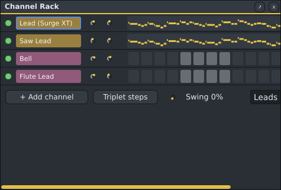
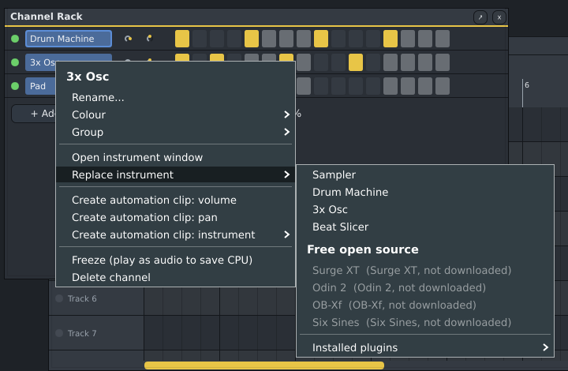
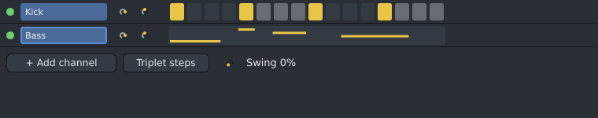

# Channel Rack (F6)

The Channel Rack lists your channels: each one is an instrument. Next to each channel is its **step
sequencer** for the current pattern (chosen in the top bar, or by clicking a pattern clip in the
[Playlist](playlist.md)). A new, empty project has no channels: the Channel Rack then says how to add
the first one (**+ Add channel**, or drag an instrument in from the [Browser](browser.md)).

| Part | What it does |
|---|---|
| Green light | Click to mute or unmute the channel. |
| Name | Click to select the channel for the Piano Roll (it gets a blue outline). Double-click to open the instrument's window. The name button is drawn in the channel's colour. Right-click for options: **Rename...**, **Colour**, **Group** (see below), Open instrument window, **Learn this instrument...** (see below), **Bank** (for a sample player, see [Sample banks](#sample-banks)), **Preset files** (see below), **Replace instrument** (see below), Create automation clip (volume, pan, or an instrument setting; see [Automation clips](playlist.md#automation-clips)), **Slices to pattern** for a [Beat Slicer](beat-slicer.md) with a loop, **Freeze** / **Unfreeze** (play the channel as audio to save CPU, see [Freeze](freeze.md); a frozen channel shows a blue snowflake), Delete channel (its mixer insert goes too, with its effects, unless another channel plays into it or another insert sends to it; Ctrl+Z brings both back). |
| Two knobs | Volume and pan. Drag to change; double-click to reset. |
| Steps | Each box is a sixteenth note. Click a box to add a note (C5), click again to remove it. Boxes are grouped by beat. There is one bar of steps in the pattern's time signature: 16 in 4/4, 12 in 3/4 or 6/8. |
| **Triplet steps** | Switches the current pattern's boxes to sixteenth-note triplets: six per beat, 24 in a 4/4 bar, for shuffles and triplet hi-hats. Click again for sixteenths. Your notes stay where they are; ones that no longer fit the boxes show as a note picture. |
| **Swing** | The knob beside Triplet steps: every second step plays a little later, for a shuffled groove. 0% is straight; about 67% is a triplet feel; 100% is half a step late (dotted). It is the pattern's: the notes stay where they are, only how they play changes. Double-click the knob for straight. |
| Note picture | When a channel has notes the steps cannot show (other pitches, longer notes, notes between steps, notes after the first bar), its row shows a small picture of them instead, as in FL Studio. Click it to edit them in the Piano Roll. |
| Audio | Vocals, stems and other audio on the Playlist are not here: they have their own [Audio tracks](audio-tracks.md) panel. |
| **+ Add channel** | Add a channel with an instrument (the Sampler, the Drum Machine, 3x Osc, the Beat Slicer, [Surge XT](surge-xt.md), or an installed plugin), or an empty one. You can also drag an instrument from the [Browser](browser.md) onto the Channel Rack, or audio files from your file manager: each becomes a [Sampler](sampler.md) channel. A file longer than 20 seconds (a vocal, a song) becomes an [audio track](audio-tracks.md) instead; hold **Shift** while dropping to make it a Sampler channel all the same. |

## Groups

With many channels, sort them into groups (FL's filter groups): right-click a channel › **Group** › **New
group...** and type a name ("Drums"), or choose a group you made before. Once there is a group, a list
appears next to **Swing**: show **All channels**, one group, or the channels **Not in a group**.

**Group › Send group "Drums" through a new mixer bus** adds a mixer insert named after the group and
plays the group's channels through it: one fader and one set of effects for all the drums (see the
[Mixer](mixer.md)). It is one undo step.

## Learn this instrument

Many sampled instruments, guitars and basses especially, use some keys as switches: a low key changes the
guitar to palm mutes instead of playing a note, and a strummer mode plays chords from its own keys. Right-click
a channel's name › **Learn this instrument...** to tell Spinus what each key of its instrument does: which keys
play, which switch what it plays, and its modes. Spinus can also listen to every key itself (with the sound the
channel has now), ask the plugin, or read its manual with the AI. What you set is kept for that instrument, on
every channel and in every project that uses it, and you can export it as a file to share. Scripts and coding
agents can learn an instrument too, without the window: `spinus --learn` on the
[command line](command-line.md#learning-an-instrument), and the `learn_instrument` tool for
[agents](agents.md). The window is the same
as in the Track creator; [Learn this instrument](track-creator.md#sounds-for-each-part) there explains it in
full. Spinus's own instruments that play every key (3x Osc, the Sampler) and the free synths it gets (Surge XT,
OB-Xf, Odin 2, Six Sines) come with what it knows of them: every key plays, with a few words on what they suit.
The Drum Machine and the Beat Slicer don't: you choose which key plays each pad or slice, and they tell Spinus
the names themselves.

### Sample banks

A sample player (sfizz, DrumGizmo, or a player like Kontakt) plays whatever bank you load into it: an .sfz guitar
with switch keys, a bass, a drum kit with its own key map. What its keys do depends on that bank, so tick **The
loaded bank decides what the keys do** at the top of Learn this instrument. Each bank then keeps its own keys and
modes, and the window learns the bank the channel plays now (its name is beside the tick box and in the window's
title). Other banks stay as they were. A bank not learned yet plays any key, as an instrument not learned does,
and coding agents are told it isn't learned.

Spinus finds the bank from the files the plugin's saved sound names (the .sfz file, the kit and its key map), so
loading another bank in the plugin's window is enough. Some plugins don't say: right-click the channel's name ›
**Bank** › **Name this bank...** and give it a name ("Strings legato"). The song keeps that name for the channel,
and the next channel with that plugin can pick it from the same menu. **As its sound says** goes back to finding
it from the plugin. Leave the tick box off for synths: their keys don't change with a preset.

## Preset files

Many sampled instruments keep their presets as files in a folder of their own that no host can list (many sampled
guitars and basses keep them in a "Presets" folder under Documents). Right-click a channel's name › **Preset files** › **Add a folder of its
preset files...** and choose that folder: the assistant and coding agents can then list and load those presets
on any channel with that instrument (`list_presets`, `device.loadPreset`), the Track creator can pick them, and
the [Analyzer](analyzer.md)'s **Closest preset** chooses from them.
**Stop using** a folder in the same menu. It is there for plugins, but not VST2 plugins, which keep their sound in
a format Spinus can't write: use the instrument's VST3 version.

## Replace instrument

To try another sound on a channel without redoing its notes (FL's **Replace**): right-click the channel's
name › **Replace instrument** and choose an instrument from the same list as **+ Add channel**. The new
instrument plays the channel's notes in every pattern, and the channel keeps its place in the Playlist, its
mixer insert, volume, pan, colour and group. Its name stays too, unless it was the old instrument's name
("3x Osc"): then the channel, and its own mixer insert, take the new instrument's name.

- [Automation clips](playlist.md#automation-clips) of the old instrument's settings (a cutoff, say) are
  removed, since the new instrument has other settings; the hint bar says how many. Automation of the
  channel's volume and pan stays.
- A frozen channel is unfrozen: the new instrument plays live.
- It is one undo step: **Ctrl+Z** brings the old instrument back with all its settings, and its automation.
- A channel with no instrument shows **Choose instrument** instead.

## Good to know

- If there is no pattern yet, your first step creates **Pattern 1** (one bar long). So do **Triplet steps**
  and **Swing**. One **Ctrl+Z** takes back the step (or the change) and the new pattern together.
- Clicking a step changes only that step: the velocity, release, pan, fine pitch and volume you gave the
  other notes in the Piano Roll stay as they are.
- Every change can be undone with **Ctrl+Z**.
- Press **Space** in pattern mode to hear the pattern loop; the playing step is outlined.
- A channel outlined in yellow is what the automation clip selected in the Playlist moves (its volume, pan or
  an instrument setting; see [What a clip moves](playlist.md#what-a-clip-moves)).
- A new channel gets its own mixer insert automatically.

