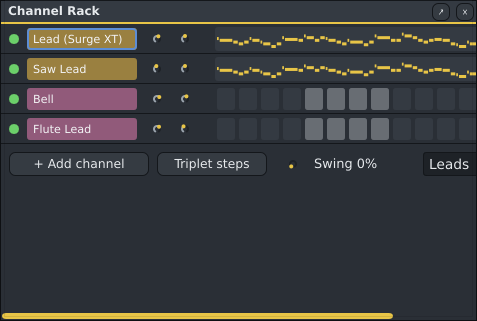
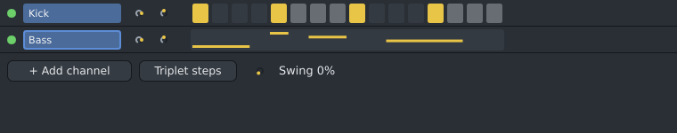

# Channel Rack (F6)

The Channel Rack lists your channels: each one is an instrument. Next to each channel is its **step
sequencer** for the current pattern (chosen in the top bar, or by clicking a pattern clip in the
[Playlist](playlist.md)).

| Part | What it does |
|---|---|
| Green light | Click to mute or unmute the channel. |
| Name | Click to select the channel for the Piano Roll (it gets a blue outline). Double-click to open the instrument's window. The name button is drawn in the channel's colour. Right-click for options: **Rename...**, **Colour**, **Group** (see below), Open instrument window, Create automation clip (volume, pan, or an instrument setting; see [Automation clips](playlist.md#automation-clips)), **Slices to pattern** for a [Beat Slicer](beat-slicer.md) with a loop, **Freeze** / **Unfreeze** (play the channel as audio to save CPU, see [Freeze](freeze.md); a frozen channel shows a blue snowflake), Delete channel. |
| Two knobs | Volume and pan. Drag to change; double-click to reset. |
| Steps | Each box is a sixteenth note. Click a box to add a note (C5), click again to remove it. Boxes are grouped by beat. There is one bar of steps in the pattern's time signature: 16 in 4/4, 12 in 3/4 or 6/8. |
| **Triplet steps** | Switches the current pattern's boxes to sixteenth-note triplets: six per beat, 24 in a 4/4 bar, for shuffles and triplet hi-hats. Click again for sixteenths. Your notes stay where they are; ones that no longer fit the boxes show as a note picture. |
| **Swing** | The knob beside Triplet steps: every second step plays a little later, for a shuffled groove. 0% is straight; about 67% is a triplet feel; 100% is half a step late (dotted). It is the pattern's: the notes stay where they are, only how they play changes. Double-click the knob for straight. |
| Note picture | When a channel has notes the steps cannot show (other pitches, longer notes, notes between steps, notes after the first bar), its row shows a small picture of them instead, as in FL Studio. Click it to edit them in the Piano Roll. |
| Audio | Vocals, stems and other audio on the Playlist are not here: they have their own [Audio tracks](audio-tracks.md) panel. |
| **+ Add channel** | Add a channel with an instrument (the Sampler, the Drum Machine, 3x Osc, the Beat Slicer, [Surge XT](surge-xt.md), or an installed plugin), or an empty one. You can also drag an instrument from the [Browser](browser.md) onto the Channel Rack, or audio files from your file manager: each becomes a [Sampler](sampler.md) channel. A file longer than 20 seconds (a vocal, a song) becomes an [audio track](audio-tracks.md) instead; hold **Shift** while dropping to make it a Sampler channel all the same. |

## Groups

With many channels, sort them into groups (FL's filter groups): right-click a channel › **Group** › **New
group...** and type a name ("Drums"), or choose a group you made before. Once there is a group, a list
appears next to **Swing**: show **All channels**, one group, or the channels **Not in a group**.

**Group › Send group "Drums" through a new mixer bus** adds a mixer insert named after the group and
plays the group's channels through it: one fader and one set of effects for all the drums (see the
[Mixer](mixer.md)). It is one undo step.

## Good to know

- If there is no pattern yet, your first step creates **Pattern 1** (one bar long).
- Every change can be undone with **Ctrl+Z**.
- Press **Space** in pattern mode to hear the pattern loop; the playing step is outlined.
- A new channel gets its own mixer insert automatically.

