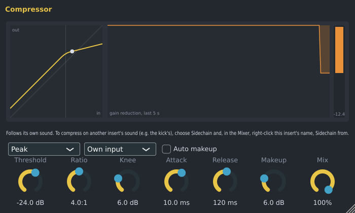

# Spinus Compressor

A compressor turns the loud moments of a sound down, so it stays at a steadier level and sits better in
the mix: a vocal that jumps out and then disappears, a bass whose notes are uneven, drums that need more
punch. It is made by Spinus, so it works without downloading anything.

## Adding it

In the [Mixer](mixer.md), click an empty slot on an insert and choose **Spinus Compressor** (or drag it
there from **Effects › Spinus** in the [Browser](browser.md)).

## Controls

| Control | What it does |
|---|---|
| **Threshold** | The level where it starts to work. Lower it until the loud parts are turned down. |
| **Ratio** | How hard it turns down what goes over the threshold. 2:1 is gentle, 4:1 is clearly audible, 10:1 and more is almost a limiter. |
| **Knee** | How gently it starts around the threshold. 0 dB starts at once; 6 to 12 dB sounds smoother. |
| **Attack** | How fast it reacts to a loud sound. Slow attacks (10 to 30 ms) let the start of a drum hit through, for punch. |
| **Release** | How fast it lets go after the loud sound. |
| **Makeup** | Turns the compressed sound back up, since compressing makes it quieter. |
| **Auto makeup** | Adds makeup by itself: half of what a full-scale sound would lose. |
| **Mix** | 100% is fully compressed; lower mixes in the original sound ("parallel" or "New York" compression: punch without losing the life of the original). |
| **Peak / RMS** | **Peak** reacts to every peak. **RMS** follows the average level, which sounds more natural on vocals and whole mixes. |
| **Own input / Sidechain** | What it listens to (see below). |

The window shows:

- **Left:** the curve of what goes in (right) against what comes out (up), with a dot at the level coming
  in right now.
- **Middle:** how far it turned the sound down over the last five seconds.
- **Right:** how far it is turning the sound down right now, also shown in the Mixer as an orange bar
  and as, for example, **-6.0 dB** in the effect's slot.

## Sidechain: compressing to another sound

The compressor can listen to another insert and turn this sound down whenever that one is loud. The
classic use: the bass ducks under the kick.

1. Choose **Sidechain** in the compressor's window (instead of **Own input**).
2. In the [Mixer](mixer.md), right-click this insert's name and choose **Sidechain from**, then the insert
   to follow (for example **Kick**).
3. The line under the display says when sound arrives on the sidechain.

With **Sidechain** chosen but nothing connected, the compressor listens to its own sound. For a simple
pump in time with the song, the [Sidechain Ducker](ducker.md) is quicker to set up.

## Good to know

- Every control can be automated.
- The Spinus Compressor is also installed as a VST3 and LV2 plugin ("Spinus Compressor") for use in
  other programs; there, connect its sidechain input as that program does.
- The LSP **Compressor** from [Get free plugins](free-plugins.md) is still there if you prefer it, and
  songs that use it open as before.
