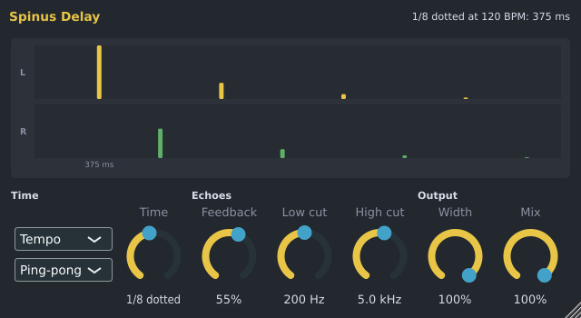

# Spinus Delay

A delay plays a sound back as echoes: a dotted-eighth echo behind a lead, a ping-pong bounce on a pluck, a
slapback on a vocal. The Spinus Delay locks its echoes to the song's tempo (or to a time you choose), so
they stay in time when you change the tempo. It is made by Spinus, so it works without downloading
anything.

## Adding it

There are two usual ways to use it:

- **On a send bus** (the usual way, so several parts share one delay): in the [Mixer](mixer.md), make an
  insert named "Delay", put the **Spinus Delay** on it and set its **Mix** to **100%** (only the echoes; the
  dry sound comes from the parts themselves). Then add a **Send** from each part to that insert.
- **Straight on a part's insert:** click an empty slot on the insert and choose **Spinus Delay** (or drag it
  there from **Effects › Spinus** in the [Browser](browser.md)). Keep **Mix** low (30% is the default) so the
  part keeps its own sound.

## Controls

| Control | What it does |
|---|---|
| **Tempo / Free** | **Tempo**: the time is a note length at the song's tempo. **Free**: the time is in milliseconds. |
| **Time** | With **Tempo**: a note length, from **1/32** to **1 bar**, with **dotted** and **triplet** lengths (1/8 dotted is the classic echo). With **Free**: 1 ms to 2 s. |
| **Feedback** | How much of each echo comes back as the next one: 0% is one echo, 35% a few, 80% and up a long trail. Up to 95%. |
| **Stereo / Ping-pong / Mono** | **Stereo**: each side echoes itself. **Ping-pong**: the echoes bounce left, right, left... **Mono**: the echoes are in the middle. |
| **Low cut** | Takes the lows out of the echoes (and so out of every repeat), so they don't muddy the bass. **Off** at its lowest. |
| **High cut** | Takes the highs out of the echoes: each repeat is darker than the one before, like a tape echo. **Off** at its highest. |
| **Width** | How wide the echoes are: 100% as they are, 0% all in the middle. |
| **Mix** | 0% only the dry sound, 50% both at full, 100% only the echoes (for a send bus). |

The window draws the echoes of one sound as they will come: when (the time of the first one is under it),
on which side (the top row is the left, the bottom row the right) and how loud. The top right says the time
in milliseconds, for example **1/8 dotted at 120 BPM: 375 ms**.

## Good to know

- The time follows the song's tempo while it plays, including tempo changes. A new time (turning the knob,
  another note length, a tempo change) fades from the old echoes to the new ones, so it never clicks.
- Every control can be automated, and scripts and the AI set it in its own units: `"note": "1/8 dotted"`,
  `"time": "350 ms"`, `"feedback": "40%"`, `"high_cut": "4.5 kHz"`, `"mode": "Ping-pong"`.
- The [Track creator](track-creator.md) and the [assistant](assistant.md) use it for their delay sends: a
  **Delay** bus with the Spinus Delay at 100% mix, its echoes in time with the song.
- The Spinus Delay is also installed as a VST3 and LV2 plugin ("Spinus Delay") for use in other programs.
- For a drawn delay-time shape (stutters, tape stops), see TIME-12 in [Get free plugins](free-plugins.md).
