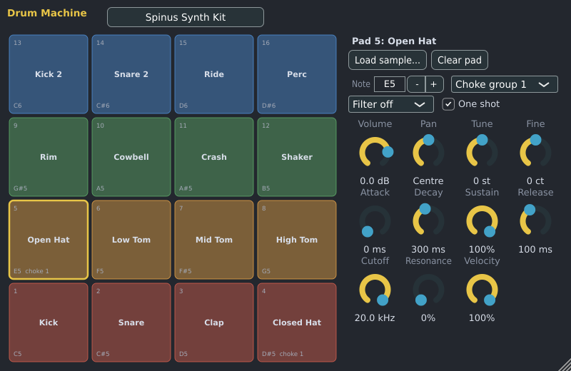

# Drum Machine

The Drum Machine has 16 pads, each playing one drum sound with its own settings. It is made by Spinus.
A new Drum Machine starts with the **Spinus Synth Kit**: 16 electronic drum sounds (kick, snares, clap,
hi-hats, toms, cymbals and percussion) that Spinus makes itself, so no sample files are needed. Four
**factory kits** of real drum samples come with it too (see [Kits](#kits)).

## Adding one

Add it from the [Browser](browser.md) (**Instruments › Spinus › Drum Machine**) or the Channel Rack's
**+ Add channel** menu. Double-click the channel's name to open its window.

## Which note plays which pad

Pad 1 (bottom left) plays at **C5**, pad 2 at C#5, and so on up to pad 16 at D#6. The Channel Rack's
steps play C5, so they play pad 1 (the kick). To program the other pads, open the
[Piano Roll](piano-roll.md) and draw notes from C5 upwards. Each pad shows its note in its corner; you can
change it with **Note**.

## Pads

- **Click a pad** to hear it and select it.
- **Drop an audio file on a pad** to put that sample on it, or select the pad and click **Load sample...**.
- **Clear pad** empties it.

## The selected pad's settings

| Setting | What it does |
|---|---|
| **Note** | The note that plays this pad. |
| **Choke group** | Pads in the same group cut each other off. In the Synth Kit the closed and open hi-hats share group 1, so the closed hat stops the open one, as on a real drum kit. |
| **Filter** | Off, low pass, high pass or band pass, with **Cutoff** and **Resonance**. |
| **One shot** | On (the default): the whole sound plays, however short the note. Off: the sound stops when the note ends (after its Release). |
| **Volume**, **Pan** | The pad's level and position. |
| **Tune**, **Fine** | Pitch in semitones and cents. |
| **Attack, Decay, Sustain, Release** | The pad's volume envelope. |
| **Velocity** | How much softer notes are quieter. |

Every setting can be automated.

## Kits

The **Kit** button shows the kit's name: **Spinus Synth Kit**, a factory kit, or the `.spinuskit` file
you loaded or saved last. Once you change a pad (its sample, note, choke group or a setting) a `*` shows
after the name. After **Clear all pads** it says **New kit**. The name is saved with the project. Click
it for:

- The factory kits, ticked when one is loaded as it is:
  - **Spinus Synth Kit** puts the built-in sounds back on all pads and resets their settings.
  - **Shrike**, **Starling**, **Magpie** and **Raven**, made of the [starter pack](starter-pack.md)'s
    drum samples. Choosing one puts its sounds on all 16 pads and sets their settings (some pads are
    tuned or quieter). They use the Synth Kit's layout: kick on pad 1, snare on pad 2, closed and open
    hi-hat on pads 4 and 5 (choke group 1), and so on, so your patterns keep working when you change kits.
- **Save kit...** saves all pads, their samples and settings as a `.spinuskit` file.
- **Load kit...** loads one.
- **Clear all pads** empties every pad.

The samples are saved inside the project too, so it sounds the same anywhere (a factory kit too, even
on a computer without the starter pack).

## In other programs

The Drum Machine is also built as a **VST3** and **LV2** plugin called "Spinus Drum Machine".
Its factory kits show there too when Spinus's starter pack is installed on the same computer (the
plugin finds it from its own folder).
