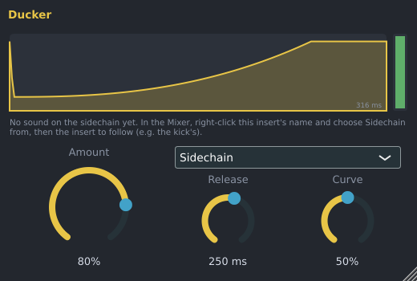

# Sidechain Ducker

The Sidechain Ducker turns a sound down for a moment each time another sound hits, then brings it
back: the "pumping" bass or pad under a kick in house and EDM, or a bass that makes room for the kick.
It is made by Spinus.

## Setting it up

1. Give the kick (or whatever should trigger the dip) and the sound to duck their own mixer inserts.
   New channels get one automatically.
2. In the [Mixer](mixer.md), click an empty slot on the **bass's** insert and choose **Sidechain
   Ducker** (or drag it there from **Effects › Spinus** in the Browser).
3. Right-click the bass insert's name and choose **Sidechain from › Kick** (the kick's insert).
4. Press **Space**. The bass dips on every kick.

The line under the curve in the Ducker's window says whether sound is arriving on the sidechain.

No kick to follow? Set **Trigger** to **Every beat** (or half beat, or 2 beats): the Ducker then dips in
time with the song while it plays, with no sidechain needed.

## Controls

| Control | What it does |
|---|---|
| **Amount** | How far the sound dips: 0% not at all, 100% to silence. This is the one to turn. |
| **Release** | How long the sound takes to come back up after a hit. |
| **Curve** | 0%: comes back evenly. Higher: stays down longer, then comes back quickly (a stronger pump). |
| Trigger | **Sidechain**: each hit on the sidechain input. **Every beat**, **Every half beat**, **Every 2 beats**: in time with the song. |

The curve at the top shows one dip: volume up, time to the right. The green bar on the right shows
the volume right now.

- The sound dips within 3 ms of a hit. Quiet hits (below -50 dB) and sounds that only get a little
  louder are ignored; a long, steady sound on the sidechain dips the sound once, not over and over.
- **Sidechain from** works for any effect with a sidechain input, such as the
  [Spinus Compressor](compressor.md) and [Spinus Gate](gate.md).
  Choose **None** to remove it. Spinus refuses a sidechain that would make a feedback loop (for
  example, from an insert that the ducked insert itself feeds).
- Every knob can be automated. The Ducker is also installed as a VST3 and LV2 plugin ("Spinus Ducker")
  for use in other programs; there, connect its sidechain input as that program does.
