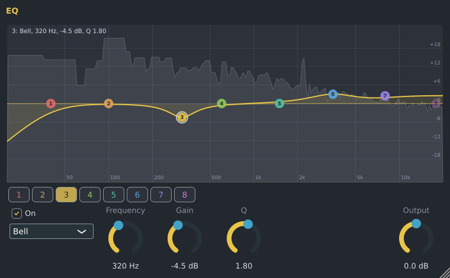

# Spinus EQ

The Spinus EQ makes some frequencies louder or quieter: less mud in a bass, more air on a vocal, a
rumble cut away below a guitar. It has eight bands and draws what it does over a picture of the sound.
It is made by Spinus, so it works without downloading anything.

## Adding it

In the [Mixer](mixer.md), click an empty slot on an insert and choose **Spinus EQ** (or drag it there from
**Effects › Spinus** in the [Browser](browser.md)). Click the slot again to open its window.

## Using the curve

The big picture shows frequencies from low (left, 20 Hz) to high (right, 20 kHz) and how much louder (up)
or quieter (down) each one becomes. The grey shape behind it is the sound coming out of the EQ while the
song plays, so you can see where the bass, the body and the hiss of a sound are.

Each band is a numbered, coloured point on the curve:

| To | Do this |
|---|---|
| Move a band | Drag its point: left and right change the frequency, up and down the boost or cut. A band that was off turns on. |
| Make a band wider or narrower | Turn the mouse wheel over its point (this is its **Q**: high Q is narrow, low Q is wide). |
| Turn a band on or off | Double-click its point. |
| Change what kind of band it is | Right-click its point and pick a type. |
| See a band's settings | Point at it: the top-left corner says, for example, "3: Bell, 320 Hz, -4.5 dB, Q 1.80". |

Below the picture, the buttons **1** to **8** choose a band; its **On** switch, **type**, **Frequency**,
**Gain** and **Q** knobs are next to them. **Output** turns the whole sound up or down at the end.

## Band types

| Type | What it does |
|---|---|
| **Bell** | Boosts or cuts around one frequency. The everyday band. |
| **Low shelf** | Boosts or cuts everything below its frequency (more or less bass). |
| **High shelf** | Boosts or cuts everything above its frequency (more or less treble, "air"). |
| **Low cut** | Removes everything below its frequency (rumble, mud). Also called a high-pass. |
| **High cut** | Removes everything above its frequency (hiss, harshness). Also called a low-pass. |
| **Notch** | Removes one narrow frequency completely (a hum, a ringing tone). |

The cuts have a **Slope**: 12, 24 or 48 dB per octave, from gentle to steep. Their **Q** sets a small bump
at the corner (0.71 has none).

A new Spinus EQ changes nothing: bands 2 to 7 are on but flat (0 dB), and the two cuts at the ends are off.

## Good to know

- Bands near the top of the range keep the shape you set. Many EQs squeeze a band at 12 kHz or above
  towards the highest frequency the song can hold; the Spinus EQ is designed to match the classic analog
  shapes there as well (within about 1.5 dB for bands up to 14 kHz, where the usual design is off by 5 dB
  and more).
- Changes glide over a few hundredths of a second, so moving a band while the song plays does not click.
- Every control can be automated.
- The [Automixer](automixer.md) adds a Spinus EQ when it suggests cuts.
- The Spinus EQ is also installed as a VST3 and LV2 plugin ("Spinus EQ") for use in other programs.
- The LSP **Parametric EQ** from [Get free plugins](free-plugins.md) is still there if you prefer it, and
  songs that use it open as before.
