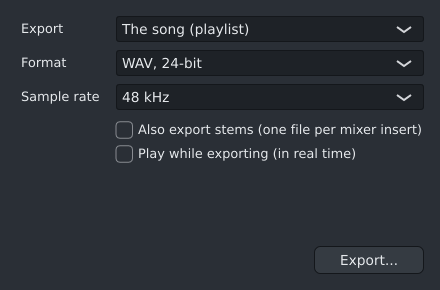

# Exporting audio (Ctrl+R)

**Ctrl+R** opens **Export audio**. Choose what to export and how, click **Export...**, and pick where to
save. You can keep working while it exports; the dialog shows progress, with **Cancel**.

| Setting | Choices |
|---|---|
| Export | **The song** (everything in the playlist, from the start to the end of the last clip), or **the current pattern** (once, as pattern mode plays it). |
| Format | **WAV 16-bit** (CD quality, with dither), **WAV 24-bit**, **WAV 32-bit float** (for further mixing), **FLAC** (lossless like WAV, about half the size), **MP3 320 or 192 kbit/s**, **Opus 160 kbit/s** (small files that sound very good), **AAC (M4A) 256 kbit/s** (for Apple devices and some video sites). |
| Sample rate | 44.1 kHz or 48 kHz. |
| Stems | Also export **one file per mixer insert**, for mixing elsewhere or sharing parts. |
| Play while exporting | Hear the song while it is exported (see below). |

- Two seconds are added at the end so reverbs and long notes can ring out.
- Stems go in a folder next to the main file: exporting `My song.wav` also writes
  `My song stems/01 Drums.wav`, `My song stems/02 Bass.wav` and so on, numbered like the mixer.
- A stem is the insert's own output, with its effects and fader: what that insert plays into the
  Master (or into a bus) during the song, without the master's effects and fader. Inserts with nothing
  playing into them get no stem.
- A reverb or delay insert that other inserts **send** to gets its wet sound in its stem; the inserts
  that send keep only their own (dry) sound in theirs. So the stems of the inserts that play into the
  Master add up to the mix before the Master's effects. An insert that plays into a bus is in its own
  stem and in the bus's too.
- A muted insert's stem is silent, and so is the stem of an insert that only plays into a muted one,
  since you don't hear it either. **Solo** is ignored for stems: with an insert soloed, the main file
  has only what you hear, and the stems still have the whole song (they then take a second pass).
- The stems are made in the same pass as the main file, so exporting with stems takes about as long
  as without.
- If the **Master is muted**, the main file is silent, as with FL Studio: it is what you hear. The
  stems are not affected, since they don't go through the Master.
- Frozen channels and inserts ([Freeze](freeze.md)) are exported from their plugins, so the result is exact.
- Sidechains keep working in stems: if a [Sidechain Ducker](ducker.md) on the bass follows the kick,
  the bass's stem still dips with every kick, but the kick itself is not in it.
- The export sounds the same as playback: instruments and effects keep their current settings.
- If you cancel, or something fails, no half-written files are left behind.
- **MP3** needs the `lame` package. If it is missing, the MP3 choices are greyed out; install it with
  `sudo pacman -S lame`.
- **AAC** needs the `ffmpeg` package in the same way (`sudo pacman -S ffmpeg`). FLAC and Opus need
  nothing extra.
- MP3, Opus and AAC files get the song's title and author.
- When it is done, **Show in folder** opens the folder in your file manager.

## Play while exporting

Tick **Play while exporting (in real time)** to hear the song as it is saved, the way it would sound
on a recording: Spinus plays it once from the start through your speakers, and what the Master puts out
is saved, with two seconds at the end for reverbs to ring out. It takes as long as the song.

- Changes you make while it plays (moving a fader, turning a knob) are in the file, like a live mix.
  Muting the Master silences the file too.
- It exports the song only, as one file, at your sound card's sample rate (see **Options ›
  Audio settings...**); stems and the sample rate choice are greyed out.
- The song loop and pattern mode are turned off while it plays and come back afterwards.
- **Cancel**, or stopping playback, stops the export; nothing is saved then.
- It needs a working sound card. If the computer is too busy to save the sound as fast as it plays,
  the export stops and says so: export without playing then.
