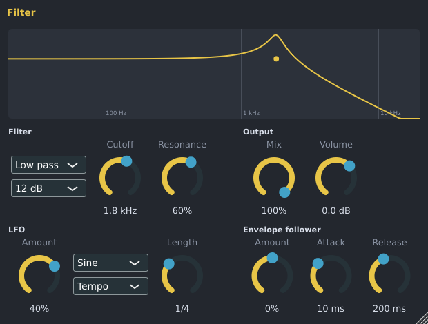

# Filter

The Filter removes part of a sound's frequencies and can sweep through them on its own: with an
**LFO** (a slow wave, in time with the song) or with an **envelope follower** (the sound's own
loudness). Use it for filter sweeps, wobbles, "telephone" sounds, or an auto-wah. It is made by Spinus.

Add it to a mixer insert from the [Browser](browser.md) (**Effects › Spinus › Filter**) or an empty
effect slot in the [Mixer](mixer.md), then double-click the effect to open its window.

The curve at the top shows what the filter does right now: frequencies where the line is high pass
through, where it is low they are cut. The dot is the cutoff; it moves when the LFO or the envelope
follower moves it.

## Filter

| Control | What it does |
|---|---|
| Type | **Low pass** keeps the lows (darker sound), **High pass** keeps the highs (thinner sound), **Band pass** keeps a band around the cutoff, **Notch** removes a narrow band. |
| Slope | **12 dB** is gentle, **24 dB** cuts harder. |
| **Cutoff** | Where the filter starts to cut. |
| **Resonance** | A peak at the cutoff. High values give the classic "squelchy" sweep; near 100% the filter rings. |

## Output

| Control | What it does |
|---|---|
| **Mix** | How much of the filtered sound you hear: 100% only filtered, 0% the original. |
| **Volume** | The level after the filter. |

## LFO

The LFO moves the cutoff up and down by itself.

| Control | What it does |
|---|---|
| **Amount** | How far it moves the cutoff: at 100%, four octaves up and down. Negative values move it the other way. 0% turns the LFO off. |
| Shape | **Sine** and **Triangle** sweep smoothly, **Ramp up** / **Ramp down** sweep one way and jump back, **Square** jumps between two cutoffs, **Random** jumps to a new random cutoff each cycle. |
| **Tempo** / **Free** | **Tempo**: the LFO follows the song. One sweep takes the **Length** (1/16 note to 4 bars) and lines up with the bars while the song plays. **Free**: one sweep takes 1 / **Rate** seconds, whatever the tempo. |

Bars are counted as four beats.

## Envelope follower

The envelope follower opens the filter when the sound gets louder (an auto-wah on guitar or a
"breathing" pad on drums).

| Control | What it does |
|---|---|
| **Amount** | How far a loud sound moves the cutoff: at 100%, up to four octaves up. Negative values close the filter instead. |
| **Attack** | How quickly it reacts when the sound gets louder. |
| **Release** | How quickly the cutoff falls back when the sound gets quieter. |

Every knob can be automated: right-click the Filter in the Mixer and choose **Create automation clip**
(see [Automation clips](playlist.md#automation-clips)). The Filter is also installed as a VST3 and LV2 plugin ("Spinus Filter")
for use in other programs.
