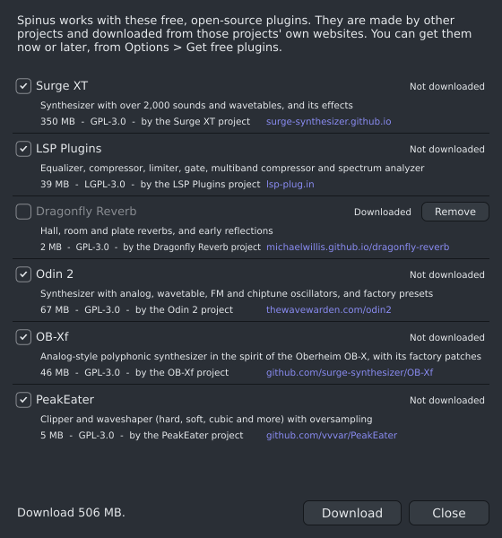
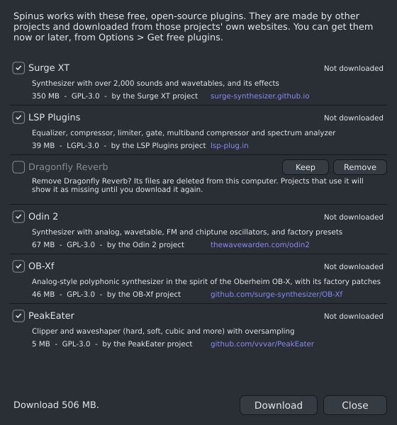

# Get free plugins

Spinus works with these free, open-source plugins made by other projects. The window lists only the
ones their projects publish for your system:

| Plugins | What they are | Linux | Windows | License |
|---|---|---|---|---|
| **Surge XT** (Surge Synth Team) | A big synthesizer with over 2,000 sounds and wavetables, plus Surge XT Effects | 350 MB | 302 MB | GPL-3.0 |
| **LSP Plugins** | Parametric EQ, compressor, limiter, gate, multiband compressor, spectrum analyzer | 39 MB | not published | LGPL-3.0 |
| **Dragonfly Reverb** | Hall, room and plate reverbs, and early reflections | 2 MB | 22 MB | GPL-3.0 |
| **Odin 2** (TheWaveWarden) | A synthesizer with analog-style, wavetable, FM and chiptune oscillators, with its factory presets | 67 MB | installer only | GPL-3.0 |
| **OB-Xf** (Surge Synth Team) | An analog-style polyphonic synthesizer in the spirit of the Oberheim OB-X, the successor of OB-Xd | 22 MB | 9 MB | GPL-3.0 |
| **PeakEater** | A clipper and waveshaper (hard, soft, cubic and more) with oversampling | 5 MB | 4 MB | GPL-3.0 |

In the [Browser](browser.md), Odin 2 and OB-Xf are with the instruments, PeakEater with the effects.

Every plugin here is open source, and so is the exact file Spinus downloads: the project's own build,
not a version that needs an account or that hides features. Plugins whose projects publish only an
installer program (like Odin 2 for Windows) are not offered, because Spinus never runs another
program's installer.

**OB-Xf's factory patches** (488 sounds) come with its download, and the Analyzer's
[Closest preset](analyzer.md) chooses from them. OB-Xf's own patch menu does not list them, though: OB-Xf
only looks in its own shared folder, outside the folder Spinus downloads into (the patches are in
`~/.local/share/Spinus DAW/plugins/ob-xf/Patches` on Linux). To browse them in OB-Xf's own window,
install OB-Xf with its own installer from its
[releases page](https://github.com/surge-synthesizer/OB-Xf/releases).

Spinus does not come with them. Instead it downloads each project's own release from its website when
you ask. Spinus works without them: you still have the [Sampler](sampler.md), the
[Drum Machine](drum-machine.md), [3x Osc](3x-osc.md), Spinus's own [EQ](eq.md), [Compressor](compressor.md),
[Limiter](limiter.md) and [Gate](gate.md), and any plugins you installed yourself. LSP Plugins is an
optional extra: its EQ and dynamics are there for those who prefer them, plus a multiband compressor and
a spectrum analyzer.

## Downloading them

The first time you start Spinus, the **Get free plugins** window opens. Later, open it from
**Options › Get free plugins...**, or double-click a greyed-out plugin in the [Browser](browser.md).

1. Tick the plugins you want (everything missing is ticked at first: untick what you don't need).
2. Click **Download**. The progress shows at the bottom; you can keep using Spinus meanwhile.
3. When a collection is done, its plugins are ready in the Browser at once. Projects that were waiting
   for them start playing them.

**Cancel** stops the download; closing the window does too. Nothing half-downloaded is kept.

Spinus checks every download against the exact file it expects. If a download is damaged or was
changed, it is not installed and the window says so: try again later.

## A project needs a plugin you have not downloaded

If you open a project that uses, say, Hall Reverb before Dragonfly Reverb is downloaded, the effect
shows as **Missing** in the [Mixer](mixer.md) and Spinus offers the download: this window opens with the
missing plugins ticked, and the bar at the bottom names them. Its settings are kept: once it is
downloaded, it sounds as before. Closed the window? It is always in **Options › Get free plugins...**.

A project made on Linux with Odin 2 or LSP Plugins opens on Windows with those devices shown as
missing, because their projects publish no Windows build Spinus can use. Their settings are kept, and
they play again when the project is opened on Linux.

## Already installed with pacman?

If you installed the plugins from the Arch repositories
(`sudo pacman -S surge-xt-clap lsp-plugins-clap dragonfly-reverb-clap`), the window shows them as
**Installed on this computer** and Spinus uses those. The same goes for any of these plugins you put in
a CLAP folder yourself (for example `Odin2.clap` in `/usr/lib/clap`, where Odin 2's own install script
puts it).

## Removing a plugin

To free the space a plugin takes, open **Options › Get free plugins...** and click **Remove** next to
it. Only plugins Spinus downloaded have this button: ones installed on your computer some other way
(for example with pacman) are left alone.

1. Click **Remove**. The row asks: "Remove Dragonfly Reverb? Its files are deleted from this computer.
   Projects that use it will show it as missing until you download it again."
2. Click **Remove** again to delete it, or **Keep** to change your mind.

Afterwards the row says **Not downloaded** and has its tick box again, so you can download it again
whenever you like. The Browser and the Analyzer's lists drop it at once.

**A plugin the open project uses is not removed.** If, say, two channels in your song play Surge XT,
the row says so ("Surge XT is used by 2 channels (Lead, Pad) in this project") and nothing is deleted.
Take the plugin out of those channels or mixer inserts first (or delete them), then click **Remove**
again. Spinus does this so a plugin that is playing never has its files pulled away from under it
(on Windows, a plugin in use can't be deleted at all). The same goes for a moment while the Analyzer is
trying a plugin's sounds: wait until it finishes.

If some files can't be deleted (another program is using them, or you aren't allowed to), the row says
which. When the plugin itself could not be deleted, it stays downloaded and working; when only some of
its sounds or other files were left behind, the row names them and the folder they are in, so you can
delete them yourself.

## Where they go

`~/.local/share/Spinus DAW/plugins` (on Windows, `%LOCALAPPDATA%\Spinus DAW\plugins`), one folder per
collection. **Remove** (above) deletes a collection's folder; deleting the folder yourself while Spinus
is closed does the same. Spinus offers it again in **Options › Get free plugins...**.
