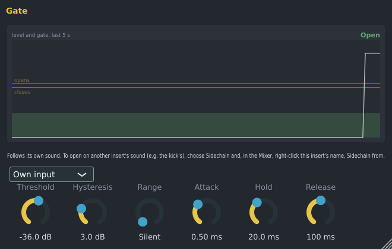

# Spinus Gate

A gate silences a sound when it is quiet and lets it through when it is loud: the hiss of a guitar amp
between phrases, the other drums bleeding into a tom microphone, the breathing between vocal lines.
It is made by Spinus, so it works without downloading anything.

## Adding it

In the [Mixer](mixer.md), click an empty slot on an insert and choose **Spinus Gate** (or drag it there
from **Effects › Spinus** in the [Browser](browser.md)).

## Controls

| Control | What it does |
|---|---|
| **Threshold** | The gate opens when the sound gets louder than this. Set it between the quiet noise and the sound you want. |
| **Hysteresis** | The gate closes only when the sound falls this much *below* the threshold. This stops it from flickering open and shut when the sound hovers around the threshold. |
| **Range** | How far it turns the sound down when closed. **Silent** cuts it off completely; -10 or -20 dB only turns the noise down, which often sounds more natural. |
| **Attack** | How fast it opens. Very short keeps the start of a drum hit; a few ms avoids clicks. |
| **Hold** | How long it stays open after the sound falls, so the end of a note is not cut. |
| **Release** | How fast it closes after the hold. |
| **Own input / Sidechain** | What it listens to (see below). |

The window shows the level of the sound over the last five seconds (the white line), the two thresholds
(**opens** and **closes**), how open the gate is (the green area) and whether it is **Open**, **Holding**
or **Closed** right now. While it turns the sound down, the Mixer shows the orange gain-reduction bar.

## Sidechain: opening on another sound

The gate can open whenever *another* insert is loud, instead of its own sound: for example a pad that
only plays while the hi-hat hits, for a rhythmic chopped effect.

1. Choose **Sidechain** in the gate's window (instead of **Own input**).
2. In the [Mixer](mixer.md), right-click this insert's name and choose **Sidechain from**, then the insert
   to follow.

With **Sidechain** chosen but nothing connected, the gate listens to its own sound.

## Good to know

- Every control can be automated.
- The Spinus Gate is also installed as a VST3 and LV2 plugin ("Spinus Gate") for use in other programs.
- The LSP **Gate** from [Get free plugins](free-plugins.md) is still there if you prefer it, and songs that
  use it open as before.
