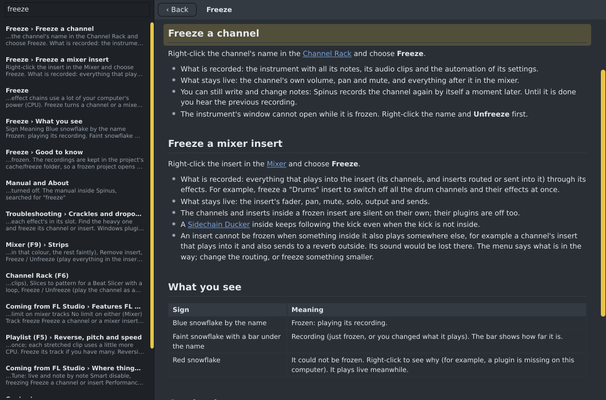

# Manual and About

The **Help** menu has this manual, a way to report a problem, Spinus's log files and the facts about Spinus. They all work with AI turned
off.

## The manual

**Help › Manual** (or **F1**) opens the manual in a window of its own, beside your song. It is the same
manual as on the web, installed with Spinus, so it works without an internet connection.

- **Pages:** the list on the left. **Contents** comes first; click a page to read it.
- **Links** to other pages open them inside the window; **‹ Back** returns to where you were. Links to
  websites open in your web browser.
- **Search:** type words in the box at the top left. Spinus looks through every page and lists the
  sections that have all the words, best first, with the words around them. A word also finds longer
  words that start with it: `autom` finds "automation" and "automixer". Click a result (or press
  **Enter** for the first one) to open its page at that section, which lights up for a moment. Clear the
  box (or press **Escape**) to see the pages again.

The search is plain text: it needs no AI and sends nothing anywhere. For questions in your own words, the
[assistant](assistant.md) reads the same pages.

## Report a problem

**Help › Report a problem...** helps you tell us about a crash, a hang or anything that doesn't work:

1. Spinus makes a **report file** (`spinus-report-<date>.zip`) with its logs of its last three runs (this
   one and the two before, so a crash is in it), its version and your system. The logs hold no keys,
   passwords, email addresses or user names (see [Log files](troubleshooting.md#log-files)).
2. It says where the file is. Click **Open the page**: GitHub's page for a new bug report opens in your
   web browser, with the version and system already filled in, and the file is shown in your file manager.
3. Describe what happened, drag the file into the **Report file** box, and click **Create**. You need a
   (free) GitHub account.

Spinus sends nothing itself: you see the file and the page, and decide. The files are kept in `reports`
beside the log folder (the newest five).

## Open log folder

**Help › Open log folder** opens the folder where Spinus keeps a log of each of its last 10 runs, in your file
manager. When something goes wrong, attach the log of that run to your bug report: see
[Log files](troubleshooting.md#log-files) for what is in them (no keys, no user name) and where the folder is.

## About Spinus

**Help › About Spinus** shows:

- Spinus's version, for example **0.1.0-alpha.2**. **Copy version info** copies the version, the kind of
  package (Flatpak, AppImage, Windows) and your system, ready to paste into a bug report.
- The license: Spinus is free software under the GNU Affero General Public License, version 3 or later
  (AGPL-3.0-or-later). The demo songs are under CC BY 4.0 (credit "Spinus DAW contributors").
- A link to Spinus on GitHub: [github.com/tuturu742/spinus-daw](https://github.com/tuturu742/spinus-daw).
- The projects Spinus is built with and their licenses, starting with JUCE and Tracktion Engine. The same
  list is the file `THIRD_PARTY.md`, in the package and on
  [GitHub](https://github.com/tuturu742/spinus-daw/blob/main/THIRD_PARTY.md).
