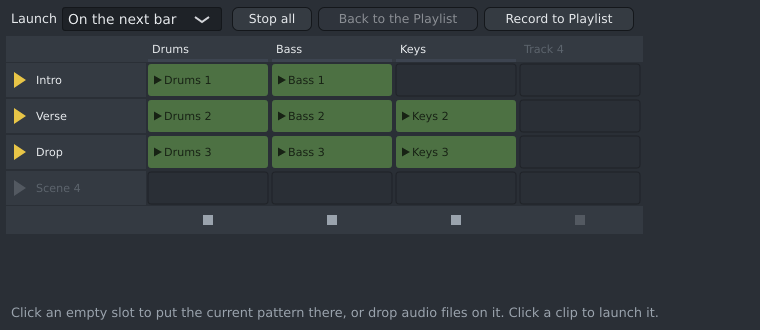

# The Launcher

The Launcher (**View › Launcher**) is a grid for playing parts live, the way Ableton Live's Session view
works: try which parts go together, jam, or play a live set. It works alongside the Playlist.

- **Columns** are launcher tracks, **rows** are scenes. Each slot holds one **pattern** or one **audio
  clip**.
- Launcher tracks are not tied to channels, just as Playlist tracks are not: a pattern plays on its own
  channels, an audio clip through its own channel (and their mixer inserts).

## Filling slots

- **Click an empty slot** to put the current pattern there (the one the Channel Rack shows).
- **Drop audio files** from the file manager onto a slot. Each file gets its own channel, as on the
  Playlist; several files go down the column, one per scene. A saved project keeps a copy in its
  `audio` folder.
- **Drag a clip** to another slot to move it. A clip dropped on a full slot replaces the clip there.
- **Clicking** a pattern clip launches it and also makes its pattern the current one (the top bar's
  pattern list shows it), to edit it in the Piano Roll or Channel Rack.
- **Right-click** a clip:
  - **Loop**: on by default. When it is off, the clip plays once and stops.
  - **Length**: the pattern's length (or the file's), or 1, 2, 4, 8 or 16 bars.
  - **Remove**: empties the slot.
- **Right-click** a track or scene name to rename or remove it.

The grid always shows a spare column and row; putting a clip there adds the track or scene. Every
change is one step in **Edit › Undo**.

## Playing

- **Click a clip** to launch it. It starts on the next bar, the next beat, or at once, as chosen in
  **Launch** at the top. It repeats until you stop it or launch another clip in the same column: a
  column plays one clip at a time.
- A clip waiting for its bar blinks. A playing clip shows a bar along its bottom: how far it is through
  its loop.
- **The triangle** beside a scene launches the whole row. A column with an empty slot in that row stops.
- **The square** under a column stops that column's clip (on the next bar or beat). **Stop all** stops
  every column.
- If Spinus is stopped, launching a clip starts playback. Stopping playback stops the launched clips.

### The Launcher and the Playlist

While a channel plays a launched clip, it does not play its Playlist clips. Other channels carry on
with the Playlist. **Back to the Playlist** stops the Launcher at once, and every channel plays the
Playlist again. The button lights up while it has something to do.

Exports play the Playlist only.

### Recording a jam into the Playlist

Click **Record to Playlist**, then play: launch clips as you like. When you stop playback (or click the
button again), Spinus writes what played into the Playlist, on a new track per launcher column named
"Launcher: <column>": a clip for each time round a loop, where it played in the song. It is one step in
**Edit › Undo**. Then **Back to the Playlist** plays your arrangement.

Recording uses song positions, so turning it on switches to song mode. Clear the Playlist's loop region
before recording: when the song position jumps back, clips can land in the wrong place.

### Keyboard

Click the Launcher first, then:

| Key | Does |
|---|---|
| Arrow keys | Choose a slot |
| Enter | Launch the chosen clip (or put the current pattern in an empty slot) |
| Ctrl+Enter | Launch the chosen slot's scene |
| Shift+Enter | Stop the chosen slot's column |
| Delete | Empty the chosen slot |

## Good to know

- Editing a pattern while its clip plays changes what you hear straight away, without stopping it.
- A frozen channel plays its frozen Playlist audio, so its launcher clips are silent until you unfreeze
  it. Launching one says so.
- Audio clips play at their own speed, as on the Playlist. A loop made at another tempo drifts against
  the beat.
