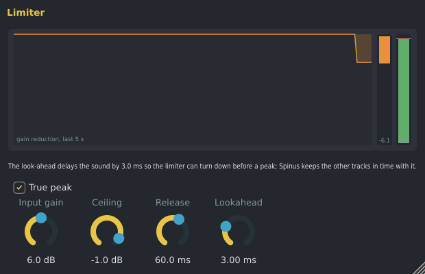

# Spinus Limiter

A limiter is a wall the sound cannot go over. On the master it lets you make a song louder without
it clipping (the harsh crackle when sound goes above 0 dB). It is made by Spinus, so it works without
downloading anything.

## Adding it

In the [Mixer](mixer.md), click an empty slot on the **Master** insert (usually the last effect there) and
choose **Spinus Limiter**, or drag it there from **Effects › Spinus** in the [Browser](browser.md).

## Controls

| Control | What it does |
|---|---|
| **Input gain** | Pushes the sound into the limiter: the more you add, the louder the song and the more the peaks are held back. Watch the orange reduction: a few dB is usually fine; 6 dB and more starts to flatten the music. |
| **Ceiling** | The highest the sound may go. -1 dB is a safe choice for streaming services. |
| **Release** | How fast the sound comes back after a peak. Short is louder but can sound gritty; longer is smoother. |
| **Lookahead** | How far ahead it looks, so it can turn down smoothly before a peak arrives instead of clipping it. 1 to 5 ms is typical. |
| **True peak** | Also catches the peaks that happen *between* the samples, which appear when the song is played back or turned into MP3 or AAC. Leave it on for a master. |

The window shows how far the limiter turned the sound down over the last five seconds, how far right now
(the orange bar), and the level coming out (green) against the ceiling (the red line).

## Good to know

- **The sound never goes above the ceiling.** With **True peak** on, not even between samples, as
  streaming services, the [Loudness Meter](loudness-meter.md) and other meters that follow the BS.1770
  standard measure it (ffmpeg's `ebur128` filter too). With a -1 dB ceiling the meter reads -1.0 dBTP or
  less.
- The Limiter delays the sound by the lookahead plus 30 samples (about 0.6 ms at 48 kHz), the part it
  needs to find the peaks between samples. Spinus knows and keeps every other track in time with it,
  so you hear nothing late. The lookahead cannot be automated, because changing it changes that delay.
- Every other control can be automated.
- The [Automixer](automixer.md) adds a Spinus Limiter to the master when you choose a loudness target.
- Put the [Loudness Meter](loudness-meter.md) after the limiter to see how loud the song is.
- The Spinus Limiter is also installed as a VST3 and LV2 plugin ("Spinus Limiter") for use in other
  programs.
- The LSP **Limiter** from [Get free plugins](free-plugins.md) is still there if you prefer it, and songs
  that use it open as before.
