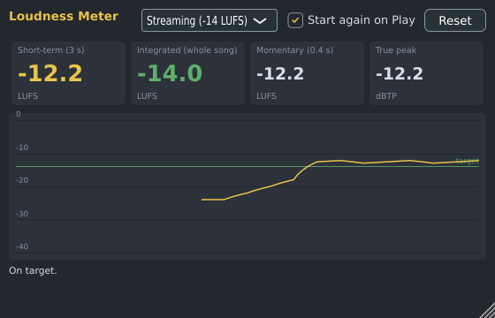

# Loudness Meter

The Loudness Meter tells you how loud your song is the way Spotify, YouTube, Apple Music and
broadcasters measure it (LUFS), and whether that is where it should be. It is made by Spinus. It doesn't
change the sound.

Put it **last on the Master** (in the [Mixer](mixer.md), click an empty slot of the Master and choose
**Spinus › Loudness Meter**, or drag it from the [Browser](browser.md)), open it with a double-click,
and play the song from the start to the end.

## The readings

| Reading | What it is |
|---|---|
| **Short-term** | The loudness of the last 3 seconds. Watch it to see the loud and quiet parts. |
| **Integrated** | The loudness of the whole song so far: the number services compare. Quiet moments (more than 10 dB below the rest) don't count, so a soft intro doesn't pull it down. |
| **Momentary** | The last 0.4 seconds: very jumpy, for single hits. |
| **True peak** | The highest point of the sound, including peaks between samples that can distort after conversion to MP3 or AAC. |

The graph shows the short-term loudness for the last minute, with the target as a green line. Under it,
the meter says in words how far the song is from the target and what to do.

Readings are green near the target (within 1 dB), yellow away from it; the true peak turns red above
the target's limit.

## Targets

| Target | Loudness | Highest true peak |
|---|---|---|
| **Streaming** (Spotify, YouTube, Tidal, Amazon) | -14 LUFS | -1 dBTP |
| **Apple Music** | -16 LUFS | -1 dBTP |
| **Broadcast, EBU R128** (TV, radio) | -23 LUFS | -1 dBTP |
| **Club or CD** | -9 LUFS | -0.3 dBTP |

Louder than the target isn't better on streaming: the services turn louder songs down to their level, so
a song squashed to sound loud ends up as loud as the others, only flatter. Quieter than the target plays
quieter than other songs (most services don't turn songs up, or only a little).

To get louder, put a Limiter on the Master before the meter and raise its input; to keep the true peak
safe, set the Limiter's ceiling (threshold) to -1 dB.

## Measuring again

With **Start again on Play** ticked (the default), each press of Play starts a new measurement from
where you play. **Reset** starts again at any time. To measure the whole song, play it from the start
to the end without stopping.

The Loudness Meter is also installed as a VST3 and LV2 plugin ("Spinus Loudness Meter") for use in
other programs. It follows ITU-R BS.1770-4 and EBU R128.
