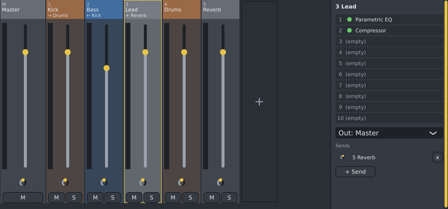
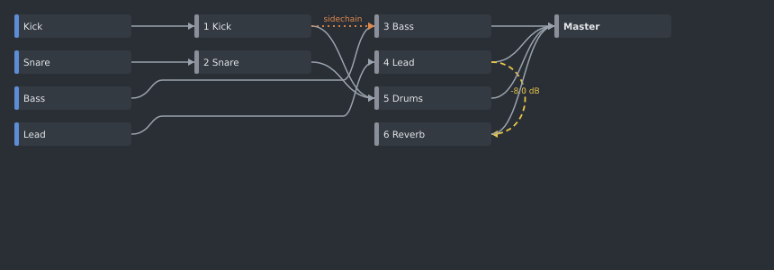

# Mixer (F9)

The Mixer is where your channels' sound is balanced, processed with effects and sent to the speakers.
Every channel plays into a **mixer insert**; inserts play into the **Master**, which you hear.

- A new channel gets its own insert automatically. A new project has only the Master.
- There is no fixed number of inserts: click the **+** strip at the end to add one.

## Strips

| Part | What it does |
|---|---|
| Number and name | Click the strip to select it. Double-click the name to rename it. Drag the name sideways to reorder inserts (the Master always stays first; routing is kept). |
| Routing line | Under the name, in yellow, when the insert does something besides playing into the Master: **← Kick** (its sidechain comes from Kick), **→ Drums** (it plays into Drums instead of the Master) or **+ Reverb** (it sends to Reverb). Point at the strip to see all of it. |
| Meter | Shows the insert's level while sound plays; red means louder than 0 dB. |
| Gain-reduction bar | An orange bar beside the meter, on inserts with a compressor, limiter, gate or [Ducker](ducker.md): it grows down from the top as they turn the sound down (the bottom is 24 dB). |
| CPU | The number at the top right (for example **4%**) is how much of the computer's time for each bit of sound the insert's effects take; shown from 1%, red from 25%. Use it to find the effect that makes playback crackle. |
| Fader | Volume. Drag it; double-click for 0 dB. |
| Knob | Pan. Double-click to centre. |
| **M** / **S** | Mute or solo the insert. **M** on the Master silences everything you hear, after the Master's effects (and the exported mix: see [Export](export.md)). |
| Right-click | Rename, **Colour** (the strip's top with its name is in that colour, the rest faintly), Remove insert, **Freeze** / **Unfreeze** (play everything in the insert as audio to save CPU, see [Freeze](freeze.md); a frozen insert shows a blue snowflake), **Sidechain from** (whose sound this insert's [Ducker](ducker.md), [Compressor](compressor.md) or [Gate](gate.md) follows; **None** removes it), **Notes from channel** (a channel whose notes the insert's effects receive, for example the melody [Spinus Tune](spinus-tune.md) pulls a vocal to; **None** stops it), **Remove unused inserts** (removes every insert with nothing playing into it and no effects). |

Removing an insert sends its channels to the Master instead.

## Effects, output and sends

The right side shows the **selected** insert. While sound plays, each effect's slot shows its CPU share and,
for compressors, limiters, gates and the Ducker, how far it is turning the sound down right now (for
example **-6.0 dB  3%**).

These are measured around each effect by comparing its sound going in and coming out, so they are close
but not exact. A compressor that compresses all the time, without a pause, slowly shows less than it
really does.

| Part | What it does |
|---|---|
| Automation | Right-click a strip's name for **Create automation clip: volume** or **pan**, or an effect for **Create automation clip** and one of its settings. See [Automation clips](playlist.md#automation-clips). |
| Effect slots | The insert's effects, applied from top to bottom. There is no limit: at least 10 slots are shown, and there is always an empty one after the last effect (scroll down when there are many). Click an empty slot to add an effect: Spinus's own [EQ](eq.md), [Compressor](compressor.md), [Limiter](limiter.md), [Gate](gate.md), [Filter](filter.md), [Sidechain Ducker](ducker.md), [Stereo Utility](stereo-utility.md), [Spinus Tune](spinus-tune.md) and [Loudness Meter](loudness-meter.md), the free open-source ones (LSP's Parametric EQ, Compressor, Limiter, Gate, Multiband Compressor and Spectrum Analyzer, the Hall, Room and Plate reverbs, Early Reflections, Surge XT Effects) or an installed plugin. You can also drag an effect from the [Browser](browser.md) onto a strip or a slot. |
| Double-click an effect | Opens the effect's window (its own controls). |
| Green light | Click to bypass the effect (it turns grey) or turn it back on. |
| Dragging a slot | Drag an effect onto another slot to change the order. |
| Right-click an effect | Open window, Bypass, Move up, Move down, Move to another insert, **Copy to insert** (the same effect with the same settings on another insert, also the ones you turned in its window), Remove. |
| **Out:** | Where the insert's sound goes: the Master or another insert (for example, all drums into a "Drums" insert). |
| **Sends** | Send some of the sound to another insert as well, typically a reverb insert. **+ Send** adds one; the knob sets how much; **x** removes it. |

- Spinus refuses routing that would feed an insert back into itself (a feedback loop) and says so below
  the sends. Sidechains count too: an insert that follows another through **Sidechain from** cannot
  send its own sound back into that insert.
- Effects can be added, moved and removed while the song plays.
- Every change can be undone with **Ctrl+Z**. One fader or knob drag is one undo step, and undoing the
  removal of an effect brings it back with its settings.
- Add installed plugins from the [Browser](browser.md) (**F8**): double-click one with an insert selected, or drag it onto a slot.

### Typing values

You can type a setting's value instead of turning its knob: click the number under a knob of a Spinus
effect or instrument, or double-click an automation point. Type it the way the control shows it:

| The control shows | You can type |
|---|---|
| `35%` (Ducker amount, resonance, mix) | `35%` or `35` |
| `250 ms` or `1.20 s` (attack, release) | `220 ms`, `220` (a plain number is milliseconds) or `1.5 s` |
| `1.20 kHz` or `250 Hz` (cutoff, frequency) | `1.2 kHz`, `1200 Hz` or `1200` (a plain number is hertz) |
| `-6.0 dB` (volume, gain, threshold) | `-6 dB` or `-6` |
| `4.0:1` (ratio) | `4:1` or `4` |
| `30% L` (pan) | `30% L`, `30 R`, `-30` (left) or `Centre` |
| `Low pass` (a choice) | its name, in any capitals: `high pass` |

A unit that does not fit the control (`50%` for a volume in dB) is not taken: the value stays as it was.

## The Routing panel

**View › Routing** shows where all the sound goes, on one page: your channels on the left, the mixer
inserts in the middle and the Master on the right. Inserts that play into another insert (a bus) sit
one column further left.

- A grey line: where a channel or insert plays into.
- A yellow dashed line: a send, with its level.
- An orange dotted line: a sidechain (whose sound a Ducker or compressor follows).

Point at a box to see only its connections. Click an insert to select it in the Mixer. The Routing
panel only shows: change outputs, sends and sidechains in the Mixer.
