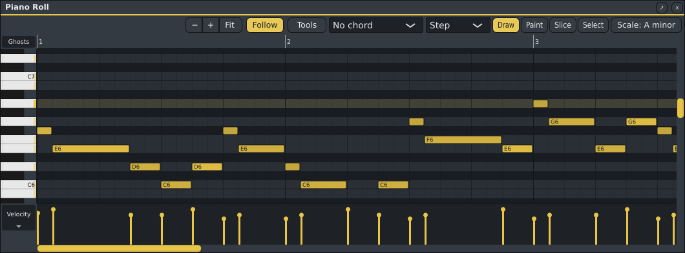
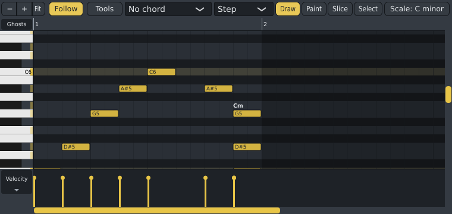
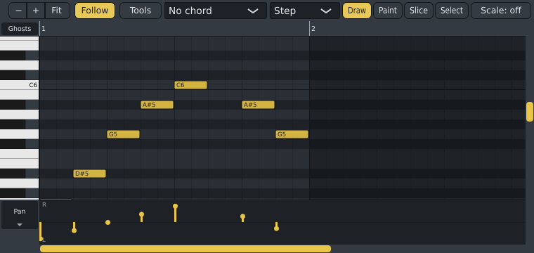

# Piano Roll (F7)

The Piano Roll edits the notes of the **selected channel** in the **current pattern**. Click a
channel's name in the Channel Rack to select it (it turns blue); a newly added channel is selected
automatically.

| Action | How |
|---|---|
| Add a note | Click an empty spot. Keep the mouse down and drag to place it. |
| Move a note | Drag it. |
| Change a note's length | Drag its right edge. |
| Delete notes | Right-click a note, or hold the right button and drag over several: every note it touches goes. |
| Select notes | **Ctrl**+drag a box around them (add **Shift** to keep what is already selected), or **Shift**+click notes one by one. **Ctrl+A** selects all, **Escape** or **Ctrl+D** none. Selected notes have a bright outline. |
| Move or resize several | Drag one of the selected notes: they all move together. Drag the right edge of a selected note: they all get longer or shorter by the same amount. A note that is not selected moves on its own. |
| Delete the selection | **Delete** (or **Backspace**). |
| Copy, cut, paste | **Ctrl+C** copies the selected notes (all of them when none is selected), **Ctrl+X** cuts them. **Ctrl+V** pastes them at the same times into the channel shown now: choose another channel in the Channel Rack (or another pattern) to copy a part to another instrument. Pasting where they came from puts them right after instead. The pasted notes are selected, ready to move. |
| Duplicate | **Ctrl+B** puts the selection (or all notes) again right after itself. |
| Move with the keys | **Shift+Up** / **Shift+Down** move the selected notes (or all notes) a semitone, **Ctrl+Up** / **Ctrl+Down** an octave, **Shift+Left** / **Shift+Right** a snap step (a sixteenth with no snap). Each press is one undo step. |
| Place freely (no grid) | Hold **Alt** while dragging. |
| Velocity, pan and more | Drag a bar in the lane at the bottom up or down (see below). Right-click a bar to reset it. |
| Loop part of the pattern | Hold the right mouse button and drag across the timeline above the notes: pattern mode then plays only that part, over and over. The part is shaded across the notes too. Right-click the timeline to loop the whole pattern again (choosing another pattern does too). |
| Scroll | Mouse wheel (up/down), **Shift**+wheel (left/right), or the scroll bars. |
| Zoom | The **−**, **+** and **Fit** buttons at the top (Fit shows the whole pattern), **Ctrl+=** and **Ctrl+-** or **Page Up** and **Page Down** (**Ctrl+0**: fit), or **Ctrl**+wheel, which zooms around the mouse. **Ctrl+Shift**+wheel makes the keys taller or shorter. |
| Follow the playing | **Follow** at the top: while the pattern plays, the view turns the page when the play position reaches its edge. On by default; Spinus remembers your choice. |

- Notes snap to the grid chosen beside the tools: **Step** (the default) follows the pattern's Channel
  Rack steps, sixteenths or, with **Triplet steps** on, sixteenth-note triplets. Or choose **Bar**,
  **Beat**, **1/8**, **1/16**, **1/32**, **1/8 triplet**, **1/16 triplet** or **None**. New notes take the
  length of the last note you drew or resized.
- The selection is only a view: it does not change the song, and it stays through undo.
- A pattern is as long as its notes, in whole bars of its time signature (at least one), as in FL Studio.
  The area after its end is shaded: placing, moving or painting a note there makes the pattern longer, to
  the end of that note's bar, and removing the notes from the last bars makes it shorter again (in the
  same undo step). A 3/4 pattern is three beats long, also on the Playlist.
- Note names follow FL Studio: middle C is **C5**.
- Every change is one undo step (**Ctrl+Z**).
- In pattern mode, press **Space** to hear the pattern; a line shows the playing position.

## Tools

The buttons at the top right choose what the left mouse button does on empty space (the actions in the
table above work with every tool):

| Tool | What it does |
|---|---|
| **Draw** (**P**) | Adds a note where you click (the default). |
| **Paint** (**B**) | Drag across the grid to lay notes one after another, each the length of the last note you drew; move up and down while dragging to change their pitch. |
| **Slice** (**C**) | Drag a line down across notes: each note it crosses is cut in two at the line (on the grid; **Alt** for anywhere). |
| **Select** (**E**) | Drag a box around notes to select them, without holding **Ctrl**. |

The keys in brackets pick a tool, as in FL Studio: in the Piano Roll when it is in front, otherwise in the
Playlist. Change them in **Options › Keyboard shortcuts...** (under Tools). While the typing keyboard is
on, these letters play notes instead.

A note you place, or pick up and drag, sounds on the channel while the mouse button is down, following its
pitch as you drag (not while recording is armed, so it isn't recorded).

Each paint stroke, cut or deletion is one undo step.

## Chords

- **Chord stamp**: choose a chord in the list beside the snap (**No chord** by default). A click then draws
  the whole chord on the note you click, and dragging moves it as one. **Chord in key** draws the key's own
  chord there, 3 or 4 notes (the song's key, or the scale chosen with the Scale button; C major without
  one); or choose a chord by name: Major, Minor, Diminished, Augmented, Suspended 2 and 4, Seventh, Major 7,
  Minor 7, Half-diminished, Diminished 7, Sixth, Minor 6, Add 9. It is one undo step.
- **Chord names**: notes that start together and make a chord are named above them, for example **Cm**,
  **G7** or **F/A** (an F chord with A in the bass).

## Note tools

**Tools** (at the top, beside the chord list) changes the selected notes, or all of them when none is
selected, as one undo step. Each tool has a key, shown in the menu (FL Studio's, where it has one):

| Tool | What it does |
|---|---|
| **Quantize** (**Alt+Q**) | Moves each note's start to the nearest snap line. |
| **Strum up** / **Strum down** (**Alt+S** / **Alt+Shift+S**) | Notes that start together (a chord) start one after another, a moment apart, from the lowest or the highest, like a strummed guitar. They still end together. |
| **Arpeggiate** (**Alt+A**) | A chord becomes its notes one after another, one per snap step, going up and starting again, for as long as the chord lasted. |
| **Chop** (**Ctrl+U**) | Cuts each note into repeats one snap step long (FL's note repeat): for rolls and stutters. |
| **Legato** (**Ctrl+L**) | Each note lasts until the next one starts. |
| **Humanize velocities** (**Alt+R**) | Makes each note a little louder or softer at random, so repeated notes sound less mechanical. |

**Slides:** with [3x Osc](3x-osc.md#slides-mono) set to **Mono (slides)**, a note that overlaps the next
one slides to it. Drag a note's end a little past the next note's start to make a slide.

## Ghost notes

The other channels' notes in the same pattern show faintly behind yours, each in its channel's colour,
so you can write a bass line against the kick or a harmony against the lead. Clicking on one adds a note
for the channel you are editing, as on empty space. **Double-click** a ghost note to edit its channel
instead: the Piano Roll switches to it (and the note the first click added goes again).

Click **Ghosts** in the top-left corner to choose whose notes show, or turn them all off. The choice
stays while Spinus is open; it does not change the song.

## Scale highlighting

The **Scale** button at the top right shows the notes of a key: rows of notes outside the scale are
darker, the key's root note (e.g. every C in C minor) is tinted, and the keyboard on the left has a
stripe on the scale's notes.

- **The song's key** (the default) follows the **Key** button in the top bar. With no key set, nothing is
  highlighted.
- Choose a note and a scale (major, minor, dorian, blues, ...) to see another key, for example to try a
  change of key or to write over a chord that is not in the song's key.
- **Off** shows plain rows.

It only changes what you see: notes can still go anywhere, and the song's key stays as it is.

## Generate

Let the AI write notes for you, or change them. Click **Generate** at the top right of the Piano Roll
(it is there only while AI is turned on in Options › AI...):

1. Say what it should play: "a funky bass line for these drums", "a sad piano chord progression, 4
   bars", "a trap hi-hat pattern with rolls". To change notes instead: "more syncopated", "simplify",
   "add a fill in bar 4", "make it bounce".
2. Tick the channels to write for (the one you are editing is ticked). It hears the other channels'
   notes in the pattern and fits with them; for a Drum Machine it uses its pads by name.
3. Choose how many **Bars** to write (the pattern's length at first; pick 1, 2, 4, 8 or 16, or type any
   number up to 64), **1 variation** or **4 variations**, and some **Swing** or **Humanize** if you like.
   If you ask for more bars than the pattern has, accepting the suggestion makes the pattern that long.
4. Click **Write** for new notes, or **Change their notes** to change the ticked channels' notes.

The notes come back as a [suggestion](#suggestions), in the song's key (when it has one) and on the
grid: **Accept**, **Discard**, **Regenerate** for another try, or **<** **>** through the variations.

It uses an AI connection from Options › AI...: the assistant's model, or another one chosen with **Use for
patterns** there. Better models write better music; a request costs about as much as a short
question to the assistant. Long parts take longer to write and cost more (8 bars with 4 variations take
about a minute).

## Record an idea

Sing, hum or beatbox an idea and get it as notes. Click **Record idea** at the top right of the Piano
Roll (there only while AI is turned on):

| Choice | What happens |
|---|---|
| **Sing or hum a melody** | The pattern plays once with the metronome to count you in (the bar at the top counts the beats), then plays again while you sing or hum over it. The notes come back for the channel you are editing, on the grid and, if the song has a key (the **Key** button in the top bar), in its key. |
| **Beatbox a beat** | The same, beatboxing: kicks, snares and hi-hats become notes on a Drum Machine's pads (C5 kick, C#5 snare, D#5 closed hi-hat). Select a Drum Machine channel first. |
| **Teach Spinus your beatbox sounds** | Once: make your kick sound 4 or 5 times, then your snare, then your hi-hat, a few seconds each, as the bar asks. Spinus then tells your sounds apart much better. You can teach them again any time. |

The notes arrive as a [suggestion](#suggestions): **Accept** or **Discard**. Your voice is listened to on
your computer by Spinus's AI service; nothing is sent anywhere. It needs:

- AI turned on (Options › AI...) and the `python-numpy` package.
- An audio input: a microphone, chosen in [Audio settings](audio-settings.md).
- A pattern as long as your idea: for a longer idea, first place a note in its last bar (the pattern
  grows to it).

**Discard** in the bar stops a recording. Takes are not kept.

## Suggestions

Features that write notes for you (the pattern generator, and humming or beatboxing an idea) never
change your pattern by themselves. Their notes show as **blue notes with a dashed outline** over your
own, which are dimmed meanwhile, with a bar at the top of the Piano Roll:

| Button | What it does |
|---|---|
| **Listen** | Plays the blue notes instead of yours, so you can hear the suggestion before deciding. If nothing is playing, it starts the pattern. Click again to hear your own notes; **Accept** and **Discard** end it too. Nothing in your pattern changes. |
| **Accept** | Writes the blue notes into the pattern, replacing that channel's notes there. One undo step: **Ctrl+Z** takes it back. |
| **Discard** | Hides the suggestion. Your notes stay as they were. |
| **Regenerate** | Asks for another suggestion (when the feature can make one). |
| **<** and **>** | Steps through the variations, when several were made at once. While listening, you hear each one as you step. |

If a suggestion also changes other channels, the bar names them; select one in the Channel Rack to see
its suggested notes. Accept writes all of them together.

## The lane under the notes

The lane at the bottom shows one bar per note. Click the name in its left corner (**Velocity** at first)
to choose what the bars show and change:

| Choice | What it does | Range |
|---|---|---|
| **Velocity** | How hard the note is played. | 0 to full (up) |
| **Release** | How fast the note is let go. Only some instruments use it. | 0 to full (up) |
| **Pan** | The note's position: up is right (**R**), down is left (**L**), the middle line is centre. | left to right |
| **Fine pitch** | Tunes the note up or down by up to a semitone (100 cents), for slides and detuned layers. | -100 to +100 cents |
| **Volume** | The note's level, without changing how hard it is played. | silent to full (up) |

- Drag a bar to change one note. Each change is one undo step.
- Right-click a bar to put it back to its starting value (velocity 78%, release 50%, pan centre, fine
  pitch 0, volume full).
- **Velocity** changes whatever the instrument makes it change: usually loudness, sometimes
  brightness. Surge XT's starting sound ignores it. To make Surge XT louder for higher bars, open its
  window and, in the **Amp EG** section, drag the **Vel** slider down (for example to -24 dB).
- **Pan, fine pitch and volume** work with Spinus's instruments (3x Osc, Sampler, Drum Machine) and
  with CLAP plugins that support per-note changes, such as Surge XT. Other plugins (VST3, LV2) play the
  notes without them; the lane says so when the selected channel has such a plugin.

## Playing with the computer keyboard

No MIDI keyboard? Press **Ctrl+T** (or click **⌨** in the top bar, or **Options › Typing keyboard to
piano**). The computer keyboard then plays the **selected channel**, like a piano with two rows:

| Keys | Notes |
|---|---|
| **Z X C V B N M** (white keys) with **S D G H J** (black keys) | C5 to B5 (as the Piano Roll names them) |
| **Q W E R T Y U** (white keys) with **2 3 5 6 7** (black keys) | C6 to B6 |
| **-** and **=** | An octave down or up (the hint bar shows where you are) |

While it is on, these keys play notes instead of their shortcuts: **R** and **L** play notes, so use the
**●** and **PAT / SONG** buttons instead. Shortcuts with **Ctrl** work as usual, and typing in a text
box (the tempo, a name) types as usual. Press **Ctrl+T** again to turn it off.

It records like a MIDI keyboard: arm recording with **●**, press **Space** and play.

## Recording from a MIDI keyboard

Plug in a MIDI keyboard (USB keyboards work without setup), or [use the computer
keyboard](#playing-with-the-computer-keyboard). It plays the **selected channel**: the one you last added, or
the one you clicked in the Channel Rack.

1. Select the channel to record.
2. Press **R** (or click **●** in the top bar). The button turns red. Recording records into the current
   pattern, so Spinus switches to pattern mode if needed.
3. Press **Space** and play. The pattern loops, so you can add more on each pass.
4. Press **Space** to stop. The notes appear in the pattern; the hint bar says how many.

- Recorded notes are added to the notes already there.
- **Ctrl+Z** removes everything from one recording at once.
- The start of each note snaps to the nearest sixteenth. Turn this off with **Options › Quantize recorded
  notes** to keep your exact timing.
- Press **R** again to stop recording without stopping playback.
- The notes you play are heard straight away, but they join the pattern's playback when you stop
  recording.

### MPE controllers

Expressive controllers that use MPE (ROLI Seaboard and Lumi, LinnStrument, Expressive E Osmose, Sensel
Morph and others) send each finger on its own MIDI channel, with how it bends, presses and slides. Turn
on the controller's MPE mode (with a pitch bend range of 48 semitones, the MPE default) and play the
selected channel:

| Instrument | Bend (glide) | Press (pressure) | Slide up/down (timbre) |
|---|---|---|---|
| [3x Osc](3x-osc.md) | Bends that note only | Swells it, up to twice as loud | Opens or closes the filter (when the filter is on) |
| [Surge XT](surge-xt.md) | Bends that note only | As **Poly AT** | As **Timbre** |
| Other CLAP plugins | As each note's tuning | As each note's pressure | As each note's brightness |
| VST3 and LV2 plugins | If the plugin has an MPE mode: turn it on in the plugin | | |

Recording keeps the notes and how hard each was struck; the bends, pressure and slides are heard while
you play but not recorded yet.
