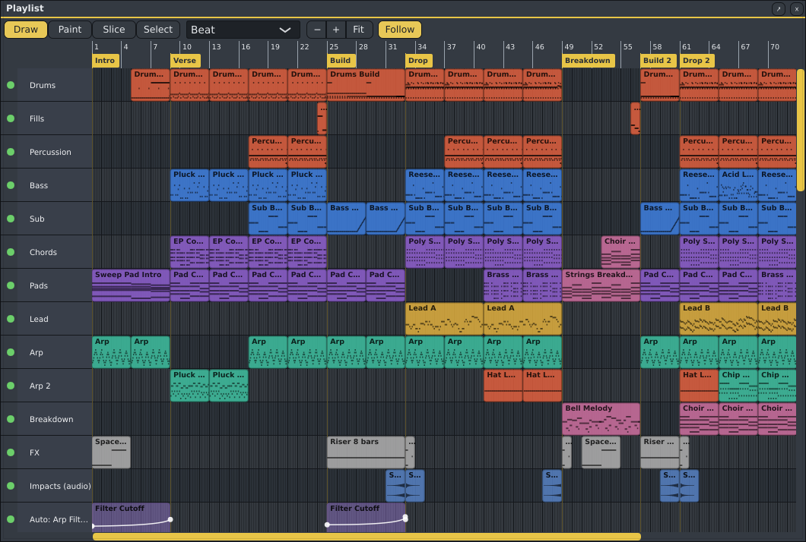

# Playlist (F5)

The Playlist is your song: patterns placed on tracks. As in FL Studio, tracks are not tied to channels;
any pattern can go on any track. Switch to **song mode** (the PAT/SONG button, or **L**) to play it.

| Action | How |
|---|---|
| Place the current pattern | Click an empty spot. Keep the mouse down and drag to place it. |
| Switch to a clip's pattern | Click a pattern clip (with any tool): its pattern becomes the current pattern, as in FL Studio. The pattern list in the top bar, the Channel Rack and the Piano Roll show it, and clicking an empty spot places it. The click still does what the tool does (move, resize, slice, select). In pattern mode, the new current pattern is what plays. Clicking an audio or automation clip leaves the current pattern as it is. |
| Move a clip | Drag it, also onto another track. |
| Change a clip's length | Drag its right edge. A shorter clip plays only the start of the pattern. |
| Delete clips | Right-click a clip, or hold the right button and drag over several: every clip it touches goes. |
| Make a clip unique | **Shift**+right-click a pattern clip › **Make unique**: the clip gets a copy of its pattern of its own ("Verse 2"), so you can change it without changing the pattern's other clips. The copy becomes the current pattern. |
| Select clips | **Ctrl**+drag a box around them (add **Shift** to keep what is already selected), or **Shift**+click clips one by one. **Ctrl+A** selects all, **Escape** or **Ctrl+D** none. Selected clips have a white outline. |
| Move or resize several | Drag one of the selected clips: they all move together, also across tracks. Drag the right edge of a selected clip: they all get longer or shorter by the same amount. A clip that is not selected moves on its own. |
| Delete the selection | **Delete** (or **Backspace**). |
| Copy, cut, paste | **Ctrl+C** copies the selected clips (pattern, audio and automation clips, with their settings), **Ctrl+X** cuts them. **Ctrl+V** puts them back where they were copied from, or right after them when they are still there. The pasted clips are selected, ready to move. |
| Duplicate | **Ctrl+B** puts the selection again right after itself (rounded up to whole bars). A pattern clip's copy plays the same pattern. |
| Move with the keys | **Shift+Left** / **Shift+Right** move the selected clips a grid step, **Shift+Up** / **Shift+Down** a track up or down. Each press is one undo step. |
| Open a clip | Double-click it: an audio clip opens in [Spinus Tune](spinus-tune.md); an automation clip opens in the [Automation editor](#the-automation-editor). |
| Mute a track | Click the light next to its name. |
| Rename, colour or delete a track | Right-click its name. The track's name is drawn on its colour, and the track itself is faintly tinted with it. Deleting a track also removes its clips. |
| Group tracks | Right-click a track › **Group with the track above** (see [Track groups](#track-groups)). |
| Choose a take | **Alt+click** an audio clip that has other takes at the same time: it plays, they are muted there (see [Takes and comping](audio-tracks.md#takes-and-comping)). |
| Move the song position | Click or drag in the ruler (song mode). |
| Markers | **Double-click** the ruler to put a marker there ("Marker 1"): a named point to see the song's parts. **Click** a marker to jump to it, **drag** it to move it, **right-click** it to rename or remove it. Its line shows faintly across the tracks. |
| Loop part of the song | Hold the right mouse button and drag across the ruler: song mode then plays that part over and over (it starts there if the position is outside it). The part is shaded across the tracks too. Right-click the ruler to stop looping. |
| Grid | The list next to the tools: bar, beat (the default), 1/2 or 1/4 beat, triplets, or no grid. Hold **Alt** while dragging to place freely. |
| Scroll | Mouse wheel, **Shift**+wheel sideways, or the scroll bars. |
| Zoom | The **−**, **+** and **Fit** buttons next to the grid list (Fit shows the whole song), **Ctrl+=** and **Ctrl+-** or **Page Up** and **Page Down** (**Ctrl+0**: fit), or **Ctrl**+wheel, which zooms around the mouse. **Ctrl+Shift**+wheel makes the tracks taller or shorter. |
| Follow the song | **Follow** next to the zoom buttons: while the song plays, the view turns the page when the song position reaches its edge. On by default; Spinus remembers your choice. |

**Tools** (the buttons at the top, as in the Piano Roll; the keys in brackets pick one when the Playlist is in front):

| Tool | What it does |
|---|---|
| **Draw** (**P**) | Places the current pattern where you click, and moves and resizes clips (the default). |
| **Paint** (**B**) | Drag along a track: the current pattern is placed again and again, one after another, as far as you drag. |
| **Slice** (**C**) | Drag a line down across clips: each clip it crosses is cut in two there (on the grid; **Alt** for anywhere). The second part plays on from the cut. |
| **Select** (**E**) | Drag a box around clips to select them, without holding **Ctrl**. |

- Each clip shows its pattern's name and a small picture of its notes.
- A clip is as long as its pattern (a 3/4 pattern makes a three-beat clip). When the pattern gets longer
  or shorter, its clips follow, except clips whose length you changed by hand.
- Empty tracks below the last one are created the first time you place something on them.
- Every change is one undo step (**Ctrl+Z**), however many clips it touches.

## Track groups

Put tracks that belong together (the drums, the synths) in a group, as in FL Studio:

- Right-click a track › **Group with the track above**: it goes under that track, indented. Do the same
  for the next track and it joins the same group. Groups can hold groups.
- Click the arrow next to a group's name to **fold** it: the tracks in it are hidden, and their clips show
  faintly on the group's row, so you can still see the song. The name says how many tracks are hidden.
  Click again to unfold.
- **Muting** a group mutes everything in it (their lights turn grey).
- **Ungroup** (right-click a grouped track) takes a track out of its group. Deleting a group's track
  keeps the tracks that were in it.

## Audio clips

Drag audio files (WAV, AIFF, FLAC, Ogg, MP3, Opus, and with ffmpeg installed (`sudo pacman -S ffmpeg`)
also M4A/AAC, WebM, WMA and more) from your file manager onto the Playlist. Each becomes an **audio clip**
where you dropped it, showing its waveform; several files go on tracks one below the other.

- Compressed files (everything but WAV, AIFF and FLAC) are turned into a FLAC file first, which takes a
  second or two for a song. The FLAC is the same sound and is what the project keeps; it is larger than
  an MP3, but plays reliably.
- Each audio clip plays through an **audio track** named after the file, with its own mixer insert. The
  [Audio tracks](audio-tracks.md) panel (**Shift+F6**) lists them, apart from the Channel Rack's
  instruments: use a track's volume and pan there, and its insert's effects in the Mixer.
  Double-click the clip to select its channel and open it in [Spinus Tune](spinus-tune.md#editing-a-vocal-note-by-note)
  (to fix a vocal note by note).
- Move, resize, mute and delete audio clips like pattern clips. Making a clip shorter plays only the start
  of the file.
- Audio plays at its own speed: changing the song's tempo does not stretch it (set its speed instead, below).
- Audio clips play in song mode only.

### Reverse, pitch and speed

**Shift**+right-click an audio clip (a plain right-click deletes clips):

| Item | What it does |
|---|---|
| **Reverse** | Plays the clip backwards (for reverse cymbals and risers). The waveform turns round too. |
| **Pitch** | Up or down by up to an octave, keeping its length. |
| **Speed** | Half speed to double speed, keeping its pitch. The clip grows or shrinks so the same audio still fits. |
| **Pitch and speed** | **Apart (stretch)**, the default: pitch and speed change separately. **For drums and hits**: the same, keeping drum hits sharp. **Together, like a record (resample)**: faster is higher and higher is faster, as on a turntable. **Off**: as recorded. |

**Alt+drag the end** of an audio clip to stretch it to any length: it plays faster or slower to fill it,
at the same pitch (from a quarter to four times as fast). The clip's name shows what is changed, for
example **Vocal +5 ×1.5** or **◀** when reversed. Each change is one undo step.

- Stretching runs as the song plays, so it is heard at once; each stretched clip uses a little more
  CPU. [Freeze](freeze.md) its track if you have many.
- Reversing makes a reversed copy first: a long clip may be silent for a moment after you reverse it.
- Exports sound the same.

**Your audio stays with the project.** In a saved project, a dropped file is copied into the project's
`audio` folder at once. In a project you have not saved yet, the file is used where it is and copied when
you first save. If a file is missing (for example, deleted outside Spinus), its clip turns red and says
"Missing".

## Automation clips

An **automation clip** changes a setting over time: a fade-in, a filter sweep, a volume dip before the drop.

**Make one:** right-click

- a mixer strip's name, and choose **Create automation clip: volume** or **pan**;
- a channel's name in the Channel Rack, for the channel's **volume**, **pan**, or any **instrument** setting;
- an effect in the Mixer's slots, and choose **Create automation clip** and the setting.

**The easy way, for a plugin's knob** (FL's "last tweaked"): open the plugin's window, move the knob you
want to automate, then choose **Edit › Automate the last moved control**. The menu item names the knob
and the plugin, so you can check it is the right one. In the right-click menus above, the knob you moved
last is also listed first, as **Last moved: ...**.

In those menus every setting shows its current value next to its name, for example **Cutoff (1.20
kHz)**, which helps to tell the plugin's settings apart.

The clip appears on a new Playlist track named after the setting, four bars long, as a flat line at the
setting's current value. The **Automation editor** opens to show it. A flat line changes nothing yet:
shape it first.

### The Automation editor

Double-click an automation clip on the Playlist to edit it in the **Automation editor** (also in
**View › Automation editor**). It shows the clip large, with the bars and beats of the song above and the
setting's real values at the left (for example dB for a volume). Hold the mouse over the curve to see
the time and value there.

| Action | How |
|---|---|
| Add a point | Click an empty spot. Keep the button down and drag to place it. |
| Move points | Drag a point (with every selected point, when it is selected). Press **Shift** while dragging to move it ten times more finely. |
| Bend the curve | Each part between two points has a small diamond in its middle: drag it up or down to curve that part. Double-click the diamond to make it straight again. |
| Type an exact value | Double-click a point and type the value in the units the control shows (for example `-6 dB` for a volume, `35%` for a Ducker's amount, `220 ms` for a release, `1.2 kHz` for a cutoff, or the name of a choice such as `High pass`) and its position as bar.beat.tick (for example `2.3.000`). See [Typing values](mixer.md#typing-values). |
| Delete points | Right-click a point, or hold the right button and drag over several. |
| Select points | **Ctrl**+drag a box around them (add **Shift** to keep the ones already selected), or **Shift**+click. **Ctrl+A** selects all, **Escape** none, **Delete** removes them. |
| Nudge the selection | **Up**/**Down**: 1% (with **Shift**: 0.1%). **Left**/**Right**: one grid step (with **Alt**: the smallest step). |
| Grid | The list next to the tools: bar, beat, down to 1/8 beat, triplets, or no grid. Hold **Alt** to place a point off the grid. |
| Scroll and zoom | Mouse wheel scrolls; **Ctrl**+wheel zooms around the mouse. The **−**, **+** and **Fit** buttons (Fit shows the whole clip), **Ctrl+=**, **Ctrl+-** and **Ctrl+0** zoom too. |
| Follow the song | **Follow**: while the song plays through the clip, the view turns the page to keep the position in sight. |

**Tools:**

| Tool | What it does |
|---|---|
| **Draw** | Adds and moves points (the default). |
| **Line** | Drag from one place to another: a straight ramp between them. The points in between are replaced. |
| **Paint** | Drag to draw the curve freehand, one point per grid step. |
| **Select** | Drag a box around points to select them, without holding **Ctrl**. |

**Shapes** writes a ramp up or down, or a sine, triangle, square or saw wave (every 2 bars down to every
1/4 beat). With two or more points selected, it fills the time between the first and the last selected
point, between their lowest and highest values; otherwise it fills the whole clip from 0 to 100%.

**On the Playlist itself** you can still drag a clip's points up, down and sideways (hold **Alt** to place
off the grid) and right-click a point to remove it. Move, resize and delete the clip as other clips
(right-click away from the points deletes it).

- Automation plays in song mode. In pattern mode the settings stay where you left them.
- While automation plays, the Mixer's faders and knobs and the Channel Rack's knobs move with it. In
  pattern mode, or without automation, they show their own setting again.
- Several clips for the same setting can sit one after another; between them the setting holds the last
  clip's final value.
- Every edit is one undo step.
