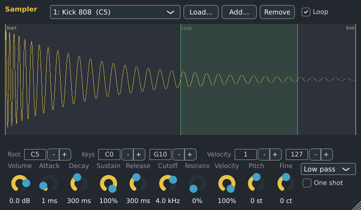

# Sampler

The Sampler plays audio files: a drum hit, a vocal chop, a loop, or a whole multi-sampled instrument.
It is made by Spinus.

## Getting a sample into Spinus

- **Drag audio files from your file manager onto the Channel Rack.** Each file becomes a new channel
  with a Sampler playing it, named after the file (like FL Studio).
- Or add a Sampler from the [Browser](browser.md) (**Instruments › Spinus › Sampler**) or from the Channel
  Rack's **+ Add channel** menu, then open its window (double-click the channel's name) and drop files on
  it, or click **Load...**.

Spinus reads WAV, AIFF, FLAC, Ogg Vorbis and MP3 files up to 10 minutes long. The sample is saved inside
the project, so the project still sounds the same if you move it, share it or delete the original file.

## Samples and zones

Each sample is a **zone**. The list at the top picks the zone you are editing.

| Control | What it does |
|---|---|
| **Load...** | Replaces all samples with the files you choose (dropping files on the window does the same). |
| **Add...** | Adds more samples. |
| **Remove** | Removes the selected sample. |
| Waveform | Drag the yellow **Start** and **End** lines to play only part of the sample. |
| **Loop** | Repeats the green part while the key is held. Drag the green lines to set the loop. |
| **Root** | The note at which the sample plays at its own pitch. Other notes play it higher or lower. |
| **Keys** | The lowest and highest key the sample answers. |
| **Velocity** | The softest and hardest notes it answers, so soft and hard hits can use different samples. |

**Several files at once:** if their names contain notes (for example `Piano_C4.wav`, `Piano_C6.wav`),
each one plays around its own note. Otherwise they take turns (round-robin), which makes repeated drum
hits sound less mechanical. Note names follow FL Studio: middle C is **C5**.

## Knobs

| Knob | What it does |
|---|---|
| **Volume** | Overall level. |
| **Attack, Decay, Sustain, Release** | The volume envelope of each note. |
| **Filter** | Off, low pass, high pass or band pass, with **Cutoff** and **Resonance**. |
| **Velocity** | How much softer notes are quieter. At 0%, every note plays at full level. |
| **Pitch**, **Fine** | Tune in semitones and cents. |
| **One shot** | Each note plays its whole sample, however short the note (good for drums). |

Every knob can be automated. Up to 32 notes play at once.

## In other programs

The Sampler is also built as a **VST3** and **LV2** plugin called "Spinus Sampler", for use in other
music programs.
