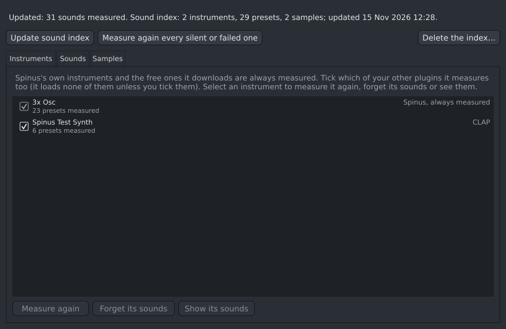

# The sound index

To choose sounds for you (the [Track creator](track-creator.md)'s parts, the assistant and coding agents
looking for "a warm pad"), Spinus first gets to know the sounds you have: it plays each preset of your
instruments and each of your samples once, in the background, and notes how it sounds. That list is the
**sound index**. Open it with **Options › Sound index...**.

At the top: how big the index is, when it was updated and how many problems it has, with **Update sound
index**, **Stop**, **Measure again every silent or failed one** and **Delete the index...**. Below, three tabs.

## Instruments

Every instrument Spinus could measure, each with a tick box and what was measured:

- **Spinus's own and the downloaded ones** (3x Osc, the Drum Machine, Surge XT, Odin 2, OB-Xf, Six Sines) are
  always measured.
- **Your other instrument plugins** (CLAP, VST3, LV2, VST2, and Windows plugins added through Spinus) are
  measured only when you tick them. This keeps the first update quick, and Spinus loads none of your own
  plugins unless you ask.
- Under each name: how many presets were measured, and what went wrong: "Did not load", presets that crashed
  or froze it, presets that were silent. An instrument you uninstalled stays listed until the next update.

Select an instrument (or right-click it) for:

- **Measure again**: Spinus forgets what it heard from it and measures all its presets anew, at once (one of
  your plugins is ticked for it).
- **Forget its sounds**: its sounds leave the index and it is unticked.
- **Show its sounds**: the Sounds tab, searched for it.

## Sounds

Everything Spinus measured, with its guess and a few details ("attack 5 ms, sustained, brightness 820 Hz,
C1-C7, chords"), and a search box: type "bass", "pad", "Surge" or "kick sample" to check its guesses. When a
name says one thing and the sound another, both are shown ("sounds like pad"). Search `problem` to see every
problem the index counts: which instrument and preset, and what went wrong ("the instrument crashed on this
preset, so it is left out").

Right-click a preset to give it a role of your own ("Use as rhythm guitar"): Spinus uses yours before its own
guess.

## Samples

The folders in the **Browser › Samples** list ("Add a folder of samples"), with how many of their files were
measured. Add or remove folders in the Browser. **Measure again** measures a whole folder anew.

## Refresh from the Browser

Right-click an instrument, a sample or a sample folder in the [Browser](browser.md) and choose **Refresh sound
index** to measure just that again (one of your plugins is ticked for it). If an update is running, it waits
for it, then runs.

## What it measures

For each sound Spinus notes how it starts and fades, how bright it is, whether it has a clear pitch, which
notes it plays, whether it plays chords, and what it is probably for: **bass, lead, pad, pluck, keys,
drums** or **fx**. A sample gets a kind (**kick, snare, clap, hat, cymbal, tom, perc, bass** or
**other**), and a loop its tempo, length in bars and key where Spinus can tell. A preset or file whose name
says what it is ("Deep Sub Bass", a "Kicks" folder, "128 BPM", "D#min") is taken at its word. Files that are
not audio (MIDI files, project files, text, zip archives) are left out; an audio file named with the wrong
extension (an AIFF called .wav) is still read. Each preset plays a few short test notes, which nobody hears.

- It runs **in the background**, so you can keep working. **Stop** stops it: what was done is kept, and the
  next update carries on from there.
- Spinus listens to **several instruments at once** (up to 4, depending on how many processor cores your
  computer has), each in a helper of its own; Windows plugins go one at a time. The first time still takes a
  while (Surge XT alone has about 3,000 presets: about 20 minutes on a fast computer). After that, **only
  what is new or changed** is listened to: a new plugin, an updated one, new preset files, new or changed
  samples. Removed ones leave the index.
- **Plugins can't crash Spinus here**: the listening happens in a separate helper program. A preset that
  makes it crash or freeze is skipped and counted as a problem; so is a plugin that doesn't load (it is
  tried again once it's updated) and a preset that doesn't load.
- **Measured again by a newer Spinus:** when a newer version of Spinus listens better, the plugins an older
  version found silent, or that failed, are listened to again at the next update. The ones that worked are
  kept as they were, so the update stays quick.
- Some plugins stay silent until you choose a sound in their own window: a drum player that needs a kit
  picked first, for example. Set it up once and keep it with the Track creator's
  [Save this sound](track-creator.md#save-this-sound).
- It needs no AI connection and no analysis engine, and nothing is sent anywhere. The index is kept in
  Spinus's settings folder (`~/.config/Spinus DAW/ai/sounds`). **Delete the index...** deletes it (your saved
  sounds, the roles you gave and your preset folders stay); the next update measures everything again.

**How Spinus guesses a role.** When a preset's name or category says its role, that decides. For the others,
Spinus learns from your own presets: the ones whose names say "bass", "pad" and so on show it how each role
sounds, and a preset without such a name gets the role of the presets it sounds most like. (With fewer than
about 60 named presets, simple rules decide instead.) On Surge XT's own presets, each guessed without its
name, this gets the role right for 57 % of them, against 44 % with the rules alone; for basses 69 % instead
of 14 %. Plucks are still often taken for keys or pads.

The guesses are a program's, made from a few test notes: a bass preset that sounds bright can be called a
lead, and an unusual drum sample "perc" or "other". The Track creator uses them only as a first sorting.
