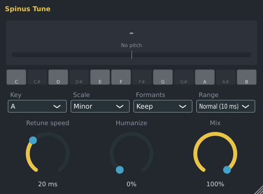
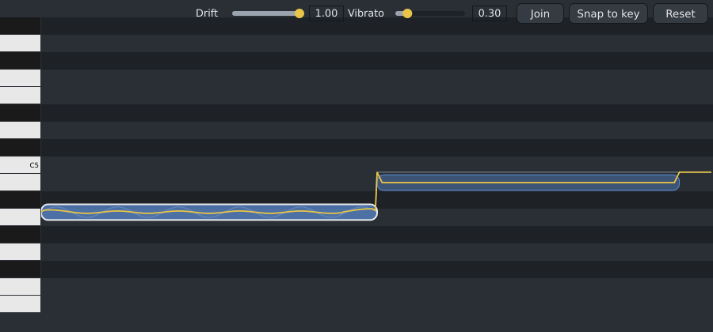

# Spinus Tune

Spinus Tune pulls a voice to the right notes as it plays: from gentle, natural correction to the hard
"robot" effect. Put it on the mixer insert your vocal plays through: click an empty effect slot in the
[Mixer](mixer.md) and choose **Spinus Tune**.

It works on one note at a time: a voice, or a solo instrument such as a flute or a bass. Breaths and
consonants (sounds without a pitch) pass through unchanged.

## The window

| Part | What it does |
|---|---|
| Big note | The note the voice is pulled to. Under it: the note sung, how many cents off it was (100 cents = one semitone), and the needle showing how far, left (flat) or right (sharp). |
| Keys | One octave: the notes of the chosen scale are lit, the current note is yellow. |
| **Key**, **Scale** | Which notes are allowed: the song's key and scale (for example **A**, **Minor**). **Chromatic** allows every note. |
| **Formants** | **Keep** (normal): the voice keeps its character when its pitch moves. **Follow pitch**: the voice gets brighter going up and darker going down, like speeding up a tape. |
| **Range** | **Normal** for most voices, with 10 ms of delay. **Low voice** for deep bass voices (below about 75 Hz), with 20 ms of delay. |
| **Retune speed** | How quickly the voice moves to the note. **Robot** (all the way left) jumps at once: the famous hard autotune sound. 20 to 60 ms sounds natural; 200 ms and more only nudges long notes. |
| **Humanize** | Holds back the correction on long, held notes, so their natural vibrato stays. Short notes are still corrected at the Retune speed. |
| **Mix** | How much of the corrected voice you hear; 0% is the voice as it was. |

## Following a melody

Instead of a scale, Spinus Tune can follow notes you write, for example the melody the vocal should
sing:

1. Add a channel for the melody in the [Channel Rack](channel-rack.md) (an empty one is fine: it makes
   no sound) and write the melody for it in the [Piano Roll](piano-roll.md).
2. In the [Mixer](mixer.md), right-click the vocal's insert and choose **Notes from channel**, then the
   melody channel.

While a note of the melody plays, the voice is pulled to it (to the nearest one if several play at once).
Where the melody has no note, the key and scale are used. **Notes from channel** › **None** stops it.

## Editing a vocal note by note

For a recorded vocal, Spinus Tune can also fix notes one by one, like Melodyne: double-click the audio
clip in the [Playlist](playlist.md). The first time, Spinus listens to the vocal (with its AI service, on
your computer; turn AI on in Options › AI...), which takes a few seconds per minute of singing.

| What you see | Meaning |
|---|---|
| Blue blobs | The notes sung, at the pitch they will have. |
| Grey line | The pitch as sung. |
| Yellow line | The pitch as it will sound. |

| To | Do |
|---|---|
| Move a note | Drag it up or down: it lands on a whole note. Hold **Alt** to move it freely. **Up** and **Down** keys move the selected notes by a semitone. |
| Select notes | Click one; **Shift**-click to add more. Drift, Vibrato, Snap and Reset work on the selection (or on all notes when none is selected). |
| Split a note | Double-click it where it should be split. |
| Join two notes | Select the first and click **Join** (or press **J**): it joins the next one. |
| Straighten wandering | **Drift**: 1 keeps how the note wanders slowly; 0 holds it straight on the note. |
| Change vibrato | **Vibrato**: 1 as sung, 0 removes it, 2 makes it twice as wide. |
| Put every note in the key | **Snap to key**: each note moves to the nearest note of the song's key (the **Key** button in the top bar), or the nearest semitone without a key. |
| Start over | **Reset** undoes every correction of the selected notes. |

Every change is one undo step (**Ctrl+Z**). Spinus then renders the tuned vocal in the background (the
bar at the bottom shows how far) with natural-sounding shifting that keeps the voice's character; until
then you hear the previous version. The recording itself is never changed: Reset all the notes to hear
it again. Notes cannot be moved in time.

## Good to know

- The delay is reported to Spinus, so playback stays in time with the rest of the song. When you sing
  through it live, you hear yourself 10 ms (or 20 ms) late.
- Spinus Tune is also installed as a VST3 and LV2 plugin for other programs.
