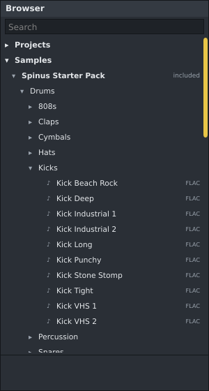
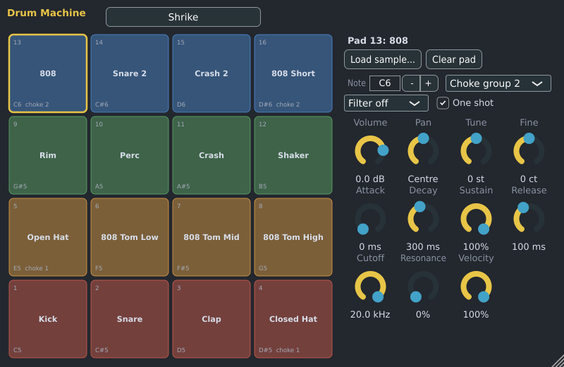

# Starter pack

Spinus comes with the **Spinus Starter Pack**: 97 free sounds to start making music with
before you have samples of your own. It is the first folder under **Samples** in the [Browser](browser.md),
and the [Drum Machine](drum-machine.md)'s four **factory kits** are made of its drum sounds.

## What is in it

| Folder | What it holds |
|---|---|
| **Drums** › Kicks, Snares, Claps, Hats, Cymbals, Toms, Percussion, 808s | One-shot drum sounds: electronic, lo-fi, industrial and found sounds (pans, coins, cutlery, stones, toy bricks). |
| **Loops** › Drums | Drum loops with their tempo in the name, e.g. "Trap Beat 115 BPM". |
| **Loops** › Melodic | Plucked strings, zither, piano, guitar and synth loops, with tempo and key in the name when they are known, e.g. "Plucked 122 BPM E major". |
| **Instruments** › Tongue Drum | Single notes of a steel tongue drum, named by their note (e.g. "Tongue Drum G4"): drop several on a [Sampler](sampler.md) to play them from the keyboard. |
| **Vocals** | Choir-like vocal stabs, with their chord in the name. |
| **Textures** | Rain on a window, a horror atmosphere, sci-fi whistles and a drum roll. |

Use them like any other samples: click to hear one, double-click to put it on a [Sampler](sampler.md)
channel, or drag it onto the Channel Rack, the [Playlist](playlist.md) or [Audio tracks](audio-tracks.md).
Loops play at their own tempo; set the song's tempo to the one in the name to keep them in time.

## Factory drum kits

In the Drum Machine, click **Kit** and choose one (they are listed after the Spinus Synth Kit):

| Kit | Its sound |
|---|---|
| **Shrike** | Hard and deep: a deep kick, crisp snares and hi-hats, a clap, long 808 bass on pads 13 and 16 (they cut each other off) and 808 toms. |
| **Starling** | Dusty and warm: hits from an old drum machine taped to VHS, dark crashes and a toy rattle. |
| **Magpie** | Collected sounds: a stomp on stones for the kick, pans and pots, coins in a glass, cutlery, toy bricks and glass. |
| **Raven** | Dark and heavy: metal struck and scraped, machines and big rooms. |

Every kit has the same layout as the Synth Kit: pad 1 is the kick, pad 2 the snare, pad 3 the clap,
pads 4 and 5 the closed and open hi-hat (in choke group 1), pads 6 to 8 the toms, then rim, percussion,
crash, shaker, a second kick, a second snare, a ride and more percussion. So the Channel Rack's steps
and patterns made for one kit work with the others.

The **Kit** button shows the kit's name, with a `*` after it once you change a pad (its sample, note,
choke group or a setting).

## Your projects keep the sounds

The pack's folder is part of Spinus and is never changed. When you use one of its sounds, your project
keeps its own copy: the Drum Machine and the Sampler keep their sounds inside the project, and an audio
clip's file is copied into the project's `audio` folder when you save. A project made with the starter
pack opens and sounds the same on any computer, with any Spinus package, even without the pack.

## Hiding it

Right-click **Spinus Starter Pack** in the Browser and choose **Hide the starter pack**. To show it
again, right-click **Samples** and choose **Show the Spinus Starter Pack**. It cannot be removed: it is
installed with Spinus.

## Where it is and its licence

It is installed with Spinus in `/usr/share/spinus/samples/Spinus Starter Pack` (the Arch package),
inside the AppImage and the Flatpak, and in the `samples` folder beside `spinus.exe` on Windows.

The sounds are from **Signature Sounds** ([signaturesounds.org](https://signaturesounds.org), formerly
signaturesamples.co.uk). Free for any use; CC0 1.0 where marked. Included with the authors' permission.
Use them in your music, commercial or not; no credit is required. The pack's `README.md` lists where
each file comes from, and `LICENSE.txt` holds the CC0 text.
