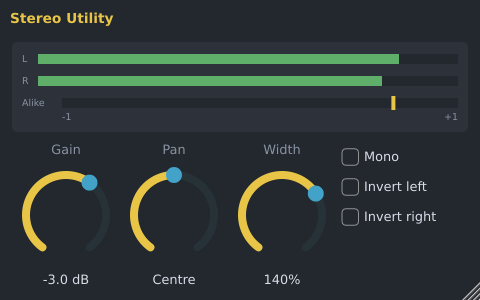

# Stereo Utility

The Stereo Utility is a small toolbox for a sound's level and stereo image. It is made by Spinus. Add
it to a mixer insert from the [Browser](browser.md) (**Effects › Spinus › Stereo Utility**) or an empty
effect slot in the [Mixer](mixer.md), then double-click it to open its window.

| Control | What it does |
|---|---|
| **Gain** | Turns the sound up or down (-48 to +24 dB), for example to match levels before other effects. |
| **Pan** | Moves the sound left or right. The far side gets quieter; nothing moves across. |
| **Width** | 0%: both sides the same (mono). 100%: unchanged. Up to 200%: wider than it was. Wide settings can sound thin when played in mono; watch the **Alike** meter. |
| **Mono** | Plays both sides as one. Use it to check how a mix sounds on a phone or a club's mono system, or to keep a bass in the middle. |
| **Invert left** / **Invert right** | Flips that side upside down (polarity). Use it when two microphones on one instrument cancel each other out. |

The meters show the left and right levels after the Utility. **Alike** shows how similar the two
sides are: at +1 they are the same (mono), around 0 they are unrelated (very wide), and below 0 (red)
they cancel out when played in mono.

Every control can be automated. The Stereo Utility is also installed as a VST3 and LV2 plugin
("Spinus Stereo Utility") for use in other programs.
