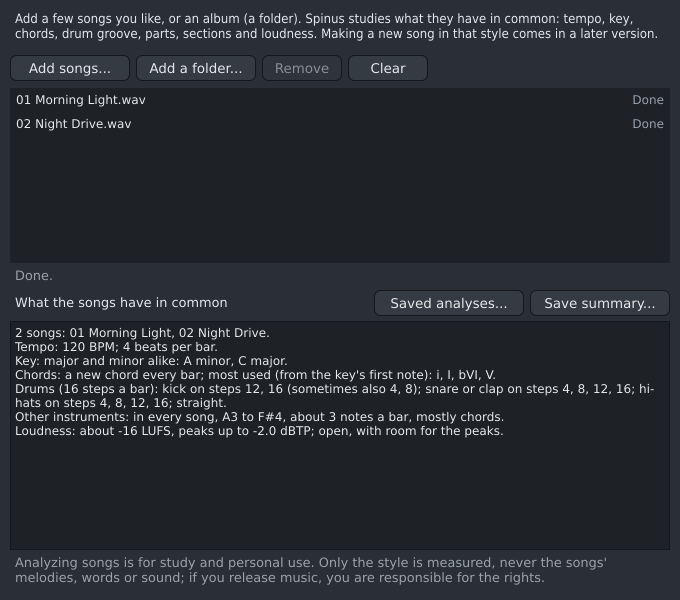
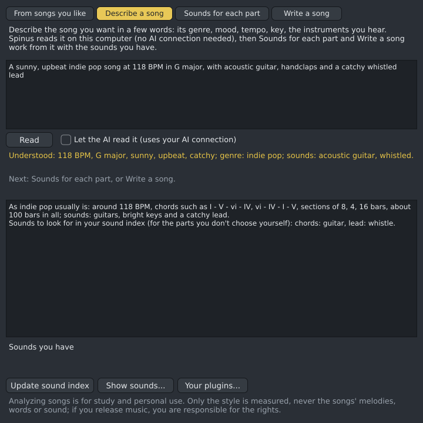
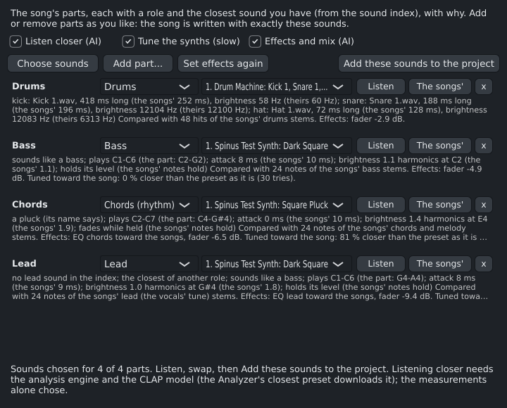
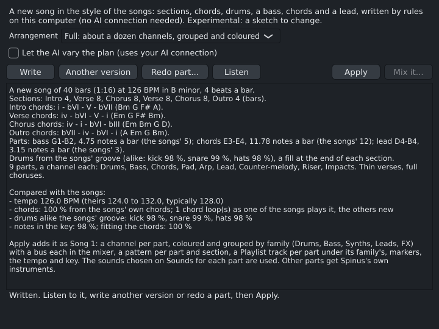
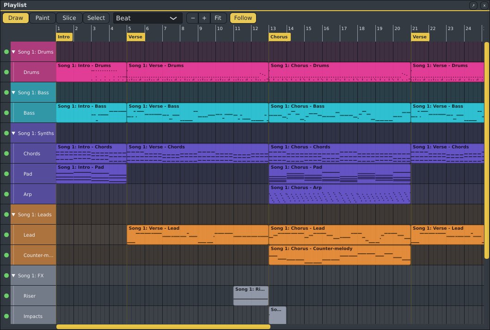

# The Track creator

Give the Track creator a few songs you like, or a whole album, and it tells you what they have in common:
their **tempo**, **key**, **chords**, **drum groove**, which **parts** play and how high or low, how long
their **sections** are, and how **loud** they are. Then it uses this to make a new song in that style, with
the instruments you have installed, in four steps: listening and summing up, [getting to know your
sounds](#your-sounds), [choosing a sound for each part](#sounds-for-each-part), and [writing a
song](#write-a-song). No songs at hand? [Describe the song](#describe-a-song) you want in words instead.

The Track creator is **experimental**: it is still being worked on, and may change, be slow or not work
well for some songs. It is hidden until you turn it on: open **Options › AI...** and tick **Show
experimental features**. **View › Track creator (experimental)** then opens it (no restart needed). Untick
it again and the Track creator closes and disappears from the menus; a saved
[window layout](main-window.md#layouts) doesn't bring it back while it's off.

It changes your song only when you click **Add these sounds to the project** (in
[Sounds for each part](#sounds-for-each-part)) or **Apply** (in [Write a song](#write-a-song)), and each
of those is one step you can undo. Everything else only listens, measures and suggests.

The panel has four pages: **From songs you like** (your songs and what they have in common), **Describe a
song** (the same, from your words), **Sounds for each part** and **Write a song**. The [sound index](#your-sounds) controls are under all of them.

## What it needs

The same as the [Analyzer](analyzer.md#what-it-needs), whose steps it uses. Everything runs on your
computer; nothing is sent anywhere.

1. **AI turned on** in **Options › AI...**.
2. **The analysis engine** (PyTorch), installed once: the Track creator offers a **Set up the analysis
   engine...** button that opens [the analysis engine page](analysis-engine.md).
3. **Model files**, downloaded once: Beat This! (8 MB on the CPU, 81 MB with a graphics card), Demucs for
   4 stems (84 MB) and Basic Pitch (230 KB). The Track creator says what is missing and how big it is;
   click **Download** to agree, and it carries on. The Analyzer's **Sources and licences...** says where
   each comes from and under which licence.

## Adding songs

- **Add songs...** picks one or more audio files. **Add a folder...** adds every song in a folder, such as
  an album, and in the folders inside it (CD 1, CD 2), but not deeper. You can also drag files or folders
  onto the Track creator.
- It reads WAV, FLAC, Ogg, AIFF, MP3 and Opus, and with ffmpeg installed (`sudo pacman -S ffmpeg`; on
  Windows `winget install ffmpeg`) also M4A/AAC, WebM, WMA and more. Other files in the folder (covers, text) are left out, and a song already in
  the list isn't added twice.
- **Remove** takes out the song you selected; **Clear** empties the list.

Each song is analyzed in turn, and its row says how it is going: **Waiting**, **Preparing...**, the step
it is on ("Finding the beat...", "Separating...", "Listening for the notes of the bass...") with its
progress, then **Done**, or **Problem:** and what went wrong. A song that can't be read doesn't stop the
others. **Cancel** stops the song being analyzed; **Analyze again** carries on with the songs that are
waiting or had a problem (for example after turning AI on or downloading the models).

For each song Spinus finds the beat and the key, measures its loudness, splits it into four stems
(vocals, drums, bass and the rest), listens for the drum hits and for the notes of the other stems, and
then measures its style. Separating takes the longest, as in the Analyzer: much quicker on a graphics card
than on the CPU, so an album takes a while. The first time, Spinus spends a few seconds learning its own
drum sounds.

**A song is analyzed once.** Everything Spinus finds (tempo, key, loudness, notes, drum hits, the style and
the stems) goes into its [saved analyses](#saved-analyses), shared with the [Analyzer](analyzer.md). Add the
same song again, even under another name or in another project, and it is **Done (analyzed before)** at
once. A song you already took apart in the Analyzer starts from what the Analyzer found: its beat, key and
stems are used as they are, which saves most of the time.

**Your list is remembered.** Close Spinus and open the Track creator again: your songs are still there, the
analyzed ones done, with the summary as it was. Songs that were not finished wait until you click
**Analyze again** (Spinus doesn't start analyzing by itself when it starts).

## Saved analyses

**Saved analyses...** (in the Track creator and in the Analyzer) shows every song Spinus has analyzed, how
much space each takes and how much of that is stems, and the total. Stems take most of the space (a
four-minute song's four stems take in the order of 100 MB); what was measured takes a few kilobytes.

- **Delete its stems**: the selected song's stems go; what was measured stays. If you need them again, the
  song is split again.
- **Delete**: everything kept of the selected song.
- **Delete all stems**: every song's stems; the measurements stay.
- **Delete everything**: the whole list.

Deleting never touches your own audio files, only what Spinus kept. The saved analyses are in Spinus's
settings folder (`~/.config/Spinus DAW/ai/library`), not in your projects. A song kept by an older version
of Spinus is shown as not used, and is analyzed again when you add it.

The window also shows how much space the [sound index](#your-sounds) takes, with **Delete the sound
index** (it is made again the next time you click **Update sound index**).

## The summary

Once the songs are analyzed, **What the songs have in common** says it in plain words, for example:

- **Tempo**: "120 to 128 BPM, typically 124 BPM; 4 beats per bar."
- **Tempo, second thoughts**: when a fast song has its snare on every beat, Spinus adds that it "may be
  felt at half that speed" (and the other way round for a slow one). The tempo itself is left as found.
- **Key**: "mostly minor (67 % of the songs): A minor (2), C major." Spinus asks several independent
  estimates (the whole mix, the instruments without drums and voice, the notes it heard, with two kinds of
  key profile) and takes the one most agree on. When they disagree, it says so: "Not sure of the key of:
  ...". Chords are named from each song's key with Roman numerals, so songs in different keys can be
  compared: in A minor, A minor is **i**, C major is **bIII** (three semitones up, major) and F major is
  **bVI**.
- **Chords**: how often the chord changes, the chords used most, and a progression the songs share
  ("Shared progression: i - bVI - bIII - bVII (in 2 songs)"). A loop counts the same whichever chord you
  start it from, and it is called shared only when at least two songs play it three times or more;
  otherwise Spinus says no progression is shared and names the one repeated most, in one song.
- **Drums**: on which of the 16 steps of a bar the kick, the snare (or clap) and the hi-hats usually
  play, numbered as in the [Channel Rack](channel-rack.md), and whether the beat is straight or swung.
  Spinus listens to the drum part itself for this. Songs with different grooves are not mixed into one:
  you get the main groove (and in how many songs), and the other grooves beside it.
- **Parts**: bass, vocals, other instruments: in how many of the songs, from which note to which, how
  many notes a bar, and whether they play single notes or chords.
- **Sections**: how long they usually are in bars (8 or 16, say), and how many a song has. Sections
  follow the song's 4-bar phrases, and a short fill does not count as a section of its own.
- **Loudness**: about how loud the songs are (LUFS, as the [Loudness Meter](loudness-meter.md) shows),
  their peaks, and how much quieter the quiet parts are.

These are measurements made by a program, not a musician: a busy mix can give an odd chord or a missed
hi-hat now and then. The more songs, the steadier the summary.

**Save summary...** saves it all as a JSON file, with the exact numbers: the drums' chance on each step,
how often each progression and each chord-to-chord change comes, every song's sections and parts. This
file is what the Track creator's next steps will start from.

## Describe a song

Instead of songs you like, you can describe the song you want in a few words, and the next pages work
from that: **Describe a song**, type, and click **Read**.

> A sunny, upbeat indie pop song at 118 BPM in G major, with acoustic guitar, handclaps and a catchy
> whistled lead

Spinus reads it on your computer, with no AI connection, and says what it understood:
"Understood: 118 BPM, G major, sunny, upbeat, catchy; genre: indie pop; sounds: acoustic guitar, whistled".
If something is missing or wrong, change the words and **Read** again. What it understands:

| You write | What it does |
|---|---|
| A **genre**, by any of its usual names: pop, indie pop, K-pop, J-pop, city pop, hyperpop, synthpop, new wave, synthwave, darksynth, darkwave, coldwave, post-punk, dream pop, shoegaze, chillwave, vaporwave, rock, indie rock, punk, pop punk, emo, metal, thrash, doom, power metal, black metal, DSBM, EDM, house, disco, nu-disco, techno, trance, hardstyle, drum and bass, jungle, breakbeat, UK garage, dubstep, future bass, hip hop (boom bap), trap, phonk, lo-fi hip hop, trip-hop, downtempo, reggae, dub, ska, reggaeton, latin, bossa nova, afrobeats, funk, soul, R&B, gospel, jazz, blues, folk, country, bluegrass, cinematic (orchestral), chiptune (video game music), ambient... | That genre's usual tempo, chord loops, drum groove, parts, section lengths, loudness and sound palette (a cold synth palette for darkwave, acoustic guitar for folk...). |
| No genre Spinus knows | It says "genre: not recognized (using a neutral style)" and leans on your mood words for the tempo and for minor or major. |
| A **tempo**: "72 BPM", "tempo 90" | That tempo. |
| A **key**: "D minor", "F#m", "Bb major" | That key. Without one, a usual key of the mode, not always the same. |
| **Pace**: slow, slowburn, laid-back, fast, uptempo, driving... | A slower or faster tempo than the genre's usual one (when no tempo is given). |
| **Mood**: dark, brooding, melancholic, cold... or happy, sunny, euphoric, uplifting... | Minor or major more often (when no key is given). |
| **Energy**: calm, chill, dreamy... or energetic, aggressive, heavy... | Fewer or more notes and drum hits. |
| **Length**: short, long, epic | A shorter or longer song. |
| **Instruments**: piano, guitar, strings, choir, organ, bells, flute, whistle, sax, brass, 808... | The part they fit gets a sound of that name from your [sound index](#your-sounds) ("Grand Piano" for a piano), unless you chose its sound yourself on [Sounds for each part](#sounds-for-each-part). |
| **Leaving out**: no drums, no melody | That part is left out. Ambient has no drums anyway. |

**Let the AI read it** (off at first): with an AI connection set up in Options › AI, the AI reads the
description instead. It answers in the same terms, choosing from the same genres, and Spinus checks its
answer. If the AI isn't reachable or answers something unusable, Spinus's own reading stays, and the page
says so. This sends your description, and nothing else, to your AI provider.

Then go on to [Sounds for each part](#sounds-for-each-part), which chooses by the parts' roles and ranges
(there are no songs to compare with), or straight to [Write a song](#write-a-song), which says "From your
description" at the top. The pages work from whichever you did last: reading a description, or your songs
being summed up. Reading a new description (or a new summary of your songs) starts the parts list on the
Sounds page again, and the page says so. Spinus remembers the description and what it understood, like
your list of songs.

## Your sounds

To pick sounds for a new song later, the Track creator first gets to know the sounds you have. Under
**Sounds you have**, click **Update sound index**. Spinus then listens to:

- **Your instruments' presets**: 3x Osc and the Drum Machine, and the free instruments you downloaded
  through Spinus (Surge XT, Odin 2, OB-Xf, Six Sines). Your other instrument plugins (CLAP, VST3, LV2,
  VST2, and Windows plugins added through Spinus) are listened to only if you tick them: click **Your
  plugins...** and tick the ones you want (click again to untick). This keeps the first update quick, and
  Spinus loads none of your own plugins unless you ask. Each preset plays a few short test notes, which
  nobody hears.
- **Your samples**: the files in the folders you added in the **Browser › Samples** list ("Add a folder of
  samples"), and the folders inside them. Nothing else on your disk is looked at.

For each sound Spinus notes how it starts and fades, how bright it is, whether it has a clear pitch, which
notes it plays, whether it plays chords, and what it is probably for: **bass, lead, pad, pluck, keys,
drums** or **fx**. A sample gets a kind (**kick, snare, clap, hat, cymbal, tom, perc, bass** or
**other**), and a loop its tempo, length in bars and key where Spinus can tell. A preset or file whose name
says what it is ("Deep Sub Bass", a "Kicks" folder, "128 BPM", "D#min") is taken at its word. Files that are
not audio (MIDI files, project files, text, zip archives) are left out; an audio file named with the wrong
extension (an AIFF called .wav) is still read.

- It runs **in the background**, so you can keep working; the line under **Sounds you have** shows how far
  it is. **Stop** stops it: what was done is kept, and the next update carries on from there.
- The first time takes a while (Surge XT alone has about 3,000 presets: about 20 minutes on a fast
  computer). After that, **only what is new or changed** is listened to: a new plugin, an updated one, new
  preset files, new or changed samples. Removed ones leave the index.
- **Plugins can't crash Spinus here**: the listening happens in a separate helper program. A preset that
  makes it crash or freeze is skipped and counted as a problem; so is a plugin that doesn't load (it is
  tried again once it's updated).
- **Show sounds...** lists everything Spinus measured, with its guess and a few details ("attack 5 ms,
  sustained, brightness 820 Hz, C1-C7, chords"), and a search box: type "bass", "pad", "Surge" or "kick
  sample" to check its guesses. When a name says one thing and the sound another, both are shown ("sounds
  like pad").
- It needs no AI connection and no analysis engine, and nothing is sent anywhere. The index is kept in
  Spinus's settings folder (`~/.config/Spinus DAW/ai/sounds`) and can be deleted in
  [Saved analyses](#saved-analyses).

**How Spinus guesses a role.** When a preset's name or category says its role, that decides. For the others,
Spinus learns from your own presets: the ones whose names say "bass", "pad" and so on show it how each role
sounds, and a preset without such a name gets the role of the presets it sounds most like. (With fewer than
about 60 named presets, simple rules decide instead.) On Surge XT's own presets, each guessed without its
name, this gets the role right for 57 % of them, against 44 % with the rules alone; for basses 69 % instead
of 14 %. Plucks are still often taken for keys or pads.

The guesses are a program's, made from a few test notes: a bass preset that sounds bright can be called a
lead, and an unusual drum sample "perc" or "other". The next step uses them only as a first sorting.

## Sounds for each part

The **Sounds for each part** page holds the song's **parts**: what the new song will have, and the sound
each plays. The song is written with exactly these parts and these sounds.

**The parts are yours.** The page starts from the [arrangement](#write-a-song) chosen on Write a song
(Sketch: drums, bass, chords and lead; Full: those and a pad, an arpeggio, a counter-melody, a riser and
impacts, with a sub bass when there is room). Then:

- **Add part...** adds one of a role: drums, bass, sub bass, chords (rhythm), pad, arpeggio, lead,
  counter-melody, a riser or impacts. Two parts may share a role, such as two guitars: the second then
  plays something else (a second chords part breaks the chords into an arpeggio an octave up, a third plays
  off-beat stabs; a second lead harmonises the first a third below; a second pad, arpeggio or bass plays an
  octave up; a second drums part plays percussion).
- The list beside a part's name changes its **role**; **x** removes it. Three parts are fine (the Drum
  Machine, a guitar and a synth), and so are a dozen.
- A new description, a new summary of your songs, or another arrangement starts the list again; the page
  says so.

Then click **Choose sounds**. For each part, Spinus picks the closest sounds you have (a part you already
chose a sound for keeps it when it is still among them):

1. **Which sounds fit**: a preset of the part's role (a bass for the bass, a pad for a pad, a pluck for an
   arpeggio...) that plays the notes the part needs, and plays chords when the part does.
2. **Drums**, from any of three kinds: Spinus's own **Drum Machine** with its kit (always there); another
   **drum instrument** (a plugin with a kit on its keys); or a **sample set**: a kick, a snare and a hat
   from your samples (or the starter pack) on the Drum Machine's pads. A drum loop near the songs' tempo
   is offered too. With songs to compare with, the closest sample set comes first; otherwise the Drum
   Machine. Whichever you pick is what the written drums play.
3. **Which is closest**: for the first drums, bass, chords and lead, Spinus measures the songs' own parts
   (their stems, kept in your [saved analyses](#saved-analyses)) note by note, the same way it measured
   your presets: how fast a note starts, whether it holds or fades, how bright it is at the part's own
   notes, how noisy. The closest come first. Other parts are chosen by role and range.
4. **Listen closer** (needs AI turned on, the analysis engine and its CLAP model, which the Analyzer's
   closest preset downloads): the first five presets are also compared with the songs by listening, as
   closest preset does, and put in order again.
5. **Tune the synths** (slow: a minute or more per part): the chosen preset is tuned toward the song's
   part, as the Analyzer's tuned synths are. It runs in a separate program, so a synth that crashes only
   stops its own tuning; **Stop** keeps what was found.
6. **Effects and mix** (needs AI turned on, but no AI connection): each chosen sound plays a few seconds of
   the part, and Spinus compares it with the songs' part: an EQ moves its tone toward theirs, a compressor
   evens it out when it is much peakier, its fader makes the parts as loud as each other as in the songs,
   and a limiter on the master aims at the songs' loudness. These are estimates until the song has notes;
   the [Automixer](automixer.md) can balance it again later.

Each part's line says what was chosen and **why**, in plain words and numbers, for example "a bass (its
name says); plays C1-C6 (the part: F#1-A#2); attack 6 ms (the songs' 10 ms); brightness 2.1 harmonics at
D2 (the songs' 2.4)". Compare the numbers: the closer they are, the closer the sound.

- **Listen** plays the chosen sound playing a short phrase in the songs' key. **The songs'** plays a few
  seconds of that part in one of your songs (its stem), to compare.
- The list beside each part holds the **alternatives**, closest first: pick another to swap. Its tuning
  and effects are dropped; **Set effects again** sets them for the sounds chosen now.
- **Add these sounds to the project** makes, for each part, a channel named after it ("Bass (Track
  creator)") in the Channel Rack group **Track creator**, with its instrument, preset, tuning, effects and
  fader, and a pattern **Track creator: sounds** with a short phrase on each, so you can hear them
  together. A drum loop goes on a Playlist track of its own. It is all **one undo step**. The song you
  write later plays on these channels.

**What you choose here wins.** The written song uses each part's sound from this page; a description's
instrument words and the sound index only fill in the parts you didn't choose a sound for.

Without AI turned on, the sounds are still chosen, by their measurements alone, and can be added; the line
at the bottom says what the AI would add. Nothing is sent anywhere: all of this runs on your computer.

These are a program's choices, made from measurements: treat them as a starting point and change them by
ear.

## Write a song

The last page, **Write a song**, writes a new song in the style of your songs (or of your description): its
sections, chords and every part on the [Sounds for each part](#sounds-for-each-part) page, as notes in
patterns you can edit like any other.

1. The **Arrangement** (Spinus remembers it) proposes the parts the Sounds page starts from:
   - **Sketch**: four parts: drums, bass, chords and lead, to build on yourself.
   - **Full**: about ten, laid out as the [demo songs](getting-started.md#listen-to-the-demo-songs-first)
     are (see [A full arrangement](#a-full-arrangement) below).

   Add, remove or change parts on the Sounds page as you like; the song is written with exactly those.
   Then click **Write**. In a moment the page says what it wrote: how long the song is, its tempo and key,
   its sections ("Intro 8, Verse 16, Chorus 16, ...") and each section's chords, its parts, and how all this
   compares with your songs in numbers.
2. **Listen** plays the song as it would be in your project, through the sounds chosen for its parts,
   before anything is changed. **Stop** stops it.
3. Not quite right? **Another version** writes a different song in the same style. **Redo part...** writes
   one part again (**New drums**, **New guitar**...) or one section again (**The chorus again**, with new
   chords), and keeps everything else exactly as it was.
4. **Apply** puts the song into your project: the tempo and key, a channel per part (or the one the Sounds
   page added for it), a pattern per part and section, Playlist tracks and a marker where each section
   starts. It is **one undo step**: Ctrl+Z takes it all away. After that, **Redo part...** and **Apply**
   change only that part or section (one more undo step each).
5. **Writing again replaces the song.** When the project has a song the Track creator wrote, Apply asks
   "Replace Song 1? It will be overwritten (Ctrl+Z brings it back)": **Replace** takes the old song out
   (its channels, patterns, Playlist tracks and markers; the Sounds page's channels stay) and puts the new
   one in its place, still one undo step; **Keep both** adds it as "Song 2" after the first; **Cancel**
   leaves the project as it is.
6. **Mix it...** opens the [Automixer](automixer.md) with your first song as its reference: it measures the
   parts now that they play notes, and suggests levels, EQ and compression toward your songs. Tick what you
   want and apply (one undo step).

**How it is written.** Rules on your computer turn the summary's numbers into the song; nothing is sent
anywhere and no AI connection is needed.

- **Tempo and key**: your songs' usual tempo, moved a little (up to 3 %); the key of one of your songs,
  sometimes a step higher or lower; minor or major as often as your songs are.
- **Sections**: an intro, verses, choruses, a bridge and an outro, about as many as your songs have and
  about as long, each 4, 8, 12, 16... bars as your songs' sections are. A chorus is the same each time
  (one pattern), so you can change it once.
- **Chords**: loops of four chords, chosen from the chords your songs use and the way they move from one
  chord to the next: new combinations, not a copy of one of your songs (a loop that one song plays as its
  own is used at most once).
- **Drums**: the kick, snare and hi-hats on the steps your songs play them, on one drums channel, a few
  extra hits by chance (fewer in quiet sections), a fill at the end of each section and a crash at the
  start of the next.
- **Bass**: the chords' roots, sometimes the fifth or the octave and a step leading into the next chord,
  where the kick plays most, as low and as busy as your songs' bass.
- **Chords part**: the chords played as high and as busy as your songs' other instruments, each chord
  close to the one before.
- **Lead**: short phrases that answer each other, in your songs' vocal range and about as many notes a bar,
  with the chord's own notes on the strong beats and in the key in between. Only the style is used: your
  songs' melodies are never read (the summary has none).
- **The other roles**: a pad holds the chords; an arpeggio plays them one note after another; a
  counter-melody is a slower line under the lead that never clashes with it; a sub bass holds the roots
  low in the choruses; a riser plays over the two bars before each chorus, and impacts (a kick and a crash)
  where each chorus and the bridge start. Two parts of one role play different things (see
  [Sounds for each part](#sounds-for-each-part)).

### A full arrangement

With **Arrangement: Full**, the song is laid out as a producer would:

| Family (colour) | Parts |
|---|---|
| **Drums** (pink) | **Drums**: kick, snare and hats on one drum instrument |
| **Bass** (cyan) | **Bass**; **Sub bass** when your songs' bass sits high enough to leave room for it |
| **Synths** (purple) | **Chords**, **Pad**, **Arpeggio** |
| **Leads** (orange) | **Lead**, **Counter-melody** |
| **FX** (grey) | **Riser**, **Impacts** |

- **Who plays when**: verses stay thin (drums, bass, chords, lead); choruses have everything; the bridge
  breaks down to the pad and builds up again with the arpeggio; the intro starts with the pad and chords.
- **The layout** (for any list of parts): each part's channel is coloured by its family and in the Channel
  Rack group of it, on a mixer insert of its own with the same name and colour, and a family's inserts play
  into a bus named after it (FX...), so one fader sets the family's level. There is a pattern per part and
  section ("Song 1: Chorus - Pad", only where the part plays) and one per effect ("Song 1: Riser"). On the
  Playlist, a track per family ("Song 1: Drums") holds a track per part, so you see the parts come and go;
  fold a family to hide its tracks.
- **Sounds**: each part plays the sound chosen for it on the Sounds page. A part without one gets the
  closest sound of its role from your [sound index](#your-sounds) (a pad for the pad, a pluck for the
  arpeggio, the instruments a description names); without one, Spinus's own (3x Osc's "Warm Pad",
  "Pluck", "Sub Bass", "Bell", "Noise Riser", the Drum Machine). The page lists which.
- **Redo part...**: **New chords** writes the chords again and with them the pad and the arpeggio,
  **New lead** the lead and what follows it; a second part of a role is written again on its own.

**Let the AI vary the plan** (off at first): with an AI connection set up in Options › AI, the AI may
change the order and length of the sections, the chord loops and the shape of the melody. Spinus checks
what it says against your songs' style (lengths on 4-bar phrases, only your songs' chords) and writes every
note itself; if the AI isn't reachable or answers something unusable, the rules' song stays, and the page
says so. This sends the summary's numbers (not your songs) to your AI provider.

The same click of **Write** with the same summary can give a different song; each song keeps its own
random numbers, so **Redo part...** changes only what you asked for.

**What it needs**: AI turned on in Options › AI (the writing runs in Spinus's AI service, on your
computer), and a summary from the first page. Without the AI service the page says so; the rest of Spinus
works as always.

These are a program's songs, made from measurements: a sketch to change by ear, not a finished song.

## How it was built

The Track creator was built in four steps: the summary of your songs' style, the
[sound index](#your-sounds), [sounds for each part](#sounds-for-each-part), and [writing a
song](#write-a-song). Then came [full arrangements](#a-full-arrangement) and
[describing a song](#describe-a-song) in words.

Only the style is used: the references' melodies, words and sound are never copied into your song.

## Copyright

Analyzing songs is for study and personal use. The Track creator measures the style of the songs (tempo,
chords, grooves and so on), not their melodies, words or sound; if you release music, you are responsible
for the rights. The analysis uses freely available open-source models made by others, not affiliated with
Spinus.
