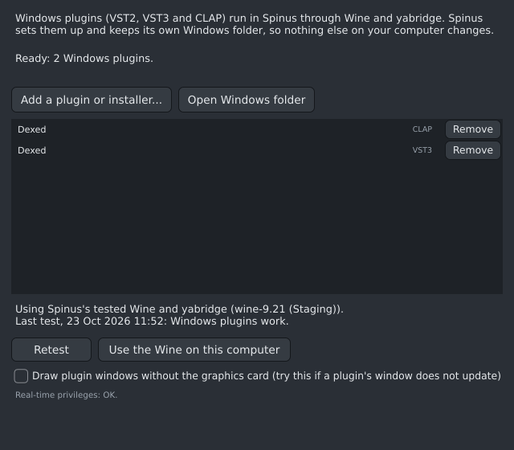
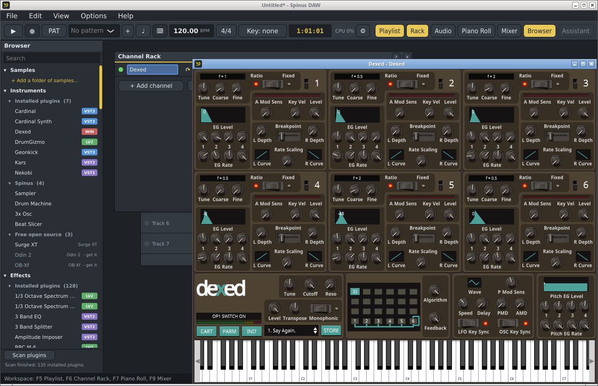

# Windows plugins



Many plugins only exist for Windows. Spinus can run them (VST2, VST3 and CLAP, 64-bit) using Wine and
yabridge, two free programs that make Windows plugins work on Linux. Spinus sets everything up itself
and keeps its own Windows folder, so nothing else on your computer changes. You never need to run
Wine yourself.

Open **Options › Windows plugins...**.

## Setting up (once)

Click **Set up Windows plugins**. Spinus:

1. Looks for Wine and yabridge on your computer (for example from `sudo pacman -S wine-staging yabridge`).
2. Tests them by starting a small free Windows plugin (Dragonfly Room Reverb, downloaded once, about 22 MB).
3. If there are none, or the test fails, it offers its own tested Wine and yabridge to download (about
   66 MB). Click **Download and set up**. These are used only by Spinus. It does the same when your Wine
   is 9.22 or newer and your yabridge 5.1.1 or older: together they make clicks land in the wrong place
   once you move a plugin's window (a known yabridge problem). Spinus's own Wine is 9.21.
4. Makes its Windows folder. Ready.

This takes a minute or two. You can keep working meanwhile; **Cancel** stops it.

## Adding a plugin

Click **Add a plugin or installer...** and choose:

- **An installer** (`.exe` or `.msi`) as you downloaded it from the plugin's maker. The installer's
  own window opens: go through its steps as on Windows and keep the folders it suggests. When it
  finishes (and any helper programs it started, such as a library installer, have finished too), Spinus
  finds the new plugins; Windows plugins open in your project don't keep it waiting. If an installer
  hangs (for example its window stays white), click **Cancel**: Spinus closes the installer and whatever
  it started, leaves the Windows plugins in your project running, and still adds the plugins the
  installer had put in place.
- **A plugin file** (`.dll`, `.vst3` or `.clap`) if the plugin came without an installer.
- **An extra installer** for a plugin you already added: many plugins come with a second installer for
  their sounds, presets or library. Add it the same way, after the plugin's own. It goes into the same
  Windows folder, so the plugin finds it; Spinus says it added no new plugin, which is expected.

The new plugins appear in the [Browser](browser.md) with a **WIN** badge after a short scan. Use them
like any other plugin: add them to a channel or a mixer insert, open their window, automate them.



**Open Windows folder** shows Spinus's Windows "C: drive" in your file manager, for example to copy
a plugin's sound library where its installer expects it.

If a Windows plugin can't be loaded (for example Wine stopped working after an update), its channel
shows **Missing:** before its name in red, and Spinus says so when you add it. Open this window and
click **Retest**.

## When a plugin asks something in a window of its own

Some Windows plugins show a window of their own when they load or when you open them: a "needs
registration" reminder, a licence or activation question. Such a plugin waits until you answer, and
Spinus waits for the plugin: until then Spinus doesn't respond and can't redraw.

Spinus brings that window to the front for you (after about a second), and the title of Spinus's
window says it is **waiting for a plugin's own window**. Answer it (for a reminder, usually **OK** or
**Close**), and Spinus goes on. If you click away to Spinus, the plugin's window comes back to the front;
a browser the plugin opened for its website stays where it is. If you still can't see the window, look
for it in the taskbar.

## Removing a plugin

Each plugin in the list has a **Remove** button. Spinus asks first, then deletes the plugin from its
Windows folder and from the Browser. Projects that use it show it as **Missing**. Its sounds and presets
stay where its installer put them (the plugin's own uninstaller removes those; you can find them with
**Open Windows folder**). To use it again, add it again.

A plugin used in the open project can't be removed: Spinus names the channels or mixer tracks that use
it. Remove it from those first.

## When a plugin's window doesn't update

Some plugins draw their window with the graphics card (Direct2D, for example plugins made with JUCE 8,
such as Ample Bass P Lite 2025). With some graphics drivers their window then doesn't redraw: clicks
work and you hear them, but the window only shows the change after you close and reopen it.

Turn on **Draw plugin windows without the graphics card**, then close and reopen the plugin's window.
Those plugins then draw the plain way, as older plugins do. It applies to all Windows plugins; if one
then shows an empty window, turn it off again.

## In the Flatpak

The Flatpak version uses the same Windows folder as Spinus installed from a package, so plugins you
added in one are there in the other. It can't use the Wine installed on your computer (that is outside
the Flatpak), only Spinus's tested Wine: **Set up** offers to download it, or uses it if the other
Spinus already did. For both to share the Windows folder smoothly, let the other Spinus use Spinus's
tested Wine too (**Use Spinus's tested Wine**): with two different Wine versions, each updates the
Windows folder when it starts, and a plugin can't open in one while the other has Windows plugins open.

Many plugin installers are **32-bit Windows programs**. The Flatpak runs them with Flatpak's 32-bit
support (`org.freedesktop.Platform.Compat.i386`), which comes along when Spinus is installed from Flathub.
If it is missing, choosing such an installer shows a message instead of starting it, with a **Copy the
command** button: paste the command in a terminal, answer its questions, restart Spinus and add the
installer again.

```sh
flatpak install flathub org.freedesktop.Platform.Compat.i386//25.08
```

## Keeping it working

- **Retest** checks that Windows plugins still work, for example after a system update.
- Spinus remembers which Wine passed the test. When the Wine on your computer is updated, Spinus tests
  it again the next time it starts and tells you if it stopped working.
- **Use Spinus's tested Wine** / **Use the Wine on this computer** switches between the two. Spinus
  tests the other one first and only switches if it works. Windows plugins already open in your
  project start working again when you reopen the project.
- The line at the bottom is about **real-time privileges**: with them, Windows plugins play without
  dropouts and without a "memlock" notice. If it shows advice, follow it once (it needs your password
  in a terminal), then log out and back in.

## Limits

- 32-bit Windows plugins are not supported yet (32-bit installers are: they can install 64-bit plugins).
- Plugins with copy protection that needs a USB key or a background service (iLok and similar) may
  not work under Wine.
- Some plugin windows draw slowly or look slightly different under Wine. The sound is the same.
- Some plugins and installers ask for fonts that Windows has and Wine doesn't; their text then shows in
  Arial, so it can look slightly different. If a plugin's or installer's text shows up as symbols or
  arrows, tell us which one.
- Ample Bass P Lite version 4: its window stops following clicks until you close and open it again.
  Version 3.5 works.
- Spinus doesn't let Wine install .NET or Internet Explorer support (Wine would ask with a window that
  blocks every plugin until answered). The rare plugin or installer that needs .NET doesn't work.
